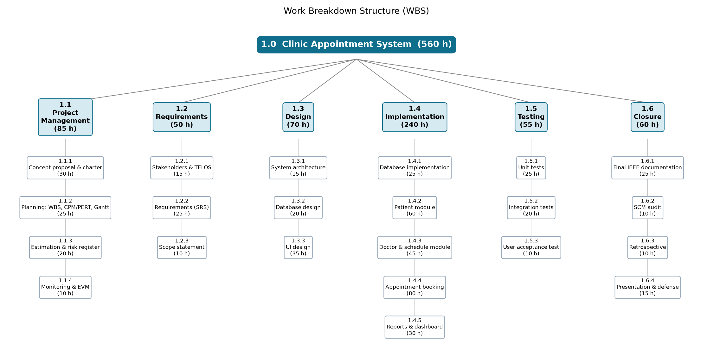

# Milestone 1 Report: Project Initiation

| | |
|---|---|
| **Project** | Clinic Appointment System (CAS) |
| **Course** | SEN4100 Software Project Management, Haliç University |
| **Instructor** | Asst. Prof. M. Fatih Mintaş |
| **Milestone** | Milestone 1 (Week 4) |
| **Version / Date** | 1.1 / 13 November 2026 |
| **Team** | Burak Demir (20091000008), Davut Ayfer (20091000054), Enes Küçükkaya (22091000275), Alper Keskin (24352525053) |

This report contains all Milestone 1 deliverables of the Clinic Appointment System project: the concept proposal and stakeholder analysis, the project charter, and the scope statement with assumptions and constraints.

**Revision history**

| Version | Date | Change |
|---|---|---|
| 1.0 | 23 Oct 2026 | Milestone 1 submitted (concept, charter, scope). |
| 1.1 | 13 Nov 2026 | Aligned with the lecture-note requirements: lifecycle justification in the charter and scope, squad roles, benefit derivation and NPV sensitivity, sprint dates aligned with the CPM baseline, backlog/board description; note about change request CR-002. |

## How this report covers the course requirements

| Course requirement (syllabus and lecture notes) | Where in this report |
|---|---|
| Project Concept Proposal & Stakeholder Analysis (syllabus) | Chapter 1.1 |
| Formal Project Charter: business justification, objectives (syllabus) | Chapter 1.2 |
| High-Level Scope Definition & Assumptions / Constraints (syllabus) | Chapter 1.3 |
| Lifecycle model with technical justification (requirements, architectural risk, delivery cadence) in the charter and the scope document (Week 2) | Chapter 1.2 section 1.2, Chapter 1.3 section 12 (also 1.1 section 5) |
| Tracking tool that matches the process model: GitHub Projects with 2-week sprints and story points (Week 2) | Chapter 1.3 section 11 |
| Charter per template: business case, measurable KPIs, squad roles, assumptions, constraints (Week 3) | Chapter 1.2 sections 1.1, 2, 3, 10 |
| Stakeholder register with at least 6 stakeholders and Mendelow Power-Interest grid (Week 3) | Chapter 1.1 section 6 |
| Scope statement: product scope, project scope, acceptance criteria, out-of-scope (Week 3) | Chapter 1.3 sections 1, 5, 6 |
| Preliminary feasibility review with TELOS, technical and economic logic (Week 3) | Chapter 1.2 section 2 |
| Centralized backlog on GitHub / GitHub Projects reflecting the scope baseline (Week 3) | Chapter 1.3 section 11 |
| Visual WBS (100% rule) and WBS dictionary for three core work packages (Week 4) | Chapter 1.3 section 10 |

# 1.1 Project Concept Proposal & Stakeholder Analysis

## 1. The problem

Many small clinics still take appointments by phone. The receptionist writes them in a notebook or an Excel file. This causes real problems:

- **Double booking.** Two patients get the same time with the same doctor. Or one patient gets two appointments at the same time.
- **Slow booking.** The receptionist cannot quickly see which times of a doctor are free.
- **Bad dates.** Appointments are written on weekends, in the past, or outside the doctor's working hours.
- **Scattered patient data.** Patient data is on paper and in many files. It is hard to find and not safe. Wrong national ID numbers are not detected.
- **No numbers for the manager.** The manager cannot answer simple questions: How busy is each doctor? How many appointments are cancelled?

## 2. Proposed solution

We will build a **web-based Clinic Appointment System (CAS)**.

- **Technology:** Python 3 + Flask web application. The database is **Microsoft SQL Server** (LocalDB instance `(localdb)\MSSQLLocalDB`, database `ClinicAppointmentDB`), connected with pyodbc.
- **Data:** four tables: departments, doctors, patients, appointments.

Main features:

1. **Patient management:** add, edit, search and delete patients. The Turkish national ID (TC Kimlik No) is checked with its official checksum rule.
2. **Doctor management:** doctors, departments and working hours.
3. **Appointment booking:** the system shows **only free 30-minute slots**. It blocks:
   - double booking for a doctor or a patient (checked in the code **and** by filtered UNIQUE indexes in SQL Server),
   - dates in the past and weekends,
   - times outside the doctor's working hours,
   - dates more than 90 days ahead.
4. **Appointment status:** BOOKED, COMPLETED or CANCELLED.
5. **Dashboard:** patient count, appointments today, cancellation rate and **doctor utilization** (utilization = booked slots / available slots this week).

## 3. Why the project is measurable ("scientific")

A "scientific" project is one where we can **measure** progress and results with numbers, and anybody can repeat the calculation. We do this in two ways.

**In project management:**

- **Function Points and COCOMO** (models that estimate effort from software size) to estimate effort in Milestone 2.
- **PERT and CPM** (methods to estimate durations and find the longest chain of tasks, the *critical path*) to find the chance to finish on time.
- **Earned Value Management (EVM)** (a method that compares planned work, done work and spent cost) to measure schedule and cost performance (SPI, CPI) in Milestone 3.
- A **risk matrix** (Probability x Impact) to rank risks.
- All numbers come from one script (`tools/pm_calculations.py`), so the results can be repeated.

**In the product:**

- Every booking rule can be tested by an **automated test** (pass / fail).
- The database itself protects the rules (unique indexes, foreign keys, check constraints).
- The dashboard shows business numbers (cancellation rate, utilization) as KPIs.

## 4. SMART objectives and KPIs

SMART means **S**pecific, **M**easurable, **A**chievable, **R**elevant, **T**ime-bound. A **KPI** (Key Performance Indicator) is a number that shows if we reached an objective.

| # | Objective (SMART) | KPI | Target |
|---|---|---|---|
| O1 | Stop double booking for doctors and patients by Week 8 (19 Nov 2026, end of activity H) | Double bookings found in tests and in the database | 0 |
| O2 | Show only valid, free 30-minute slots when booking, by Week 8 (19 Nov 2026, end of activity H) | Booking rules covered by automated tests | 100% of rules tested, 100% of tests pass |
| O3 | Give the clinic manager a dashboard by Week 10 | Dashboard shows patient count, appointments today, cancellation rate, doctor utilization | 4 of 4 numbers shown and correct |
| O4 | Validate every patient national ID at entry | Invalid TC Kimlik No accepted | 0 |
| O5 | Finish the working system and documents within the 60 working-day plan (by 18 Dec 2026) | Finish date; Schedule Performance Index (SPI) | On or before 18 Dec 2026; SPI >= 0.90 |
| O6 | Stay inside the effort budget | Actual effort vs 560 person-hour plan; Cost Performance Index (CPI) | Not more than 616 h (plan + 10% reserve); CPI >= 0.90 |

## 5. Lifecycle model: Hybrid "Water-Scrum-Fall"

A **lifecycle model** is the order and style of the project phases. We chose a **hybrid** model: plan-driven at the start and the end, Scrum-like in the middle.

| Part | What we do | Style |
|---|---|---|
| **Water** (Weeks 1-3) | Concept, charter, scope and WBS for Milestone 1. Detailed planning (Function Points + COCOMO, CPM/PERT schedule, risk register) for Milestone 2 continues in parallel until Week 7 | Predictive (plan-driven) |
| **Scrum** (Weeks 4-9) | Build the system in **3 two-week increments (sprints)**. Each sprint ends with a **demo** | Iterative |
| **Fall** (Weeks 10-13) | Final regression check, IEEE documentation, SCM audit, retrospective, oral defense | Predictive |

The three sprints are:

| Sprint | Weeks | Dates | Main activities | Demo |
|---|---|---|---|---|
| Sprint 1 | 4-5 | 19-30 Oct 2026 | E, F, G | End of Week 5 (30 Oct) |
| Sprint 2 | 6-7 | 2-13 Nov 2026 | F, H | End of Week 7 (13 Nov) |
| Sprint 3 | 8-9 | 16-27 Nov 2026 | H, I, J | End of Week 9 (27 Nov) |

The letters are the CPM activities of Milestone 2. Some activities cross a sprint boundary by a few days. The baseline Gantt chart in Milestone 2 shows the sprints as shaded bands.

What each demo shows:

- **Sprint 1 demo (30 Oct):** the database (E) and the doctor & schedule module (G) are finished. The first version of the patient module (F) is shown (FR-1, FR-2).
- **Sprint 2 demo (13 Nov):** the patient module (F) is finished (4 Nov). The first version of appointment booking (H) is shown (FR-4, FR-5, FR-11).
- **Sprint 3 demo (27 Nov):** booking (H) finished on 19 Nov (FR-6, FR-7, FR-8 accepted). The dashboard (I) shows FR-9 and FR-10. Testing (J) gives the test report (D5). The user acceptance test (UAT, work package 1.5.3) runs inside J.

**Technical justification:**

- **Requirements:** The requirements are fairly **stable and well known** (booking rules are clear). So up-front planning is safe and useful. Pure Scrum would not give us the fixed baselines the course asks for.
- **Architectural risk:** The highest technical risk is the **booking logic** (double booking, slot rules). Short sprints with demos let us test this logic early and fix it before the end. A pure Waterfall would find these bugs too late. The Flask + pyodbc + SQL Server LocalDB integration (with filtered UNIQUE indexes) was new for the team; activity E builds and tests this layer first, so architecture problems appear before the booking module (H).
- **Delivery cadence:** The **deadline and the milestones are fixed** by the course (Week 4, 7, 13). A plan-driven frame fits fixed dates. Two-week sprints fit a student team that works about 12 hours a week each.
- **Control:** Changes go through a formal **Change Control Board** (see the Charter), so scope does not grow without control.

**Tooling:** The code and documents are in the GitHub repository (https://github.com/burakdemirsw/Software-Project-Managment). The backlog is defined in `docs/backlog/Product_Backlog.csv`. It holds the user stories US-1..US-12 with story points and sprints, plus the change requests CR-001..CR-004. A GitHub Projects board is set up from this file. The board has a two-week Iteration field (Sprint 1-3), a "Story points" number field, and one issue per backlog item. The board is not created yet. Board link: [GitHub Projects board link - to be added]

## 6. Stakeholder analysis

A **stakeholder** is any person or group that can affect the project or is affected by it.

### 6.1 Stakeholder Register

| ID | Name / Role | Internal / External | Main expectations | Power | Interest | Attitude | Strategy |
|---|---|---|---|---|---|---|---|
| S1 | Asst. Prof. M. Fatih Mintaş, course instructor (project sponsor, evaluator) | External | Correct PM methods, on-time milestones, working product | High | High | Supporter | Manage closely |
| S2 | Clinic manager (business owner, customer) | External | Fewer mistakes, reports, low cost, good return on investment | High | High | Supporter | Manage closely |
| S3 | Burak Demir, Project Manager + backend developer | Internal | Clear plan, controlled scope, good grade | High | High | Supporter | Manage closely |
| S4 | Development team: Davut Ayfer, Enes Küçükkaya, Alper Keskin | Internal | Clear tasks, fair workload, good grade | Low | High | Supporter | Keep informed (active involvement) |
| S5 | Receptionist (main daily user) | External | Easy and fast booking screen, no double booking | Low | High | Neutral | Keep informed |
| S6 | Doctors | External | Correct schedule, respect for working hours | Low | High | Neutral | Keep informed |
| S7 | Patients | External | Correct appointment time, privacy of personal data | Low | High | Neutral | Keep informed |
| S8 | Personal Data Protection Authority (KVKK, regulator) | External | Health data is protected by law (KVKK) | High | Low | Neutral | Keep satisfied |
| S9 | Clinic IT / system administrator | External | Easy installation, database backup | Low | Low | Resistor (extra work for them) | Monitor |
| S10 | Haliç University, Department of Software Engineering | External | Course rules and academic honesty are followed | High | Low | Supporter | Keep satisfied |

### 6.2 Mendelow Power-Interest grid

| | **Low interest** | **High interest** |
|---|---|---|
| **High power** | **Keep satisfied:** S8 KVKK authority, S10 Department | **Manage closely:** S1 Instructor, S2 Clinic manager, S3 Project Manager |
| **Low power** | **Monitor:** S9 IT administrator | **Keep informed:** S4 Team, S5 Receptionist, S6 Doctors, S7 Patients |

Each stakeholder's Power and Interest values in the register (6.1) match its quadrant in this grid.

Notes:

- S2 Clinic manager pays for the system and decides about it. We manage them closely so they are never surprised.
- S4 Team members cannot change the project goals alone, but they care a lot about the work. We keep them informed and involve them in every sprint.
- S6 Doctors care about the system because their working hours are the base of the booking rules. We keep them informed.
- S9 may resist because the system gives them extra work. We reduce this with simple install scripts and a backup guide.

## 7. Communication plan

| Stakeholder | What we share | How | When | Responsible |
|---|---|---|---|---|
| S1 Instructor | Milestone reports, demo, final presentation | Written report + class presentation | Week 4, Week 7, Week 13 | Burak Demir |
| S2 Clinic manager | Progress summary, business numbers, change requests | Short e-mail report, sprint demo | End of each sprint (every 2 weeks) | Burak Demir |
| S3 + S4 Team | Tasks, progress, problems | WhatsApp group, product backlog (`docs/backlog/Product_Backlog.csv`, later the GitHub Projects board), weekly meeting | Weekly meeting + daily chat | Burak Demir |
| S5 Receptionist, S6 Doctors | Screen designs, booking rules, test version | Sprint demo, short user test | End of Sprint 1 and Sprint 3 | Enes Küçükkaya |
| S7 Patients | Privacy notice (how data is used) | Text in the system / clinic notice | Before go-live | Alper Keskin |
| S8 KVKK, S10 Department | Data protection and course rule compliance | Section in final documentation | Week 13 | Alper Keskin |
| S9 IT administrator | Install and backup guide | README and SQL scripts in GitHub | Week 12 | Davut Ayfer |

## 8. Team and roles

| Member | Student No | Role | Main responsibilities |
|---|---|---|---|
| Burak Demir | 20091000008 | Project Manager + backend developer | Charter, plan, schedule, risks, EVM; appointment booking module |
| Davut Ayfer | 20091000054 | Database designer + developer | SQL Server database design and scripts; doctor & schedule module |
| Enes Küçükkaya | 22091000275 | UI designer + developer | User interface; patient module; dashboard |
| Alper Keskin | 24352525053 | Test / quality + documentation | Requirements (SRS), tests, user acceptance test, IEEE documentation, SCM audit |

# 1.2 Project Charter

A **Project Charter** is the document that officially starts the project. It gives the Project Manager the authority to use the team's time and resources.

## 1. Project metadata

| Item | Value |
|---|---|
| Project title | Clinic Appointment System (CAS) |
| Project code | SEN4100-CAS |
| Charter version | 1.0 |
| Draft charter | 2 October 2026 (end of activity A, project initiation) |
| Approval status | Submitted for sponsor approval: 23 October 2026 (M1 gate) |
| Project sponsor | Asst. Prof. M. Fatih Mintaş (course instructor) |
| Customer | Clinic manager (business owner) |
| Project Manager | Burak Demir |
| Lifecycle model | Hybrid Water-Scrum-Fall (3 two-week sprints) |
| Project start / deadline | 28 September 2026 / 18 December 2026 (60 working days); expected finish 14 December 2026 (CPM baseline) |
| Repository | https://github.com/burakdemirsw/Software-Project-Managment |

### 1.1 Project team (squad roles)

| Member | Student No | Project role | Main work packages |
|---|---|---|---|
| Burak Demir | 20091000008 | Project Manager, backend developer | 1.1 Project management, 1.2.1 Stakeholder analysis & TELOS feasibility, 1.2.3 Scope statement, 1.4.4 Appointment module (accountable) |
| Davut Ayfer | 20091000054 | Database designer, developer | 1.3.2 Database design, 1.4.1 Database, 1.4.3 Doctor module; contributes to 1.4.4 Appointment module |
| Enes Küçükkaya | 22091000275 | UI designer, developer | 1.3.1 Architecture, 1.3.3 UI design, 1.4.2 Patient module, 1.4.5 Dashboard |
| Alper Keskin | 24352525053 | Quality lead, documentation | 1.2.2 Requirements (SRS), 1.5 Testing, 1.6.1 Final IEEE documentation, 1.6.2 SCM audit; pair work on D (design), F (patient module) and G (doctor module) |
| All members | - | Whole team | 1.6.3 Retrospective, 1.6.4 Final presentation & oral defense (Burak Demir is accountable, all members contribute) |

Each work package has **one accountable owner**. Other members can contribute, but the owner answers for the result.

### 1.2 Lifecycle model and justification

We use a **Hybrid "Water-Scrum-Fall"** lifecycle:

| Phase | Weeks | Style | Work |
|---|---|---|---|
| Water | 1-3 (detailed planning continues in parallel until Week 7) | Predictive (plan-driven) | Weeks 1-3: concept, charter, scope, WBS (for M1). Until Week 7: Function Points / COCOMO, CPM/PERT, risk register (for M2) |
| Scrum | 4-9 | Iterative, **3 two-week sprints** with a demo at the end of each | Database, patient, doctor, appointment modules, dashboard, tests |
| Fall | 10-13 | Predictive | Final regression check, IEEE documentation, SCM audit, retrospective, oral defense (the user acceptance test runs earlier, inside J in Sprint 3) |

The three sprints (dates from the CPM baseline in Milestone 2):

| Sprint | Weeks | Dates | Main activities | Demo |
|---|---|---|---|---|
| Sprint 1 | 4-5 | 19-30 Oct 2026 | E (database, 14-22 Oct), F (patient module, starts 23 Oct), G (doctor & schedule module, 23 Oct-2 Nov) | End of Week 5 (30 Oct) |
| Sprint 2 | 6-7 | 2-13 Nov 2026 | F (finishes 4 Nov), H (appointment booking module, starts 4 Nov) | End of Week 7 (13 Nov) |
| Sprint 3 | 8-9 | 16-27 Nov 2026 | H (finishes 19 Nov), I (reports & dashboard, 19-25 Nov), J (testing & bug fixing, 19-30 Nov) | End of Week 9 (27 Nov) |

Some activities cross a sprint boundary by a few days (for example G ends on 2 Nov and J ends on 30 Nov). The baseline Gantt chart in Milestone 2 shows this with shaded sprint bands.

Technical justification:

- **Requirements:** the booking rules are stable and well known, so up-front planning (WBS, Function Points, COCOMO, CPM) is safe and gives the fixed baselines the course needs.
- **Architectural risk:** the riskiest part is the booking logic (double booking, slot rules). Short sprints with demos test it early, before the final phase. The Flask + pyodbc + SQL Server LocalDB integration (with filtered UNIQUE indexes) was new for the team; activity E builds and tests this layer first, so architecture problems appear before the booking module (H).
- **Delivery cadence:** milestone dates are fixed (Weeks 4, 7, 13). A plan-driven frame fits fixed dates; two-week sprints fit a part-time student team (about 12 hours per person per week).
- **Tooling:** the backlog is defined in `docs/backlog/Product_Backlog.csv` (user stories US-1..US-12 with story points and sprints, plus change requests CR-001..CR-004). The GitHub Projects board is set up from that file: a two-week Iteration field (Sprint 1-3), a "Story points" number field and one issue per backlog item. The board is not created yet. Board link: [GitHub Projects board link - to be added]

## 2. Business case

### 2.1 Problem and opportunity

Small clinics manage appointments by phone and paper. This leads to double bookings, slow booking, lost patient data and no reports. A simple web system with strict booking rules removes these mistakes and saves receptionist time (about 2 hours per day).

### 2.2 Feasibility (TELOS)

**TELOS** is a check of five kinds of feasibility: Technical, Economic, Legal, Operational, Schedule.

| Area | Question | Result | Feasible? |
|---|---|---|---|
| **T**echnical | Can we build it? | Python 3 + Flask and SQL Server LocalDB are free, well documented and known by the team. Four tables and simple web pages. Main technical risk (double booking) is solved in code **and** with filtered UNIQUE indexes in the database. | Yes |
| **E**conomic | Is it worth the money? | NPV = +30,343 TL, ROI = 59.6%, payback = 1.88 years (see 2.3). Software licence cost = 0 TL. | Yes |
| **L**egal | Is it allowed? | Patient data is personal health data under **KVKK** (Turkish Personal Data Protection Law No. 6698). We use only test data in development, store data only in the clinic's own database, and show a privacy notice. All tools are open-source or free. | Yes, with care |
| **O**perational | Will people use it? | The receptionist needs only a web browser. Screens are simple and follow the order of their daily work. Doctors' working hours drive the slots, so doctors keep control. | Yes |
| **S**chedule | Can we finish in time? | Planned effort 560 person-hours. Team capacity is 4 x 12 weeks x ~12 h = 576 person-hours. Plan deadline is 60 working days (18 Dec 2026). Plan 560 h + management reserve 56 h = 616 h, which is 40 h above the 576 h capacity. Using the full reserve needs about 1 extra hour per person per week, or a scope cut decided by the Change Control Board. | Yes, but tight |

### 2.3 Economic numbers (clinic view, 3 years, discount rate r = 10%)

**Benefit derivation (assumptions).** These values are our assumptions for a small clinic. The clinic manager should confirm them.

| Benefit | Assumption | Calculation | Yearly value |
|---|---|---|---|
| Receptionist time saved | 2 hours per day, 250 working days per year, 90 TL per hour | 2 x 250 x 90 | 45,000 TL |
| Recovered appointments from eliminated double bookings and booking errors | About 2 per week x 50 weeks = 100 per year, 150 TL per appointment | 100 x 150 | 15,000 TL |
| **Total yearly benefit** | | 45,000 + 15,000 | **60,000 TL** |

| Item | Value |
|---|---|
| Investment at year 0 | 84,000 TL development + 10,000 TL installation & training = **94,000 TL** (see the note below the table) |
| Yearly benefit | 60,000 TL (see the benefit derivation table above) |
| Yearly maintenance | 10,000 TL |
| Net cash flow, years 1-3 | 60,000 - 10,000 = **50,000 TL per year** |

Note: the 84,000 TL development cost is the full WBS budget. It also includes course-only closure work (final presentation, retrospective) that a real clinic would not pay for. We keep it in the investment to stay conservative.

**Net Present Value (NPV)** = the value today of all future money, minus the investment. Formula: NPV = sum of CFt / (1 + r)^t - investment.

- Year 1: 50,000 / 1.1 = 45,455 TL
- Year 2: 50,000 / 1.1^2 = 41,322 TL
- Year 3: 50,000 / 1.1^3 = 37,566 TL
- NPV = -94,000 + 45,455 + 41,322 + 37,566 = **+30,343 TL**. NPV > 0, so we **accept** the project.

**Return on Investment (ROI)** = profit / investment.

- ROI = (total net benefit - investment) / investment = (150,000 - 94,000) / 94,000 = **59.6%**

**Payback period** = the time needed to earn back the investment.

- Payback = 94,000 / 50,000 = **1.88 years** (less than the 3-year horizon).

**Sensitivity of NPV to the second benefit.** The 15,000 TL per year from recovered appointments is the least certain number. The table shows the NPV when only part of it is real. The receptionist time saving (45,000 TL) and the other values stay the same. The 3-year discount factor is 1/1.1 + 1/1.1^2 + 1/1.1^3 = 2.4869.

| Second benefit used | Second benefit per year | Net cash flow per year | NPV (3 years, r = 10%) |
|---|---|---|---|
| 0% | 0 TL | 35,000 TL | 35,000 x 2.4869 - 94,000 = **-6,960 TL** |
| 50% | 7,500 TL | 42,500 TL | **+11,692 TL** |
| 100% (base case) | 15,000 TL | 50,000 TL | **+30,343 TL** |

- Break-even second benefit = 6,960 / 2.4869 = about **2,800 TL per year** (about 19 recovered appointments per year at 150 TL).
- So the accept decision **depends on this assumption**. With no recovered appointments at all, NPV is negative. The clinic manager must confirm the number of recovered appointments before the decision is final.

## 3. SMART objectives and KPIs

| # | Objective | KPI and target |
|---|---|---|
| O1 | No double booking for doctor or patient by Week 8 (19 Nov 2026, end of activity H) | 0 double bookings in tests and database |
| O2 | Only valid, free 30-minute slots can be booked by Week 8 (19 Nov 2026, end of activity H) | 100% of booking rules have automated tests; 100% pass |
| O3 | Manager dashboard ready by Week 10 | Patient count, appointments today, cancellation rate and doctor utilization shown and correct |
| O4 | Valid patient identity data | 0 invalid TC Kimlik No accepted |
| O5 | On-time delivery | System and documents finished by 18 Dec 2026; SPI >= 0.90 |
| O6 | On-budget delivery | Effort not more than 616 h (560 h + 10% reserve); CPI >= 0.90 |

## 4. High-level requirements and boundaries

**Inside the system:**

- Patient management (add, edit, search, delete, national ID check).
- Doctor and department management with working hours.
- Appointment booking with rules: 30-minute slots, only free slots shown, no double booking, no past dates, no weekends, only inside working hours, max 90 days ahead.
- Appointment status: BOOKED, COMPLETED, CANCELLED.
- Dashboard with four KPIs.
- SQL Server database with scripts (create, schema, seed) and automated tests.

**Outside the system (boundaries):** online patient self-booking, SMS/e-mail reminders, payments and insurance, medical records, mobile app, cloud hosting. Full list in the Scope Statement (1.3).

## 5. Project Manager and authority limits

The Project Manager, **Burak Demir**, has the authority to:

- Assign work packages and tasks to team members.
- Choose technical tools and libraries inside the agreed stack (Python, Flask, SQL Server).
- Re-plan tasks inside a sprint if the milestone dates do not move.
- Approve small changes: up to **8 person-hours** and no change to a milestone date.
- Use the management reserve (56 h) after informing the team.

The Project Manager **cannot** alone:

- Change a milestone date or the final deadline.
- Add or remove a "Must have" requirement.
- Increase the total budget above 616 person-hours.

These need a decision of the Change Control Board.

## 6. Governance and Change Control Board

| Role | Person | Responsibility |
|---|---|---|
| Sponsor | Asst. Prof. M. Fatih Mintaş | Approves the charter and big changes; evaluates milestones |
| Project Manager | Burak Demir | Runs the project; chairs the Change Control Board |
| Product Owner (customer voice) | Clinic manager (represented by Burak Demir in class) | Sets backlog priorities |
| Quality lead | Alper Keskin | Checks tests and acceptance criteria |

In class, the PM (Burak Demir) acts as **proxy Product Owner**. If there is a priority conflict, it is escalated to the sponsor.

**Change Control Board (CCB):** a small group that accepts or rejects change requests.

- Members: PM Burak Demir + one team member (the owner of the affected module).
- For **big changes** (milestone date, "Must" requirement, budget above 616 h) the instructor joins as sponsor.
- All change requests are written in the change log `docs/Change_Requests.md` and added to `docs/backlog/Product_Backlog.csv`. When the GitHub Projects board is set up, each one becomes an issue with the label `change-request`.

## 7. Summary milestone schedule

| Milestone / gate | Date | Content |
|---|---|---|
| Project start | 28 Sep 2026 (Week 1) | Kick-off, concept |
| Draft charter (end of activity A) | 2 Oct 2026 (Week 1) | Draft charter ready. Work until the M1 gate runs under this draft. |
| **M1** - Concept, Charter, Scope | 23 Oct 2026 (Week 4) | This document set, WBS. **Formal charter approval** (M1 gate) |
| Sprint 1 demo | 30 Oct 2026 (end of Week 5) | Database (E) and doctor & schedule module (G) finished; first version of the patient module (F), with FR-1 and FR-2 shown |
| **M2** - Planning package | 13 Nov 2026 (Week 7) | WBS dictionary, CPM/PERT, Gantt, estimation, risk register |
| Sprint 2 demo | 13 Nov 2026 (end of Week 7) | Patient module (F) finished (4 Nov); first version of appointment booking (H): FR-4, FR-5, FR-11 |
| Sprint 3 demo | 27 Nov 2026 (end of Week 9) | Appointment booking (H) finished on 19 Nov (FR-6, FR-7, FR-8 accepted); reports & dashboard (I) with FR-9 and FR-10; testing & bug fixing (J, deliverable D5), including the user acceptance test (1.5.3), which runs inside J |
| Planned finish (expected) | 14 Dec 2026 (Week 12) | End of activity L (retrospective & presentation) in the CPM baseline |
| Plan deadline (system finished) | 18 Dec 2026 (end of Week 12) | 60 working days. Final regression check, IEEE documentation, release v1.0 |
| **M3** - Final delivery & oral defense | 25 Dec 2026 (Week 13) | SCM audit, EVM report, presentation |

## 8. Budget baseline

| Item | Value |
|---|---|
| Bottom-up effort (from WBS) | 560 person-hours |
| Notional rate | 150 TL per person-hour |
| **Budget at Completion (BAC)** | 560 x 150 = **84,000 TL** |
| Management reserve (10%) | 56 h (8,400 TL) |
| Software cost | 0 TL (Python/Flask open-source; SQL Server Express LocalDB free) |
| Team capacity | 4 x 12 weeks x ~12 h = 576 person-hours |

**Capacity check:** plan 560 h + management reserve 56 h = 616 h. This is 40 h above the team capacity of 576 h. If the full reserve is used, each member needs about 1 extra hour per week, or the Change Control Board must decide a scope cut.

## 9. High-level risks

| Risk | Effect | First response |
|---|---|---|
| Team member not available (exams, illness) | Delay | Cross-training, pair work on critical modules |
| Requirements change late | Rework, delay | Scope baseline + Change Control Board |
| Effort underestimated | Overrun | Management reserve, two estimation methods |
| Double booking bug | Wrong appointments | Rule check in code + UNIQUE indexes + tests |
| Patient data privacy (KVKK) | Legal problem | Test data only, privacy notice |
| Scope creep (extra features) | Delay | Out-of-scope list, MoSCoW priorities |

The full risk register with Probability x Impact scores comes in Milestone 2.

## 10. Assumptions and constraints

**Assumptions** (we believe these are true, but we cannot prove them):

- Each member can work about 12 hours per week.
- SQL Server LocalDB and Python run on all team laptops.
- The clinic works Monday to Friday, with 30-minute appointments.
- Requirements will stay mostly stable after Week 4.
- Business case benefits (section 2.3): the receptionist saves 2 hours per day, the clinic works 250 days per year, receptionist time costs 90 TL per hour (45,000 TL per year).
- Business case benefits (section 2.3): the system recovers about 2 appointments per week (100 per year, 50 weeks) that were lost to double bookings and booking errors, at 150 TL each (15,000 TL per year). The NPV is sensitive to this value (break-even about 2,800 TL per year), so the clinic manager must confirm it.
- Yearly maintenance is 10,000 TL; installation and training cost 10,000 TL once.

**Constraints** (fixed limits):

- Fixed deadlines: M1 23 Oct, M2 13 Nov, M3 25 Dec 2026; system finished by 18 Dec 2026.
- Team of 4 students; no money budget for software.
- Technology: Python 3 + Flask, Microsoft SQL Server, Git/GitHub.
- KVKK: no real patient data in development.

## 11. Success criteria

The project is successful when:

1. All "Must have" requirements work and pass their acceptance criteria.
2. All automated tests pass; 0 double bookings.
3. The system is finished by 18 Dec 2026 and M3 is presented on 25 Dec 2026.
4. Effort stays within 616 person-hours.
5. The instructor accepts all three milestones.

## 12. Approval

| Role | Name | Signature | Date |
|---|---|---|---|
| Project Sponsor | Asst. Prof. M. Fatih Mintaş | Pending - charter submitted with Milestone 1 | 23.10.2026 (submitted) |
| Project Manager | Burak Demir | Burak Demir (signed electronically) | 23.10.2026 |
| Database / Doctor module | Davut Ayfer | Davut Ayfer (signed electronically) | 23.10.2026 |
| UI / Patient module | Enes Küçükkaya | Enes Küçükkaya (signed electronically) | 23.10.2026 |
| Test & Documentation | Alper Keskin | Alper Keskin (signed electronically) | 23.10.2026 |

# 1.3 Scope Statement, Assumptions & Constraints

The **Scope Statement** says exactly what we will build and what we will not build. Together with the WBS and the WBS Dictionary (Section 10) it forms the **scope baseline**: the approved scope that we measure changes against.

## 1. Product scope vs project scope

| | Meaning | For CAS |
|---|---|---|
| **Product scope** | The features of the software | A web system for patients, doctors, appointment booking with strict rules, and a manager dashboard, on Python 3 + Flask and Microsoft SQL Server |
| **Project scope** | All the work needed to deliver the product | Planning and management, requirements, design, coding, testing, documentation, source control (Git/GitHub), retrospective and oral defense |

## 2. Deliverables

| # | Deliverable | Milestone |
|---|---|---|
| D1 | Concept proposal, stakeholder analysis, project charter, scope statement, visual WBS and WBS dictionary for 3 core packages | M1 (23 Oct 2026) |
| D2 | Full WBS dictionary (all 22 packages), CPM/PERT network, baseline Gantt chart, effort estimation (FP, COCOMO), risk register | M2 (13 Nov 2026) |
| D3 | SQL Server database scripts: `create_database.sql`, `schema.sql`, `seed.sql` | Sprint 1 (Weeks 4-5) |
| D4 | Working Flask web application (patient, doctor, appointment modules, dashboard) | Sprints 1-3 (Weeks 4-9) |
| D5 | Automated test suite (Python unittest) and test report | Sprint 3 (Weeks 8-9) |
| D6 | Git repository with branch history, release branch `release/v1.0` and tag `v1.0.0` | M3 |
| D7 | Final IEEE documentation, EVM report, SCM audit | M3 (25 Dec 2026) |
| D8 | Retrospective and final presentation / oral defense | M3 (25 Dec 2026) |

## 3. Functional requirements (MoSCoW)

**MoSCoW** is a way to set priority: **M**ust have, **S**hould have, **C**ould have, **W**on't have (this time).

| ID | Requirement | Priority |
|---|---|---|
| FR-1 | The user can add, edit, search and delete patients. | Must |
| FR-2 | The system checks the Turkish national ID (TC Kimlik No) with its checksum rule and rejects invalid numbers. | Must |
| FR-3 | The user can manage departments and doctors, including each doctor's working hours. | Must |
| FR-4 | The system divides each doctor's working hours into 30-minute slots and shows only free slots. | Must |
| FR-5 | The system blocks double booking for a doctor (same doctor, same time). | Must |
| FR-6 | The system blocks double booking for a patient (same patient, same time). | Must |
| FR-7 | The system rejects bookings in the past, on weekends, outside working hours, or more than 90 days ahead. | Must |
| FR-8 | Each appointment has a status: BOOKED, COMPLETED or CANCELLED. The user can cancel or complete an appointment. | Must |
| FR-9 | The user can list and filter appointments (by date, doctor, status). | Should |
| FR-10 | The dashboard shows patient count, appointments today, cancellation rate and doctor utilization (booked slots / available slots this week). | Should |
| FR-11 | The free slots are loaded without reloading the page (JSON query). | Could |
| FR-12 | Online self-booking by patients, SMS reminders. | Won't (this version) |

## 4. Non-functional requirements

| ID | Type | Requirement |
|---|---|---|
| NFR-1 | Data integrity | Double booking is blocked **also in the database** with filtered UNIQUE indexes, foreign keys and check constraints. |
| NFR-2 | Privacy (KVKK) | Only test data is used in development. Personal data stays in the clinic's own SQL Server database. |
| NFR-3 | Usability | A receptionist can book an appointment with a few clicks, on simple screens, in a normal web browser. |
| NFR-4 | Reliability | All automated tests pass before each merge to `develop` and before release. Database tests use a separate test database `ClinicAppointmentDB_Test`. |
| NFR-5 | Portability | Runs on Windows with Python 3 and SQL Server LocalDB `(localdb)\MSSQLLocalDB`. |
| NFR-6 | Maintainability | Code is split into modules (db, scheduling, patients, doctors, appointments, reports) and kept in Git with pull requests. |
| NFR-7 | Cost | Only free or open-source software (0 TL licence cost). |

## 5. User acceptance criteria

The customer (clinic manager) and the sponsor accept the product when:

1. A patient with an invalid TC Kimlik No **cannot** be saved.
2. When booking, only free 30-minute slots inside the doctor's working hours are shown.
3. A second booking for the same doctor and time is **rejected**. A second booking for the same patient and time is **rejected**.
4. Bookings in the past, on Saturday/Sunday, outside the doctor's working hours, or more than 90 days ahead are **rejected**.
5. Cancelling an appointment frees the slot again.
6. The dashboard shows the four numbers and they match a manual count on the seed data.
7. 100% of automated tests pass on a clean install from the GitHub repository.
8. All "Must" requirements (FR-1 to FR-8) are demonstrated in the final demo.

## 6. Out of scope (we will NOT build)

- Online booking by patients (patient portal) and mobile app.
- SMS or e-mail reminders.
- Payments, invoices, insurance (SGK) integration.
- Electronic medical records, prescriptions, lab results.
- User login with roles and passwords (single clinic user in this version).
- Multiple clinics / branches.
- Cloud hosting or production deployment on a real server.
- Integration with the national e-Nabız or MHRS systems.

Note: user login was later moved into scope by change request CR-002 (approved on 5 Nov 2026), see Milestone 2, chapter 2.5.

## 7. Assumptions

- Each team member can work about 12 hours per week (capacity 576 person-hours).
- SQL Server LocalDB, Python 3 and the ODBC driver can be installed on all team laptops.
- The clinic works Monday to Friday. Appointments are 30 minutes.
- Requirements stay mostly stable after Milestone 1.
- The instructor (sponsor) is available for big change decisions.

## 8. Constraints

- **Time:** M1 23 Oct 2026, M2 13 Nov 2026, M3 25 Dec 2026. The system must be finished by 18 Dec 2026 (60 working days).
- **Cost:** effort budget 560 person-hours (BAC 84,000 TL) + 10% management reserve (56 h). No money for software.
- **Capacity:** the team capacity is 576 person-hours (4 x 12 weeks x ~12 h). Plan 560 h + reserve 56 h = 616 h, which is 40 h above capacity. Using the full reserve needs about 1 extra hour per person per week, or a scope cut decided by the Change Control Board (CCB).
- **People:** 4 students, part-time.
- **Technology:** Python 3 + Flask, Microsoft SQL Server (LocalDB), pyodbc, Git/GitHub.
- **Legal:** KVKK rules for personal health data.

## 9. Change control process

**Scope creep** means the scope slowly grows without approval. To stop it, every change follows these steps:

1. **Submit:** Anyone writes a **Change Request (CR)** (what, why, who asks). It is recorded in the backlog file and, on GitHub, as an issue with the label `change-request`.
2. **Log:** The PM gives it a number (CR-001, CR-002, ...) and adds it to the change log.
3. **Impact analysis:** The PM and the module owner estimate the effect on scope, effort (hours), schedule (critical path), cost, quality and risk. They also say which lower-priority item can drop out if needed.
4. **CCB review:** The Change Control Board (PM Burak Demir + module owner) decides. Big changes (milestone date, "Must" requirement, budget above 616 h) go to the instructor as sponsor.
5. **Decision:** Approved or rejected. The decision and the reason are written in the issue.
6. **Update baselines:** If approved, the PM updates the scope statement, WBS, schedule and budget, and the product backlog (`docs/backlog/Product_Backlog.csv` and the GitHub Projects board set up from it).
7. **Implement:** The work is done on a `feature/*` or `bugfix/*` branch and merged into `develop` with a pull request.
8. **Notify and close:** The team and affected stakeholders are informed; the issue is closed.

Small changes (8 person-hours or less, no milestone date change) can be approved by the PM alone, but are still logged.

## 10. Work Breakdown Structure (WBS)

A **WBS** breaks the total work into smaller pieces. It follows the **100% rule**: it holds all the work of the project and nothing more. Our WBS has three levels: the project (level 1), control accounts (level 2) and work packages (level 3). Each work package follows the **8/80 rule** (between 8 and 80 hours). Total = **560 person-hours**.

The WBS tree is shown in Figure 1.3-1. The table below gives the hours of each control account (see Figure 1.3-1 for the same structure as a picture).

| Level 2 (control account) | Work packages | Hours |
|---|---|---|
| 1.1 Project Management | 1.1.1 Concept & charter (30), 1.1.2 Planning (25), 1.1.3 Estimation & risk register (20), 1.1.4 Monitoring & EVM (10) | 85 |
| 1.2 Requirements | 1.2.1 Stakeholders & TELOS (15), 1.2.2 SRS (25), 1.2.3 Scope statement (10) | 50 |
| 1.3 Design | 1.3.1 Architecture (15), 1.3.2 Database design (20), 1.3.3 UI design (35) | 70 |
| 1.4 Implementation | 1.4.1 Database implementation (25), 1.4.2 Patient module (60), 1.4.3 Doctor & schedule module (45), 1.4.4 Appointment booking (80), 1.4.5 Reports & dashboard (30) | 240 |
| 1.5 Testing | 1.5.1 Unit tests (25), 1.5.2 Integration tests (20), 1.5.3 User acceptance test (10) | 55 |
| 1.6 Closure | 1.6.1 IEEE documentation, incl. README installation & backup guide and KVKK privacy notice (25), 1.6.2 SCM audit (10), 1.6.3 Retrospective (10), 1.6.4 Presentation & defense (15) | 60 |
| **Total** | | **560** |

### 10.1 WBS Dictionary (three core work packages)

The **WBS Dictionary** describes each work package so nobody is confused about what "done" means.

**1.4.1 Database implementation**

| Field | Value |
|---|---|
| Description | Create the SQL Server database `ClinicAppointmentDB` on `(localdb)\MSSQLLocalDB`. Write `create_database.sql`, `schema.sql` (tables departments, doctors, patients, appointments; keys, check constraints, filtered UNIQUE indexes against double booking) and `seed.sql` (test data). Write the connection layer `db.py` with pyodbc. |
| Owner | Davut Ayfer |
| CPM activity | E (Database design & implementation) |
| Planned start / finish | 14 Oct - 22 Oct 2026 (activity E) |
| Predecessors | B (Requirements & stakeholder analysis) |
| Deliverable | D3: `create_database.sql`, `schema.sql`, `seed.sql` and the connection layer `db.py` |
| Effort / cost | 25 person-hours = 3,750 TL |
| Branch | `feature/database` |
| Definition of Done | Scripts run without error on a clean LocalDB; all four tables and indexes exist; inserting a second BOOKED appointment for the same doctor and time fails in the database; `db.py` connects and is used by all modules; separate test database `ClinicAppointmentDB_Test` works; ready before the Sprint 1 demo (end of Week 5); merged into `develop` by pull request. |

**1.4.2 Patient module**

| Field | Value |
|---|---|
| Description | Screens and code to add, edit, search, list and delete patients (`patients.py` and templates). Includes TC Kimlik No checksum validation (FR-1, FR-2). |
| Owner | Enes Küçükkaya |
| CPM activity | F (Patient module) - on the critical path |
| Planned start / finish | 23 Oct - 4 Nov 2026 (activity F) |
| Predecessors | D (System & UI design), E (Database design & implementation) |
| Deliverable | Patient module of the web application (part of D4): `patients.py` and patient templates |
| Effort / cost | 60 person-hours = 9,000 TL |
| Branch | `feature/patient-module` |
| Definition of Done | All patient screens work in the browser; invalid national IDs are rejected with a clear message; duplicate national ID is rejected; search by name or ID works; unit tests for the checksum pass; a first version (FR-1, FR-2) is shown at the Sprint 1 demo (end of Week 5); the package is done when activity F finishes on 4 Nov 2026 (Sprint 2); code reviewed and merged into `develop`. |

**1.4.4 Appointment booking module**

| Field | Value |
|---|---|
| Description | The core of the system (`scheduling.py`, `appointments.py`, booking screen). Build 30-minute slots from doctor working hours, show only free slots, book / cancel / complete appointments, and enforce all rules: no double booking for doctor or patient, no past dates, no weekends, only inside working hours, max 90 days ahead (FR-4 to FR-8). |
| Owner | Burak Demir (accountable); Davut Ayfer contributes |
| CPM activity | H (Appointment booking module) - on the critical path |
| Planned start / finish | 4 Nov - 19 Nov 2026 (activity H) |
| Predecessors | F (Patient module), G (Doctor & schedule module) |
| Deliverable | Booking module of the web application (part of D4): `scheduling.py`, `appointments.py`, booking screen and slots API |
| Effort / cost | 80 person-hours = 12,000 TL |
| Branch | `feature/appointment-booking` |
| Definition of Done | Every booking rule has at least one automated test and all tests pass; a double booking is blocked both in the code and by the database index; cancelling frees the slot; statuses BOOKED, COMPLETED, CANCELLED work; a first version (FR-4, FR-5, FR-11) is shown at the Sprint 2 demo; H is planned to finish on 19 Nov 2026; FR-4 to FR-8 are accepted at the Sprint 3 demo (end of Week 9); merged into `develop` by pull request. |

## 11. Backlog and scope baseline repository

The approved scope is stored in our GitHub repository: https://github.com/burakdemirsw/Software-Project-Managment

- The product backlog is defined in `docs/backlog/Product_Backlog.csv`. It holds the user stories **US-1 to US-12** with story points and sprints. Each user story is linked to its requirement (FR-1 to FR-11; US-11 and US-12 cover NFR-1, NFR-4 and NFR-5) and to its WBS work package code. Later it also holds the change requests CR-001 to CR-004.
- The **GitHub Projects** board is set up from that file: one issue per backlog item (the user stories US-1 to US-12), a two-week **Iteration** field (Sprint 1, 2, 3) to match our Water-Scrum-Fall model, and a "Story points" number field. Change requests are issues with the label `change-request`.
- Board link: [GitHub Projects board link - to be added]
- This scope statement is the baseline. Any change after 23 October 2026 must go through the change control process in Section 9.
- Branching: `main` (releases only), `develop` (integration), `feature/*`, `bugfix/*`, `test/*`, `release/v1.0`. Work is merged with pull requests.

## 12. Lifecycle model and delivery cadence

The scope is delivered with a **Hybrid "Water-Scrum-Fall"** lifecycle (full justification in the Project Charter, section 1.2):

- **Water (Weeks 1-3):** concept, charter, scope statement and WBS for Milestone 1. Activity A (initiation) ended on 2 Oct 2026 with a **draft** charter. Work before 23 Oct 2026 ran under this draft charter. The formal charter approval is the M1 gate on 23 Oct 2026. Detailed planning for Milestone 2 (Function Points / COCOMO, CPM/PERT, risk register) continues in parallel until Week 7. This scope statement, the WBS and the WBS dictionary are the baseline. They change only through the change control process (Section 9).
- **Scrum (Weeks 4-9):** the "Must" and "Should" requirements are built in **three two-week sprints**:

| Sprint | Weeks | Dates | Main CPM activities | Requirements delivered | Demo |
|---|---|---|---|---|---|
| Sprint 1 | 4-5 | 19-30 Oct 2026 | E, F, G | Database scripts (D3, activity E) and doctor & schedule module (G, FR-3) finished; first version of the patient module (F): FR-1, FR-2 shown | End of Week 5 (30 Oct) |
| Sprint 2 | 6-7 | 2-13 Nov 2026 | F, H | Patient module (F) finished on 4 Nov; first version of booking (H): FR-4, FR-5, FR-11 | End of Week 7 (13 Nov) |
| Sprint 3 | 8-9 | 16-27 Nov 2026 | H, I, J | Booking (H) finished on 19 Nov: FR-6, FR-7, FR-8 accepted; FR-9, FR-10 dashboard (I); automated tests (J, D5), including the user acceptance test 1.5.3 that runs inside J | End of Week 9 (27 Nov) |

- Some activities cross a sprint boundary by a few days (for example F ends on 4 Nov and H ends on 19 Nov). The baseline Gantt chart in Milestone 2, chapter 2.3 shows the sprints as shaded bands.
- **Fall (Weeks 10-13):** final regression check, IEEE documentation, SCM audit, retrospective and oral defense (M3, 25 Dec 2026).

- **Why this fits the scope:** the requirements are stable (good for a fixed baseline), the riskiest requirements (FR-4 to FR-7, booking rules) are first shown in Sprint 2 and accepted in Sprint 3, so problems are found early, and the fixed course dates set the delivery cadence. The Flask + pyodbc + SQL Server LocalDB integration (with filtered UNIQUE indexes) was new for the team; activity E builds and tests this layer first, so architecture problems appear before the booking module (H).
