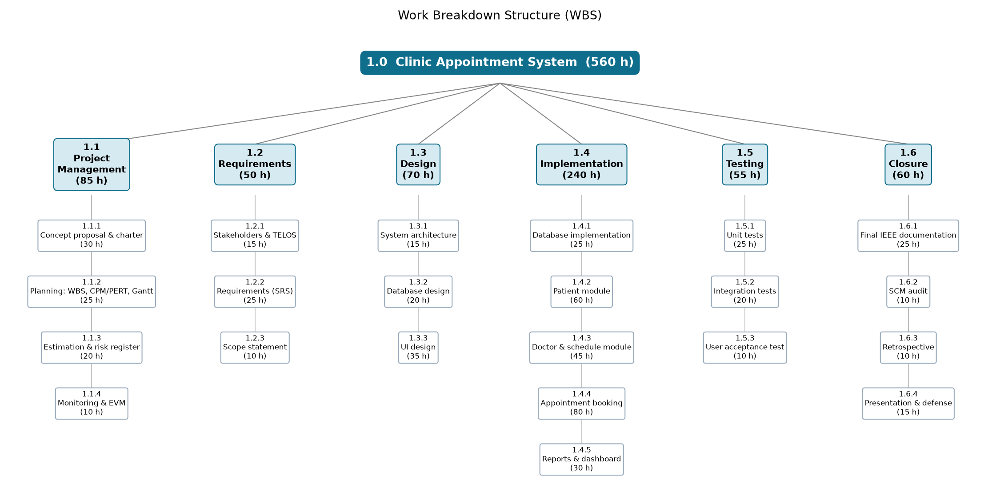
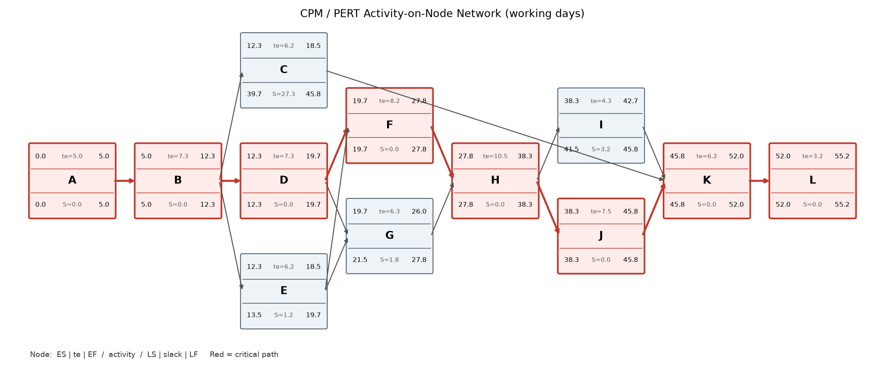
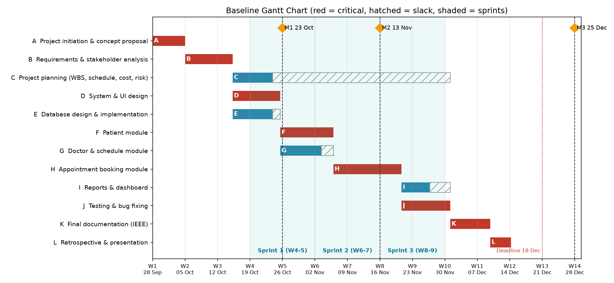
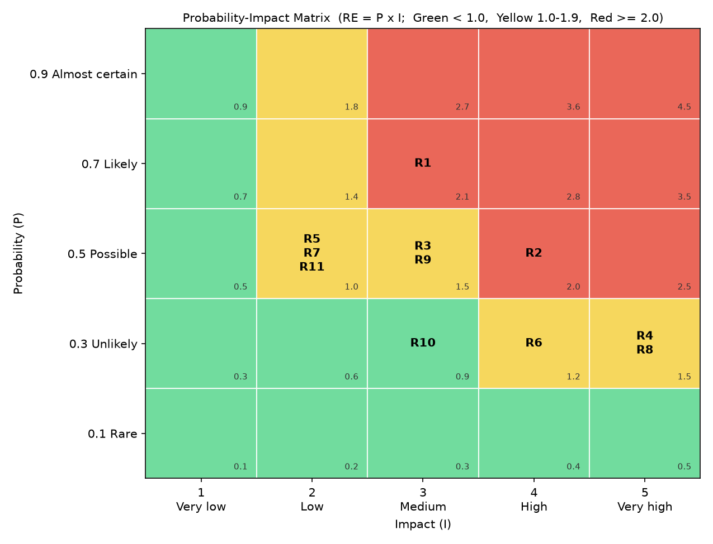

# Milestone 1 & Milestone 2 Report

| | |
|---|---|
| **Project** | Clinic Appointment System (CAS) |
| **Course** | SEN4100 Software Project Management, Haliç University |
| **Instructor** | Asst. Prof. M. Fatih Mintaş |
| **Milestone** | Milestone 1 (Week 4) and Milestone 2 (Week 7) - combined report |
| **Version / Date** | 1.1 / 13 November 2026 |
| **Team** | Burak Demir (20091000008), Davut Ayfer (20091000054), Enes Küçükkaya (22091000275), Alper Keskin (24352525053) |

This report puts all Milestone 1 and Milestone 2 deliverables of the Clinic Appointment System
project into one document. Part I covers project initiation (concept, stakeholders, charter, scope).
Part II covers planning (WBS, schedule, effort estimation, risks). All numbers come from one
calculation script (`tools/pm_calculations.py`), so they are the same in every chapter.

## How this report covers the course requirements

| Course requirement (lecture notes) | Where in this report |
|---|---|
| Project concept proposal & stakeholder analysis, stakeholder register with at least 6 stakeholders, Power-Interest grid (Week 3) | Chapter 1.1 |
| Project charter: business case, measurable KPIs, squad roles, assumptions, constraints (Week 3) | Chapter 1.2 |
| Preliminary feasibility review (TELOS), NPV / ROI (Week 3) | Chapter 1.2, section 2 |
| Lifecycle model with technical justification in the charter and scope document (Week 2) | Chapters 1.1, 1.2 (section 1.2), 1.3 (section 12) |
| Scope statement: product scope, project scope, acceptance criteria, out-of-scope (Week 3) | Chapter 1.3 |
| Visual WBS (100% rule) and WBS dictionary for three core work packages (Week 4) | Chapter 1.3, section 10 |
| Backlog repository on GitHub / GitHub Projects (Weeks 2, 3, 4) | Chapter 1.3, section 11; Chapter 2.3, Part C |
| Effort estimate for every bottom-level work package (Week 5) | Chapter 2.1 |
| Algorithmic estimation: Function Points + COCOMO (Weeks 4-5) | Chapter 2.3, Part B |
| Story points (Fibonacci) and projected sprint velocity for the sprints (Weeks 2, 5) | Chapter 2.3, Part C |
| Baseline schedule with dependencies, AON network, CPM/PERT and critical path (Week 6) | Chapters 2.2 and 2.3, Part A |
| Risk register with at least 5 risks, P x I matrix, strategies and owners (Week 6) | Chapter 2.4 |

# Part I - Milestone 1 (Week 4): Initiation

## 1.1 Project Concept Proposal & Stakeholder Analysis

Haliç University, Faculty of Engineering, Department of Software Engineering.

### 1. The problem

Many small clinics still take appointments by phone. The receptionist writes them in a notebook or an Excel file. This causes real problems:

- **Double booking.** Two patients get the same time with the same doctor. Or one patient gets two appointments at the same time.
- **Slow booking.** The receptionist cannot quickly see which times of a doctor are free.
- **Bad dates.** Appointments are written on weekends, in the past, or outside the doctor's working hours.
- **Scattered patient data.** Patient data is on paper and in many files. It is hard to find and not safe. Wrong national ID numbers are not detected.
- **No numbers for the manager.** The manager cannot answer simple questions: How busy is each doctor? How many appointments are cancelled?

### 2. Proposed solution

We will build a **web-based Clinic Appointment System (CAS)**.

- **Technology:** Python 3 + Flask web application. The database is **Microsoft SQL Server** (LocalDB instance `(localdb)\MSSQLLocalDB`, database `ClinicAppointmentDB`), connected with pyodbc.
- **Data:** four tables: departments, doctors, patients, appointments.

Main features:

1. **Patient management:** add, edit, search and delete patients. The Turkish national ID (TC Kimlik No) is checked with its official checksum rule.
2. **Doctor management:** doctors, departments and working hours.
3. **Appointment booking:** the system shows **only free 30-minute slots**. It blocks:
   - double booking for a doctor or a patient (checked in the code **and** by filtered UNIQUE indexes in SQL Server),
   - dates in the past and weekends,
   - times outside the doctor's working hours,
   - dates more than 90 days ahead.
4. **Appointment status:** BOOKED, COMPLETED or CANCELLED.
5. **Dashboard:** patient count, appointments today, cancellation rate and **doctor utilization** (utilization = booked slots / available slots this week).

### 3. Why the project is measurable ("scientific")

A "scientific" project is one where we can **measure** progress and results with numbers, and anybody can repeat the calculation. We do this in two ways.

**In project management:**

- **Function Points and COCOMO** (models that estimate effort from software size) to estimate effort in Milestone 2.
- **PERT and CPM** (methods to estimate durations and find the longest chain of tasks, the *critical path*) to find the chance to finish on time.
- **Earned Value Management (EVM)** (a method that compares planned work, done work and spent cost) to measure schedule and cost performance (SPI, CPI) in Milestone 3.
- A **risk matrix** (Probability x Impact) to rank risks.
- All numbers come from one script (`tools/pm_calculations.py`), so the results can be repeated.

**In the product:**

- Every booking rule can be tested by an **automated test** (pass / fail).
- The database itself protects the rules (unique indexes, foreign keys, check constraints).
- The dashboard shows business numbers (cancellation rate, utilization) as KPIs.

### 4. SMART objectives and KPIs

SMART means **S**pecific, **M**easurable, **A**chievable, **R**elevant, **T**ime-bound. A **KPI** (Key Performance Indicator) is a number that shows if we reached an objective.

| # | Objective (SMART) | KPI | Target |
|---|---|---|---|
| O1 | Stop double booking for doctors and patients by the end of Sprint 2 (Week 8) | Double bookings found in tests and in the database | 0 |
| O2 | Show only valid, free 30-minute slots when booking, by Week 8 | Booking rules covered by automated tests | 100% of rules tested, 100% of tests pass |
| O3 | Give the clinic manager a dashboard by Week 10 | Dashboard shows patient count, appointments today, cancellation rate, doctor utilization | 4 of 4 numbers shown and correct |
| O4 | Validate every patient national ID at entry | Invalid TC Kimlik No accepted | 0 |
| O5 | Finish the working system and documents within the 60 working-day plan (by 18 Dec 2026) | Finish date; Schedule Performance Index (SPI) | On or before 18 Dec 2026; SPI >= 0.90 |
| O6 | Stay inside the effort budget | Actual effort vs 560 person-hour plan; Cost Performance Index (CPI) | Not more than 616 h (plan + 10% reserve); CPI >= 0.90 |

### 5. Lifecycle model: Hybrid "Water-Scrum-Fall"

A **lifecycle model** is the order and style of the project phases. We chose a **hybrid** model: plan-driven at the start and the end, Scrum-like in the middle.

| Part | What we do | Style |
|---|---|---|
| **Water** (Weeks 1-4) | Concept, charter, scope, WBS, estimation (Function Points + COCOMO), CPM/PERT schedule, risks | Predictive (plan-driven) |
| **Scrum** (Weeks 5-10) | Build the system in **3 two-week increments (sprints)**. Each sprint ends with a **demo** | Iterative |
| **Fall** (Weeks 11-13) | Final testing, IEEE documentation, SCM audit, retrospective, oral defense | Predictive |

**Technical justification:**

- **Requirements:** The requirements are fairly **stable and well known** (booking rules are clear). So up-front planning is safe and useful. Pure Scrum would not give us the fixed baselines the course asks for.
- **Architectural risk:** The highest technical risk is the **booking logic** (double booking, slot rules). Short sprints with demos let us test this logic early and fix it before the end. A pure Waterfall would find these bugs too late.
- **Delivery cadence:** The **deadline and the milestones are fixed** by the course (Week 4, 7, 13). A plan-driven frame fits fixed dates. Two-week sprints fit a student team that works about 12 hours a week each.
- **Control:** Changes go through a formal **Change Control Board** (see the Charter), so scope does not grow without control.

**Tooling:** The GitHub repository (https://github.com/burakdemirsw/Software-Project-Managment) with a GitHub Projects board is our backlog. The board uses two-week iterations, one per sprint, to match the model.

### 6. Stakeholder analysis

A **stakeholder** is any person or group that can affect the project or is affected by it.

#### 6.1 Stakeholder Register

| ID | Name / Role | Internal / External | Main expectations | Power | Interest | Attitude | Strategy |
|---|---|---|---|---|---|---|---|
| S1 | Asst. Prof. M. Fatih Mintaş, course instructor (project sponsor, evaluator) | External | Correct PM methods, on-time milestones, working product | High | High | Supporter | Manage closely |
| S2 | Clinic manager (business owner, customer) | External | Fewer mistakes, reports, low cost, good return on investment | High | Medium | Supporter | Manage closely |
| S3 | Burak Demir, Project Manager + backend developer | Internal | Clear plan, controlled scope, good grade | High | High | Supporter | Manage closely |
| S4 | Development team: Davut Ayfer, Enes Küçükkaya, Alper Keskin | Internal | Clear tasks, fair workload, good grade | Medium | High | Supporter | Keep informed (active involvement) |
| S5 | Receptionist (main daily user) | External | Easy and fast booking screen, no double booking | Low | High | Neutral | Keep informed |
| S6 | Doctors | External | Correct schedule, respect for working hours | Medium | Medium | Neutral | Keep informed |
| S7 | Patients | External | Correct appointment time, privacy of personal data | Low | High | Neutral | Keep informed |
| S8 | Personal Data Protection Authority (KVKK, regulator) | External | Health data is protected by law (KVKK) | High | Low | Neutral | Keep satisfied |
| S9 | Clinic IT / system administrator | External | Easy installation, database backup | Low | Low | Resistor (extra work for them) | Monitor |
| S10 | Haliç University, Department of Software Engineering | External | Course rules and academic honesty are followed | High | Low | Supporter | Keep satisfied |

#### 6.2 Mendelow Power-Interest grid

| | **Low interest** | **High interest** |
|---|---|---|
| **High power** | **Keep satisfied:** S8 KVKK authority, S10 Department | **Manage closely:** S1 Instructor, S2 Clinic manager, S3 Project Manager |
| **Low power** | **Monitor:** S9 IT administrator | **Keep informed:** S4 Team, S5 Receptionist, S6 Doctors, S7 Patients |

Notes:

- S2 has medium interest but high power (they pay and decide). We manage them closely so they are never surprised.
- S6 Doctors have medium power and interest. We keep them informed because their working hours are the base of the booking rules.
- S9 may resist because the system gives them extra work. We reduce this with simple install scripts and a backup guide.

### 7. Communication plan

| Stakeholder | What we share | How | When | Responsible |
|---|---|---|---|---|
| S1 Instructor | Milestone reports, demo, final presentation | Written report + class presentation | Week 4, Week 7, Week 13 | Burak Demir |
| S2 Clinic manager | Progress summary, business numbers, change requests | Short e-mail report, sprint demo | End of each sprint (every 2 weeks) | Burak Demir |
| S3 + S4 Team | Tasks, progress, problems | WhatsApp group, GitHub Projects board, weekly meeting | Weekly meeting + daily chat | Burak Demir |
| S5 Receptionist, S6 Doctors | Screen designs, booking rules, test version | Sprint demo, short user test | End of Sprint 1 and Sprint 3 | Enes Küçükkaya |
| S7 Patients | Privacy notice (how data is used) | Text in the system / clinic notice | Before go-live | Alper Keskin |
| S8 KVKK, S10 Department | Data protection and course rule compliance | Section in final documentation | Week 13 | Alper Keskin |
| S9 IT administrator | Install and backup guide | README and SQL scripts in GitHub | Week 12 | Davut Ayfer |

### 8. Team and roles

| Member | Student No | Role | Main responsibilities |
|---|---|---|---|
| Burak Demir | 20091000008 | Project Manager + backend developer | Charter, plan, schedule, risks, EVM; appointment booking module |
| Davut Ayfer | 20091000054 | Database designer + developer | SQL Server database design and scripts; doctor & schedule module |
| Enes Küçükkaya | 22091000275 | UI designer + developer | User interface; patient module; dashboard |
| Alper Keskin | 24352525053 | Test / quality + documentation | Requirements (SRS), tests, user acceptance test, IEEE documentation, SCM audit |

## 1.2 Project Charter

A **Project Charter** is the document that officially starts the project. It gives the Project Manager the authority to use the team's time and resources.

### 1. Project metadata

| Item | Value |
|---|---|
| Project title | Clinic Appointment System (CAS) |
| Project code | SEN4100-CAS |
| Charter version | 1.0 |
| Approval date | 23 October 2026 |
| Project sponsor | Asst. Prof. M. Fatih Mintaş (course instructor) |
| Customer | Clinic manager (business owner) |
| Project Manager | Burak Demir |
| Lifecycle model | Hybrid Water-Scrum-Fall (3 two-week sprints) |
| Project start / planned end | 28 September 2026 / 18 December 2026 (60 working days) |
| Repository | https://github.com/burakdemirsw/Software-Project-Managment |

#### 1.1 Project team (squad roles)

| Member | Student No | Project role | Main work packages |
|---|---|---|---|
| Burak Demir | 20091000008 | Project Manager, backend developer | 1.1 Project management, 1.4.4 Appointment module |
| Davut Ayfer | 20091000054 | Database designer, developer | 1.3.2 Database design, 1.4.1 Database, 1.4.3 Doctor module |
| Enes Küçükkaya | 22091000275 | UI designer, developer | 1.3.1 Architecture, 1.3.3 UI design, 1.4.2 Patient module, 1.4.5 Dashboard |
| Alper Keskin | 24352525053 | Quality lead, documentation | 1.2.2 Requirements (SRS), 1.5 Testing, 1.6 Final documentation |

#### 1.2 Lifecycle model and justification

We use a **Hybrid "Water-Scrum-Fall"** lifecycle:

| Phase | Weeks | Style | Work |
|---|---|---|---|
| Water | 1-4 | Predictive (plan-driven) | Concept, charter, scope, WBS, estimation, schedule, risks |
| Scrum | 5-10 | Iterative, **3 two-week sprints** with a demo at the end of each | Database, patient, doctor, appointment modules, dashboard, tests |
| Fall | 11-13 | Predictive | Final testing, IEEE documentation, SCM audit, retrospective, oral defense |

Technical justification:

- **Requirements:** the booking rules are stable and well known, so up-front planning (WBS, Function Points, COCOMO, CPM) is safe and gives the fixed baselines the course needs.
- **Architectural risk:** the riskiest part is the booking logic (double booking, slot rules). Short sprints with demos test it early, before the final phase.
- **Delivery cadence:** milestone dates are fixed (Weeks 4, 7, 13). A plan-driven frame fits fixed dates; two-week sprints fit a part-time student team (about 12 hours per person per week).
- **Tooling:** the GitHub Projects board uses two-week iterations (Sprint 1-3) and story points, to match this model.

### 2. Business case

#### 2.1 Problem and opportunity

Small clinics manage appointments by phone and paper. This leads to double bookings, slow booking, lost patient data and no reports. A simple web system with strict booking rules removes these mistakes and saves receptionist time (about 2 hours per day).

#### 2.2 Feasibility (TELOS)

**TELOS** is a check of five kinds of feasibility: Technical, Economic, Legal, Operational, Schedule.

| Area | Question | Result | Feasible? |
|---|---|---|---|
| **T**echnical | Can we build it? | Python 3 + Flask and SQL Server LocalDB are free, well documented and known by the team. Four tables and simple web pages. Main technical risk (double booking) is solved in code **and** with filtered UNIQUE indexes in the database. | Yes |
| **E**conomic | Is it worth the money? | NPV = +30,343 TL, ROI = 59.6%, payback = 1.88 years (see 2.3). Software licence cost = 0 TL. | Yes |
| **L**egal | Is it allowed? | Patient data is personal health data under **KVKK** (Turkish Personal Data Protection Law No. 6698). We use only test data in development, store data only in the clinic's own database, and show a privacy notice. All tools are open-source or free. | Yes, with care |
| **O**perational | Will people use it? | The receptionist needs only a web browser. Screens are simple and follow the order of their daily work. Doctors' working hours drive the slots, so doctors keep control. | Yes |
| **S**chedule | Can we finish in time? | Planned effort 560 person-hours. Team capacity is 4 x 12 weeks x ~12 h = 576 person-hours. Plan deadline is 60 working days (18 Dec 2026). | Yes, but tight |

#### 2.3 Economic numbers (clinic view, 3 years, discount rate r = 10%)

| Item | Value |
|---|---|
| Investment at year 0 | 84,000 TL development + 10,000 TL installation & training = **94,000 TL** |
| Yearly benefit | 60,000 TL (receptionist time saved, fewer double bookings and no-shows) |
| Yearly maintenance | 10,000 TL |
| Net cash flow, years 1-3 | 60,000 - 10,000 = **50,000 TL per year** |

**Net Present Value (NPV)** = the value today of all future money, minus the investment. Formula: NPV = sum of CFt / (1 + r)^t - investment.

- Year 1: 50,000 / 1.1 = 45,455 TL
- Year 2: 50,000 / 1.1^2 = 41,322 TL
- Year 3: 50,000 / 1.1^3 = 37,566 TL
- NPV = -94,000 + 45,455 + 41,322 + 37,566 = **+30,343 TL**. NPV > 0, so we **accept** the project.

**Return on Investment (ROI)** = profit / investment.

- ROI = (total net benefit - investment) / investment = (150,000 - 94,000) / 94,000 = **59.6%**

**Payback period** = the time needed to earn back the investment.

- Payback = 94,000 / 50,000 = **1.88 years** (less than the 3-year horizon).

### 3. SMART objectives and KPIs

| # | Objective | KPI and target |
|---|---|---|
| O1 | No double booking for doctor or patient by Week 8 | 0 double bookings in tests and database |
| O2 | Only valid, free 30-minute slots can be booked by Week 8 | 100% of booking rules have automated tests; 100% pass |
| O3 | Manager dashboard ready by Week 10 | Patient count, appointments today, cancellation rate and doctor utilization shown and correct |
| O4 | Valid patient identity data | 0 invalid TC Kimlik No accepted |
| O5 | On-time delivery | System and documents finished by 18 Dec 2026; SPI >= 0.90 |
| O6 | On-budget delivery | Effort not more than 616 h (560 h + 10% reserve); CPI >= 0.90 |

### 4. High-level requirements and boundaries

**Inside the system:**

- Patient management (add, edit, search, delete, national ID check).
- Doctor and department management with working hours.
- Appointment booking with rules: 30-minute slots, only free slots shown, no double booking, no past dates, no weekends, only inside working hours, max 90 days ahead.
- Appointment status: BOOKED, COMPLETED, CANCELLED.
- Dashboard with four KPIs.
- SQL Server database with scripts (create, schema, seed) and automated tests.

**Outside the system (boundaries):** online patient self-booking, SMS/e-mail reminders, payments and insurance, medical records, mobile app, cloud hosting. Full list in the Scope Statement (1.3).

### 5. Project Manager and authority limits

The Project Manager, **Burak Demir**, has the authority to:

- Assign work packages and tasks to team members.
- Choose technical tools and libraries inside the agreed stack (Python, Flask, SQL Server).
- Re-plan tasks inside a sprint if the milestone dates do not move.
- Approve small changes: up to **8 person-hours** and no change to a milestone date.
- Use the management reserve (56 h) after informing the team.

The Project Manager **cannot** alone:

- Change a milestone date or the final deadline.
- Add or remove a "Must have" requirement.
- Increase the total budget above 616 person-hours.

These need a decision of the Change Control Board.

### 6. Governance and Change Control Board

| Role | Person | Responsibility |
|---|---|---|
| Sponsor | Asst. Prof. M. Fatih Mintaş | Approves the charter and big changes; evaluates milestones |
| Project Manager | Burak Demir | Runs the project; chairs the Change Control Board |
| Product Owner (customer voice) | Clinic manager (represented by Burak Demir in class) | Sets backlog priorities |
| Quality lead | Alper Keskin | Checks tests and acceptance criteria |

**Change Control Board (CCB):** a small group that accepts or rejects change requests.

- Members: PM Burak Demir + one team member (the owner of the affected module).
- For **big changes** (milestone date, "Must" requirement, budget above 616 h) the instructor joins as sponsor.
- All change requests are written as GitHub issues with the label `change-request`.

### 7. Summary milestone schedule

| Milestone / gate | Date | Content |
|---|---|---|
| Project start | 28 Sep 2026 (Week 1) | Kick-off, concept |
| **M1** - Concept, Charter, Scope | 23 Oct 2026 (Week 4) | This document set, WBS |
| Sprint 1 demo | End of Week 6 | Database, patient and doctor modules |
| **M2** - Planning package | 13 Nov 2026 (Week 7) | WBS dictionary, CPM/PERT, Gantt, estimation, risk register |
| Sprint 2 demo | End of Week 8 | Appointment booking module |
| Sprint 3 demo | End of Week 10 | Dashboard, tests |
| Plan deadline (system finished) | 18 Dec 2026 (end of Week 12) | Final tests, IEEE documentation, release v1.0 |
| **M3** - Final delivery & oral defense | 25 Dec 2026 (Week 13) | SCM audit, EVM report, presentation |

### 8. Budget baseline

| Item | Value |
|---|---|
| Bottom-up effort (from WBS) | 560 person-hours |
| Notional rate | 150 TL per person-hour |
| **Budget at Completion (BAC)** | 560 x 150 = **84,000 TL** |
| Management reserve (10%) | 56 h (8,400 TL) |
| Software cost | 0 TL (Python/Flask open-source; SQL Server Express LocalDB free) |
| Team capacity | 4 x 12 weeks x ~12 h = 576 person-hours |

### 9. High-level risks

| Risk | Effect | First response |
|---|---|---|
| Team member not available (exams, illness) | Delay | Cross-training, pair work on critical modules |
| Requirements change late | Rework, delay | Scope baseline + Change Control Board |
| Effort underestimated | Overrun | Management reserve, two estimation methods |
| Double booking bug | Wrong appointments | Rule check in code + UNIQUE indexes + tests |
| Patient data privacy (KVKK) | Legal problem | Test data only, privacy notice |
| Scope creep (extra features) | Delay | Out-of-scope list, MoSCoW priorities |

The full risk register with Probability x Impact scores comes in Milestone 2.

### 10. Assumptions and constraints

**Assumptions** (we believe these are true, but we cannot prove them):

- Each member can work about 12 hours per week.
- SQL Server LocalDB and Python run on all team laptops.
- The clinic works Monday to Friday, with 30-minute appointments.
- Requirements will stay mostly stable after Week 4.

**Constraints** (fixed limits):

- Fixed deadlines: M1 23 Oct, M2 13 Nov, M3 25 Dec 2026; system finished by 18 Dec 2026.
- Team of 4 students; no money budget for software.
- Technology: Python 3 + Flask, Microsoft SQL Server, Git/GitHub.
- KVKK: no real patient data in development.

### 11. Success criteria

The project is successful when:

1. All "Must have" requirements work and pass their acceptance criteria.
2. All automated tests pass; 0 double bookings.
3. The system is finished by 18 Dec 2026 and M3 is presented on 25 Dec 2026.
4. Effort stays within 616 person-hours.
5. The instructor accepts all three milestones.

### 12. Approval

| Role | Name | Signature | Date |
|---|---|---|---|
| Project Sponsor | Asst. Prof. M. Fatih Mintaş | | |
| Project Manager | Burak Demir | | 23 Oct 2026 |
| Database / Doctor module | Davut Ayfer | | 23 Oct 2026 |
| UI / Patient module | Enes Küçükkaya | | 23 Oct 2026 |
| Test & Documentation | Alper Keskin | | 23 Oct 2026 |

## 1.3 Scope Statement, Assumptions & Constraints

The **Scope Statement** says exactly what we will build and what we will not build. Together with the WBS and the WBS Dictionary (Section 10) it forms the **scope baseline**: the approved scope that we measure changes against.

### 1. Product scope vs project scope

| | Meaning | For CAS |
|---|---|---|
| **Product scope** | The features of the software | A web system for patients, doctors, appointment booking with strict rules, and a manager dashboard, on Python 3 + Flask and Microsoft SQL Server |
| **Project scope** | All the work needed to deliver the product | Planning and management, requirements, design, coding, testing, documentation, source control (Git/GitHub), retrospective and oral defense |

### 2. Deliverables

| # | Deliverable | Milestone |
|---|---|---|
| D1 | Concept proposal, stakeholder analysis, project charter, scope statement, visual WBS | M1 (23 Oct 2026) |
| D2 | WBS dictionary, CPM/PERT network, baseline Gantt chart, effort estimation (FP, COCOMO), risk register | M2 (13 Nov 2026) |
| D3 | SQL Server database scripts: `create_database.sql`, `schema.sql`, `seed.sql` | Sprint 1 |
| D4 | Working Flask web application (patient, doctor, appointment modules, dashboard) | Sprints 1-3 |
| D5 | Automated test suite (Python unittest) and test report | Sprint 3 |
| D6 | Git repository with branch history, release branch `release/v1.0` and tag `v1.0.0` | M3 |
| D7 | Final IEEE documentation, EVM report, SCM audit | M3 (25 Dec 2026) |
| D8 | Retrospective and final presentation / oral defense | M3 (25 Dec 2026) |

### 3. Functional requirements (MoSCoW)

**MoSCoW** is a way to set priority: **M**ust have, **S**hould have, **C**ould have, **W**on't have (this time).

| ID | Requirement | Priority |
|---|---|---|
| FR-1 | The user can add, edit, search and delete patients. | Must |
| FR-2 | The system checks the Turkish national ID (TC Kimlik No) with its checksum rule and rejects invalid numbers. | Must |
| FR-3 | The user can manage departments and doctors, including each doctor's working hours. | Must |
| FR-4 | The system divides each doctor's working hours into 30-minute slots and shows only free slots. | Must |
| FR-5 | The system blocks double booking for a doctor (same doctor, same time). | Must |
| FR-6 | The system blocks double booking for a patient (same patient, same time). | Must |
| FR-7 | The system rejects bookings in the past, on weekends, outside working hours, or more than 90 days ahead. | Must |
| FR-8 | Each appointment has a status: BOOKED, COMPLETED or CANCELLED. The user can cancel or complete an appointment. | Must |
| FR-9 | The user can list and filter appointments (by date, doctor, status). | Should |
| FR-10 | The dashboard shows patient count, appointments today, cancellation rate and doctor utilization (booked slots / available slots this week). | Should |
| FR-11 | The free slots are loaded without reloading the page (JSON query). | Could |
| FR-12 | Online self-booking by patients, SMS reminders. | Won't (this version) |

### 4. Non-functional requirements

| ID | Type | Requirement |
|---|---|---|
| NFR-1 | Data integrity | Double booking is blocked **also in the database** with filtered UNIQUE indexes, foreign keys and check constraints. |
| NFR-2 | Privacy (KVKK) | Only test data is used in development. Personal data stays in the clinic's own SQL Server database. |
| NFR-3 | Usability | A receptionist can book an appointment with a few clicks, on simple screens, in a normal web browser. |
| NFR-4 | Reliability | All automated tests pass before each merge to `develop` and before release. Database tests use a separate test database `ClinicAppointmentDB_Test`. |
| NFR-5 | Portability | Runs on Windows with Python 3 and SQL Server LocalDB `(localdb)\MSSQLLocalDB`. |
| NFR-6 | Maintainability | Code is split into modules (db, scheduling, patients, doctors, appointments, reports) and kept in Git with pull requests. |
| NFR-7 | Cost | Only free or open-source software (0 TL licence cost). |

### 5. User acceptance criteria

The customer (clinic manager) and the sponsor accept the product when:

1. A patient with an invalid TC Kimlik No **cannot** be saved.
2. When booking, only free 30-minute slots inside the doctor's working hours are shown.
3. A second booking for the same doctor and time is **rejected**. A second booking for the same patient and time is **rejected**.
4. Bookings in the past, on Saturday/Sunday, or more than 90 days ahead are **rejected**.
5. Cancelling an appointment frees the slot again.
6. The dashboard shows the four numbers and they match a manual count on the seed data.
7. 100% of automated tests pass on a clean install from the GitHub repository.
8. All "Must" requirements (FR-1 to FR-8) are demonstrated in the final demo.

### 6. Out of scope (we will NOT build)

- Online booking by patients (patient portal) and mobile app.
- SMS or e-mail reminders.
- Payments, invoices, insurance (SGK) integration.
- Electronic medical records, prescriptions, lab results.
- User login with roles and passwords (single clinic user in this version).
- Multiple clinics / branches.
- Cloud hosting or production deployment on a real server.
- Integration with the national e-Nabız or MHRS systems.

### 7. Assumptions

- Each team member can work about 12 hours per week (capacity 576 person-hours).
- SQL Server LocalDB, Python 3 and the ODBC driver can be installed on all team laptops.
- The clinic works Monday to Friday. Appointments are 30 minutes.
- Requirements stay mostly stable after Milestone 1.
- The instructor (sponsor) is available for big change decisions.

### 8. Constraints

- **Time:** M1 23 Oct 2026, M2 13 Nov 2026, M3 25 Dec 2026. The system must be finished by 18 Dec 2026 (60 working days).
- **Cost:** effort budget 560 person-hours (BAC 84,000 TL) + 10% reserve (56 h). No money for software.
- **People:** 4 students, part-time.
- **Technology:** Python 3 + Flask, Microsoft SQL Server (LocalDB), pyodbc, Git/GitHub.
- **Legal:** KVKK rules for personal health data.

### 9. Change control process

**Scope creep** means the scope slowly grows without approval. To stop it, every change follows these steps:

1. **Submit:** Anyone writes a **Change Request (CR)** as a GitHub issue with the label `change-request` (what, why, who asks).
2. **Log:** The PM gives it a number and adds it to the change log.
3. **Impact analysis:** The PM and the module owner estimate the effect on scope, effort (hours), schedule (critical path), cost, quality and risk. They also say which lower-priority item can drop out if needed.
4. **CCB review:** The Change Control Board (PM Burak Demir + module owner) decides. Big changes (milestone date, "Must" requirement, budget above 616 h) go to the instructor as sponsor.
5. **Decision:** Approved or rejected. The decision and the reason are written in the issue.
6. **Update baselines:** If approved, the PM updates the scope statement, WBS, schedule and budget, and the GitHub Projects backlog.
7. **Implement:** The work is done on a `feature/*` or `bugfix/*` branch and merged into `develop` with a pull request.
8. **Notify and close:** The team and affected stakeholders are informed; the issue is closed.

Small changes (8 person-hours or less, no milestone date change) can be approved by the PM alone, but are still logged.

### 10. Work Breakdown Structure (WBS)

A **WBS** breaks the total work into smaller pieces. It follows the **100% rule**: it holds all the work of the project and nothing more. Our WBS has three levels: the project (level 1), control accounts (level 2) and work packages (level 3). Each work package follows the **8/80 rule** (between 8 and 80 hours). Total = **560 person-hours**.

| Level 2 (control account) | Work packages | Hours |
|---|---|---|
| 1.1 Project management | 1.1.1 Concept & charter (30), 1.1.2 Planning (25), 1.1.3 Estimation & risk register (20), 1.1.4 Monitoring & EVM (10) | 85 |
| 1.2 Requirements | 1.2.1 Stakeholders & TELOS (15), 1.2.2 SRS (25), 1.2.3 Scope statement (10) | 50 |
| 1.3 Design | 1.3.1 Architecture (15), 1.3.2 Database design (20), 1.3.3 UI design (35) | 70 |
| 1.4 Construction | 1.4.1 Database implementation (25), 1.4.2 Patient module (60), 1.4.3 Doctor & schedule module (45), 1.4.4 Appointment booking (80), 1.4.5 Reports & dashboard (30) | 240 |
| 1.5 Testing | 1.5.1 Unit tests (25), 1.5.2 Integration tests (20), 1.5.3 User acceptance test (10) | 55 |
| 1.6 Closing | 1.6.1 IEEE documentation (25), 1.6.2 SCM audit (10), 1.6.3 Retrospective (10), 1.6.4 Presentation & defense (15) | 60 |
| **Total** | | **560** |

#### 10.1 WBS Dictionary (three core work packages)

The **WBS Dictionary** describes each work package so nobody is confused about what "done" means.

**1.4.1 Database implementation**

| Field | Value |
|---|---|
| Description | Create the SQL Server database `ClinicAppointmentDB` on `(localdb)\MSSQLLocalDB`. Write `create_database.sql`, `schema.sql` (tables departments, doctors, patients, appointments; keys, check constraints, filtered UNIQUE indexes against double booking) and `seed.sql` (test data). Write the connection layer `db.py` with pyodbc. |
| Owner | Davut Ayfer |
| CPM activity | E (Database design & implementation) |
| Effort / cost | 25 person-hours = 3,750 TL |
| Branch | `feature/database` |
| Definition of Done | Scripts run without error on a clean LocalDB; all four tables and indexes exist; inserting a second BOOKED appointment for the same doctor and time fails in the database; `db.py` connects and is used by all modules; separate test database `ClinicAppointmentDB_Test` works; merged into `develop` by pull request. |

**1.4.2 Patient module**

| Field | Value |
|---|---|
| Description | Screens and code to add, edit, search, list and delete patients (`patients.py` and templates). Includes TC Kimlik No checksum validation (FR-1, FR-2). |
| Owner | Enes Küçükkaya |
| CPM activity | F (Patient module) |
| Effort / cost | 60 person-hours = 9,000 TL |
| Branch | `feature/patient-module` |
| Definition of Done | All patient screens work in the browser; invalid national IDs are rejected with a clear message; duplicate national ID is rejected; search by name or ID works; unit tests for the checksum pass; code reviewed and merged into `develop`. |

**1.4.4 Appointment booking module**

| Field | Value |
|---|---|
| Description | The core of the system (`scheduling.py`, `appointments.py`, booking screen). Build 30-minute slots from doctor working hours, show only free slots, book / cancel / complete appointments, and enforce all rules: no double booking for doctor or patient, no past dates, no weekends, only inside working hours, max 90 days ahead (FR-4 to FR-8). |
| Owner | Burak Demir & Davut Ayfer |
| CPM activity | H (Appointment booking module) - on the critical path |
| Effort / cost | 80 person-hours = 12,000 TL |
| Branch | `feature/appointment-booking` |
| Definition of Done | Every booking rule has at least one automated test and all tests pass; a double booking is blocked both in the code and by the database index; cancelling frees the slot; statuses BOOKED, COMPLETED, CANCELLED work; demo accepted at the end of Sprint 2; merged into `develop` by pull request. |

### 11. Backlog and scope baseline repository

The approved scope is stored in our GitHub repository: https://github.com/burakdemirsw/Software-Project-Managment

- Each functional requirement (FR-1 to FR-11) is a **GitHub issue**, linked to its WBS work package.
- The **GitHub Projects** board is the product backlog. It has two-week iterations (Sprint 1, 2, 3) to match our Water-Scrum-Fall model.
- This scope statement is the baseline. Any change after 23 October 2026 must go through the change control process in Section 9.
- Branching: `main` (releases only), `develop` (integration), `feature/*`, `bugfix/*`, `test/*`, `release/v1.0`. Work is merged with pull requests.

### 12. Lifecycle model and delivery cadence

The scope is delivered with a **Hybrid "Water-Scrum-Fall"** lifecycle (full justification in the Project Charter, section 1.2):

- **Predictive part (Weeks 1-4 and 11-13):** this scope statement, the WBS and the WBS dictionary are the baseline. They change only through the change control process (Section 9).
- **Iterative part (Weeks 5-10):** the "Must" and "Should" requirements are built in **three two-week sprints**:

| Sprint | Weeks | Requirements delivered | Demo |
|---|---|---|---|
| Sprint 1 | 5-6 | Database scripts (D3), FR-1, FR-2, FR-3 | End of Week 6 |
| Sprint 2 | 7-8 | FR-4, FR-5, FR-6, FR-7, FR-8, FR-11 | End of Week 8 |
| Sprint 3 | 9-10 | FR-9, FR-10, automated tests (D5) | End of Week 10 |

- **Why this fits the scope:** the requirements are stable (good for a fixed baseline), the riskiest requirements (FR-4 to FR-7, booking rules) are built and demonstrated in the middle sprint so problems are found early, and the fixed course dates set the delivery cadence.

# Part II - Milestone 2 (Week 7): Planning

## 2.1 Work Breakdown Structure (WBS) and WBS Dictionary

### 1. What is a WBS?

A **Work Breakdown Structure (WBS)** is a tree that breaks the whole project scope into smaller pieces of work. It is based on **deliverables** (things we produce), not on time.

- A WBS is **not a schedule**. It does not show order or dependencies. The order is shown in the CPM network (document 2.2).
- A WBS is **not an organization chart**. It breaks down the product and the work, not the people.

Our WBS has three levels:

- **Level 1 - Project:** 1.0 Clinic Appointment System.
- **Level 2 - Control accounts:** big areas of work where we control cost and time (1.1 to 1.6).
- **Level 3 - Work packages:** the lowest level. Each work package has one owner, an effort estimate and a clear "done" rule.

### 2. Two rules we follow

#### 2.1 The 100% rule

The **100% rule** says: the WBS must contain **all** the work of the project (also project management work) and **nothing more**. If a task is not in the WBS, it gets no time and no budget. So we added management work (charter, planning, EVM report) and closing work (SCM audit, retrospective, presentation) as well.

#### 2.2 The 8/80 rule

The **8/80 rule** says: a work package should take **at least 8 hours** and **at most 80 hours** of effort. A package bigger than 80 hours is a "black box" and must be split. A package smaller than 8 hours is too small to track.

### 3. WBS diagram

### 4. WBS outline (levels 1-3)

- **1.0 Clinic Appointment System** (560 h)
  - **1.1 Project Management** (85 h)
    - 1.1.1 Concept proposal & project charter (30 h)
    - 1.1.2 Planning: WBS, CPM/PERT, Gantt (25 h)
    - 1.1.3 Effort estimation (FP, COCOMO) & risk register (20 h)
    - 1.1.4 Monitoring & EVM report (10 h)
  - **1.2 Requirements** (50 h)
    - 1.2.1 Stakeholder analysis & TELOS feasibility (15 h)
    - 1.2.2 Requirements specification (SRS) (25 h)
    - 1.2.3 Scope statement (10 h)
  - **1.3 Design** (70 h)
    - 1.3.1 System architecture (15 h)
    - 1.3.2 Database design (ER model) (20 h)
    - 1.3.3 User interface design (35 h)
  - **1.4 Implementation** (240 h)
    - 1.4.1 Database implementation (SQL Server scripts, connection layer) (25 h)
    - 1.4.2 Patient module (60 h)
    - 1.4.3 Doctor & schedule module (45 h)
    - 1.4.4 Appointment booking module (80 h)
    - 1.4.5 Reports & dashboard (30 h)
  - **1.5 Testing** (55 h)
    - 1.5.1 Unit tests (25 h)
    - 1.5.2 Integration tests (20 h)
    - 1.5.3 User acceptance test (10 h)
  - **1.6 Closure** (60 h)
    - 1.6.1 Final IEEE documentation (25 h)
    - 1.6.2 SCM audit (10 h)
    - 1.6.3 Retrospective (10 h)
    - 1.6.4 Final presentation & oral defense (15 h)

### 5. WBS Dictionary

The **WBS Dictionary** describes every work package, so that nobody is unsure what the package means. For each package we give the WBS code, name, description, owner, effort, the CPM activity it belongs to (see document 2.2), the deliverable, and the acceptance criteria. The acceptance criteria are our **Definition of Done (DoD)**: the package is finished only when all of them are true.

#### 1.1 Project Management

| Field | 1.1.1 |
|---|---|
| **Name** | Concept proposal & project charter |
| **Description** | Write the project concept proposal (problem, goals, business case with NPV / ROI / payback) and the project charter that officially starts the project. |
| **Owner** | Burak Demir |
| **Effort** | 30 h |
| **CPM activity** | A - Project initiation & concept proposal |
| **Deliverable** | Concept proposal and project charter documents (Milestone 1) |
| **Acceptance criteria (DoD)** | Charter has objectives, scope summary, budget, milestones and roles; business case numbers are checked; team reviewed it; submitted on 23 Oct 2026. |

| Field | 1.1.2 |
|---|---|
| **Name** | Planning: WBS, CPM/PERT, Gantt |
| **Description** | Build the WBS and WBS Dictionary, the activity list with dependencies, PERT estimates, the CPM network and the baseline Gantt chart. |
| **Owner** | Burak Demir |
| **Effort** | 25 h |
| **CPM activity** | C - Project planning |
| **Deliverable** | Documents 2.1, 2.2 and 2.3 Part A |
| **Acceptance criteria (DoD)** | WBS passes the 100% rule and 8/80 rule; every activity has predecessors; critical path and slack are calculated; Gantt dates match the CPM table. |

| Field | 1.1.3 |
|---|---|
| **Name** | Effort estimation (FP, COCOMO) & risk register |
| **Description** | Estimate size with Function Points, convert to KLOC, calculate Basic and Intermediate COCOMO, compare with the WBS estimate, and build the risk register. |
| **Owner** | Burak Demir |
| **Effort** | 20 h |
| **CPM activity** | C - Project planning |
| **Deliverable** | Documents 2.3 Part B and 2.4 |
| **Acceptance criteria (DoD)** | All FP counts and COCOMO steps are shown; estimate is compared with team capacity; at least 5 risks with P, I, RE, response and owner. |

| Field | 1.1.4 |
|---|---|
| **Name** | Monitoring & EVM report |
| **Description** | Track progress during construction, collect actual hours, and calculate Earned Value metrics (PV, EV, AC, SV, CV, SPI, CPI, EAC). |
| **Owner** | Burak Demir |
| **Effort** | 10 h |
| **CPM activity** | K - Final documentation |
| **Deliverable** | EVM status report with S-curve (Milestone 3) |
| **Acceptance criteria (DoD)** | Actual hours are recorded for every activity; all EVM formulas are shown; a short corrective action plan is written. |

#### 1.2 Requirements

| Field | 1.2.1 |
|---|---|
| **Name** | Stakeholder analysis & TELOS feasibility |
| **Description** | Identify stakeholders (receptionist, doctors, patients, clinic manager, instructor), map their power and interest, and check feasibility with TELOS (Technical, Economic, Legal, Operational, Schedule). |
| **Owner** | Burak Demir |
| **Effort** | 15 h |
| **CPM activity** | B - Requirements & stakeholder analysis |
| **Deliverable** | Stakeholder register and TELOS feasibility section |
| **Acceptance criteria (DoD)** | Every stakeholder has needs and an engagement strategy; each TELOS area has a clear result. |

| Field | 1.2.2 |
|---|---|
| **Name** | Requirements specification (SRS) |
| **Description** | Write functional requirements (patients, doctors, booking rules, dashboard) and non-functional requirements (security, usability, data rules). |
| **Owner** | Alper Keskin |
| **Effort** | 25 h |
| **CPM activity** | B - Requirements & stakeholder analysis |
| **Deliverable** | SRS document |
| **Acceptance criteria (DoD)** | Each requirement has an ID, is testable, and is approved by the team; all booking rules (30-minute slots, no double booking, no past dates, no weekends, working hours, max 90 days, TC Kimlik No check) are written down. |

| Field | 1.2.3 |
|---|---|
| **Name** | Scope statement |
| **Description** | Define what is in scope and out of scope, the main deliverables and the constraints and assumptions. |
| **Owner** | Burak Demir |
| **Effort** | 10 h |
| **CPM activity** | B - Requirements & stakeholder analysis |
| **Deliverable** | Project scope statement |
| **Acceptance criteria (DoD)** | In-scope and out-of-scope lists exist; scope is approved and becomes the scope baseline for change control. |

#### 1.3 Design

| Field | 1.3.1 |
|---|---|
| **Name** | System architecture |
| **Description** | Design the structure of the Flask web application: modules, routes, templates and the connection to SQL Server through pyodbc. |
| **Owner** | Enes Küçükkaya |
| **Effort** | 15 h |
| **CPM activity** | D - System & UI design |
| **Deliverable** | Architecture diagram and short description |
| **Acceptance criteria (DoD)** | Every module (db, scheduling, patients, doctors, appointments, reports) has a clear job; the team agrees on the folder structure. |

| Field | 1.3.2 |
|---|---|
| **Name** | Database design (ER model) |
| **Description** | Design the ER model with the tables departments, doctors, patients and appointments, keys and constraints. |
| **Owner** | Davut Ayfer |
| **Effort** | 20 h |
| **CPM activity** | E - Database design & implementation |
| **Deliverable** | ER diagram and table definitions |
| **Acceptance criteria (DoD)** | All tables have primary and foreign keys; the double-booking rule is planned as filtered UNIQUE indexes; design is reviewed by the team. |

| Field | 1.3.3 |
|---|---|
| **Name** | User interface design |
| **Description** | Design the screens: dashboard, patient list and form, doctor list and form, appointment list and booking screen. |
| **Owner** | Enes Küçükkaya |
| **Effort** | 35 h |
| **CPM activity** | D - System & UI design |
| **Deliverable** | Screen mock-ups and base HTML/CSS layout |
| **Acceptance criteria (DoD)** | Every screen in the SRS has a mock-up; navigation is the same on all pages; the team approves the design. |

#### 1.4 Implementation

| Field | 1.4.1 |
|---|---|
| **Name** | Database implementation (SQL Server scripts, connection layer) |
| **Description** | Write create_database.sql, schema.sql and seed.sql for ClinicAppointmentDB on SQL Server LocalDB, and the Python connection layer (db.py) with pyodbc. |
| **Owner** | Davut Ayfer |
| **Effort** | 25 h |
| **CPM activity** | E - Database design & implementation |
| **Deliverable** | SQL scripts and db.py, merged from feature/database |
| **Acceptance criteria (DoD)** | Scripts run without error on a clean LocalDB; filtered UNIQUE indexes exist; seed data loads; the app can connect; code is reviewed in a pull request. |

| Field | 1.4.2 |
|---|---|
| **Name** | Patient module |
| **Description** | Add, edit, delete and search patients, with TC Kimlik No checksum validation. |
| **Owner** | Enes Küçükkaya |
| **Effort** | 60 h |
| **CPM activity** | F - Patient module |
| **Deliverable** | patients.py and patient templates, merged from feature/patient-module |
| **Acceptance criteria (DoD)** | All patient screens work; a wrong TC Kimlik No is rejected; unit tests pass; pull request is reviewed and merged into develop. |

| Field | 1.4.3 |
|---|---|
| **Name** | Doctor & schedule module |
| **Description** | Add, edit and list doctors with department and working hours. |
| **Owner** | Davut Ayfer |
| **Effort** | 45 h |
| **CPM activity** | G - Doctor & schedule module |
| **Deliverable** | doctors.py and doctor templates, merged from feature/doctor-module |
| **Acceptance criteria (DoD)** | Doctors can be added and edited; working hours are stored and used for free slots; tests pass; pull request merged. |

| Field | 1.4.4 |
|---|---|
| **Name** | Appointment booking module |
| **Description** | Show only free 30-minute slots, book, cancel and complete appointments, and enforce all booking rules in the code (scheduling.py, appointments.py). |
| **Owner** | Burak Demir & Davut Ayfer |
| **Effort** | 80 h |
| **CPM activity** | H - Appointment booking module |
| **Deliverable** | Booking feature, merged from feature/appointment-booking (and bugfix/double-booking-index) |
| **Acceptance criteria (DoD)** | No double booking for doctor or patient (code and database); no past dates, weekends, times outside working hours or more than 90 days ahead; statuses BOOKED / COMPLETED / CANCELLED work; tests pass. |

| Field | 1.4.5 |
|---|---|
| **Name** | Reports & dashboard |
| **Description** | Dashboard with patient count, appointments today, cancellation rate and doctor utilization (booked slots / available slots this week). |
| **Owner** | Enes Küçükkaya |
| **Effort** | 30 h |
| **CPM activity** | I - Reports & dashboard |
| **Deliverable** | reports.py and dashboard page, merged from feature/dashboard |
| **Acceptance criteria (DoD)** | All four numbers are shown and checked by hand against the database; page loads without error. |

#### 1.5 Testing

| Field | 1.5.1 |
|---|---|
| **Name** | Unit tests |
| **Description** | Write automated tests with Python unittest for validation and scheduling rules. |
| **Owner** | Alper Keskin |
| **Effort** | 25 h |
| **CPM activity** | J - Testing & bug fixing |
| **Deliverable** | app/tests/test_clinic.py, merged from test/unit-tests |
| **Acceptance criteria (DoD)** | Every booking rule and the TC Kimlik No check has at least one test; all tests pass. |

| Field | 1.5.2 |
|---|---|
| **Name** | Integration tests |
| **Description** | Test the modules together with the real SQL Server test database ClinicAppointmentDB_Test. |
| **Owner** | Alper Keskin |
| **Effort** | 20 h |
| **CPM activity** | J - Testing & bug fixing |
| **Deliverable** | Database tests and test report |
| **Acceptance criteria (DoD)** | Tests run on the separate test database only; double booking is blocked by the database indexes; all found bugs are fixed or logged. |

| Field | 1.5.3 |
|---|---|
| **Name** | User acceptance test |
| **Description** | A user (acting as receptionist) runs real scenarios: register patient, book, cancel, complete, read dashboard. |
| **Owner** | Alper Keskin |
| **Effort** | 10 h |
| **CPM activity** | J - Testing & bug fixing |
| **Deliverable** | UAT checklist with results |
| **Acceptance criteria (DoD)** | All UAT scenarios pass; no open critical bugs; sign-off by the PM. |

#### 1.6 Closure

| Field | 1.6.1 |
|---|---|
| **Name** | Final IEEE documentation |
| **Description** | Collect all project documents into the final report in IEEE format. |
| **Owner** | Alper Keskin |
| **Effort** | 25 h |
| **CPM activity** | K - Final documentation (IEEE) |
| **Deliverable** | Final project report (Milestone 3) |
| **Acceptance criteria (DoD)** | All sections are complete; figures and numbers match results.md; team has reviewed it. |

| Field | 1.6.2 |
|---|---|
| **Name** | SCM audit |
| **Description** | Check the Git repository: branches, pull requests, merges, release/v1.0 and tag v1.0.0. |
| **Owner** | Alper Keskin |
| **Effort** | 10 h |
| **CPM activity** | K - Final documentation (IEEE) |
| **Deliverable** | SCM audit report |
| **Acceptance criteria (DoD)** | Every planned branch exists and is merged by pull request; main has only releases; tag v1.0.0 points to the released code. |

| Field | 1.6.3 |
|---|---|
| **Name** | Retrospective |
| **Description** | Team meeting about what went well, what went badly and lessons learned. |
| **Owner** | All |
| **Effort** | 10 h |
| **CPM activity** | L - Retrospective & presentation |
| **Deliverable** | Lessons-learned section |
| **Acceptance criteria (DoD)** | Every member gives input; at least three lessons with actions are written. |

| Field | 1.6.4 |
|---|---|
| **Name** | Final presentation & oral defense |
| **Description** | Prepare slides and a live demo, and present the project to the instructor. |
| **Owner** | All |
| **Effort** | 15 h |
| **CPM activity** | L - Retrospective & presentation |
| **Deliverable** | Slides and live demo (Milestone 3, Week 13) |
| **Acceptance criteria (DoD)** | Demo runs without error; every member presents a part; questions are answered. |

### 6. Check of the 100% rule and the 8/80 rule

| WBS | Work package | Owner | Hours | 8 <= h <= 80? |
|---|---|---|---|---|
| 1.1.1 | Concept proposal & project charter | Burak Demir | 30 | Yes |
| 1.1.2 | Planning: WBS, CPM/PERT, Gantt | Burak Demir | 25 | Yes |
| 1.1.3 | Effort estimation (FP, COCOMO) & risk register | Burak Demir | 20 | Yes |
| 1.1.4 | Monitoring & EVM report | Burak Demir | 10 | Yes |
| 1.2.1 | Stakeholder analysis & TELOS feasibility | Burak Demir | 15 | Yes |
| 1.2.2 | Requirements specification (SRS) | Alper Keskin | 25 | Yes |
| 1.2.3 | Scope statement | Burak Demir | 10 | Yes |
| 1.3.1 | System architecture | Enes Küçükkaya | 15 | Yes |
| 1.3.2 | Database design (ER model) | Davut Ayfer | 20 | Yes |
| 1.3.3 | User interface design | Enes Küçükkaya | 35 | Yes |
| 1.4.1 | Database implementation | Davut Ayfer | 25 | Yes |
| 1.4.2 | Patient module | Enes Küçükkaya | 60 | Yes |
| 1.4.3 | Doctor & schedule module | Davut Ayfer | 45 | Yes |
| 1.4.4 | Appointment booking module | Burak Demir & Davut Ayfer | 80 | Yes (upper limit) |
| 1.4.5 | Reports & dashboard | Enes Küçükkaya | 30 | Yes |
| 1.5.1 | Unit tests | Alper Keskin | 25 | Yes |
| 1.5.2 | Integration tests | Alper Keskin | 20 | Yes |
| 1.5.3 | User acceptance test | Alper Keskin | 10 | Yes |
| 1.6.1 | Final IEEE documentation | Alper Keskin | 25 | Yes |
| 1.6.2 | SCM audit | Alper Keskin | 10 | Yes |
| 1.6.3 | Retrospective | All | 10 | Yes |
| 1.6.4 | Final presentation & oral defense | All | 15 | Yes |
| | **Total** | | **560** | |

**Totals per control account (100% rule):**

| Control account | Hours |
|---|---|
| 1.1 Project Management | 85 |
| 1.2 Requirements | 50 |
| 1.3 Design | 70 |
| 1.4 Implementation | 240 |
| 1.5 Testing | 55 |
| 1.6 Closure | 60 |
| **1.0 Project total** | **560** |

- **100% rule:** the 22 work packages add up to **560 person-hours**, the same as the six control accounts and the project total. No work is missing and no work is counted twice.
- **8/80 rule:** the smallest packages are 10 h and the largest is 80 h (1.4.4). All packages are inside the 8-80 h range. Package 1.4.4 is exactly at the upper limit, so we watch it closely (it is also on the critical path, see document 2.2).
- **Cost:** 560 h x 150 TL = **84,000 TL** (Budget at Completion, BAC). A management reserve of 10% (56 h) is kept by the project manager for unknown problems.

## 2.2 CPM / PERT Network and Critical Path

### 1. Purpose

The WBS (document 2.1) tells us **what** work we must do. This document tells us **in what order** and **how long**. We use two methods:

- **CPM (Critical Path Method):** finds the longest chain of dependent activities. This chain gives the shortest possible project duration.
- **PERT (Program Evaluation and Review Technique):** uses three time estimates per activity to include uncertainty, and lets us calculate the chance of finishing on time.

All durations are in **working days** (5 days per week).

### 2. Activity list and dependencies

We grouped the 22 WBS work packages into 12 schedule activities (A to L). An **activity** is a piece of work on the time plan. A **predecessor** is an activity that must finish before another can start.

All dependencies are **Finish-to-Start (FS)**: the predecessor must finish before the next activity starts. We did not use Start-to-Start (SS), Finish-to-Finish (FF) or Start-to-Finish (SF) links, to keep the plan simple and clear.

| ID | Activity | Predecessors (FS) | WBS work packages | Hours (WBS) | Owner |
|---|---|---|---|---|---|
| A | Project initiation & concept proposal | - | 1.1.1 | 30 | Burak Demir |
| B | Requirements & stakeholder analysis | A | 1.2.1, 1.2.2, 1.2.3 | 50 | Burak Demir, Alper Keskin |
| C | Project planning (WBS, schedule, cost, risk) | B | 1.1.2, 1.1.3 | 45 | Burak Demir |
| D | System & UI design | B | 1.3.1, 1.3.3 | 50 | Enes Küçükkaya |
| E | Database design & implementation | B | 1.3.2, 1.4.1 | 45 | Davut Ayfer |
| F | Patient module | D, E | 1.4.2 | 60 | Enes Küçükkaya |
| G | Doctor & schedule module | D, E | 1.4.3 | 45 | Davut Ayfer |
| H | Appointment booking module | F, G | 1.4.4 | 80 | Burak Demir, Davut Ayfer |
| I | Reports & dashboard | H | 1.4.5 | 30 | Enes Küçükkaya |
| J | Testing & bug fixing | H | 1.5.1, 1.5.2, 1.5.3 | 55 | Alper Keskin |
| K | Final documentation (IEEE) | C, I, J | 1.1.4, 1.6.1, 1.6.2 | 45 | Alper Keskin |
| L | Retrospective & presentation | K | 1.6.3, 1.6.4 | 25 | All members |
| | **Total** | | **22 work packages** | **560** | |

Every WBS work package belongs to exactly one activity, and the hours add up to 560 h. So the schedule also covers 100% of the scope.

### 3. PERT three-point estimates

For each activity the owner gave three estimates:

- **O (Optimistic):** everything goes perfectly.
- **M (Most likely):** normal work.
- **P (Pessimistic):** many things go wrong.

Formulas:

- Expected time: **te = (O + 4M + P) / 6**
- Variance: **Var = ((P - O) / 6)^2**

| ID | Activity | Predecessors | O | M | P | te = (O+4M+P)/6 | Variance ((P-O)/6)^2 |
|---|---|---|---|---|---|---|---|
| A | Project initiation & concept proposal | - | 3 | 5 | 7 | 5.00 | 0.444 |
| B | Requirements & stakeholder analysis | A | 5 | 7 | 11 | 7.33 | 1.000 |
| C | Project planning (WBS, schedule, cost, risk) | B | 4 | 6 | 9 | 6.17 | 0.694 |
| D | System & UI design | B | 5 | 7 | 11 | 7.33 | 1.000 |
| E | Database design & implementation | B | 4 | 6 | 9 | 6.17 | 0.694 |
| F | Patient module | D, E | 5 | 8 | 12 | 8.17 | 1.361 |
| G | Doctor & schedule module | D, E | 4 | 6 | 10 | 6.33 | 1.000 |
| H | Appointment booking module | F, G | 7 | 10 | 16 | 10.50 | 2.250 |
| I | Reports & dashboard | H | 3 | 4 | 7 | 4.33 | 0.444 |
| J | Testing & bug fixing | H | 5 | 7 | 12 | 7.50 | 1.361 |
| K | Final documentation (IEEE) | C, I, J | 4 | 6 | 9 | 6.17 | 0.694 |
| L | Retrospective & presentation | K | 2 | 3 | 5 | 3.17 | 0.250 |

Example for activity H: te = (7 + 4 x 10 + 16) / 6 = 63 / 6 = 10.50 days. Variance = ((16 - 7) / 6)^2 = 1.5^2 = 2.250.

The PERT formula gives most weight to M, but P pulls the result a little higher. This gives a safer plan than one single guess.

### 4. AON network diagram

In an **Activity-on-Node (AON)** diagram, each box is an activity and each arrow is a dependency. The red path is the critical path.

### 5. Forward pass and backward pass

#### 5.1 Forward pass (early dates)

The **forward pass** goes from the start to the end of the network.

- **ES (Early Start):** the earliest day an activity can start. ES = the largest EF of all its predecessors (0 for the first activity).
- **EF (Early Finish):** EF = ES + te.

Examples:

- F has two predecessors, D (EF 19.67) and E (EF 18.50). So ES(F) = max(19.67, 18.50) = 19.67.
- H waits for F (EF 27.83) and G (EF 26.00). So ES(H) = 27.83.
- K waits for C (EF 18.50), I (EF 42.67) and J (EF 45.83). So ES(K) = 45.83.
- The last activity L finishes at EF = **55.17**. This is the expected project duration.

#### 5.2 Backward pass (late dates)

The **backward pass** goes from the end back to the start. We start with LF(L) = 55.17.

- **LF (Late Finish):** the latest day an activity can finish without delaying the project. LF = the smallest LS of all its successors.
- **LS (Late Start):** LS = LF - te.

Examples:

- H has two successors, I (LS 41.50) and J (LS 38.33). So LF(H) = min(41.50, 38.33) = 38.33.
- B has three successors, C (LS 39.67), D (LS 12.33) and E (LS 13.50). So LF(B) = 12.33.

#### 5.3 Slack

**Slack (float)** is how many days an activity can be late without making the whole project late.

**Slack = LS - ES = LF - EF**

#### 5.4 CPM table

| ID | te | ES | EF | LS | LF | Slack | Critical |
|---|---|---|---|---|---|---|---|
| A | 5.00 | 0.00 | 5.00 | 0.00 | 5.00 | 0.00 | YES |
| B | 7.33 | 5.00 | 12.33 | 5.00 | 12.33 | 0.00 | YES |
| C | 6.17 | 12.33 | 18.50 | 39.67 | 45.83 | 27.33 | no |
| D | 7.33 | 12.33 | 19.67 | 12.33 | 19.67 | 0.00 | YES |
| E | 6.17 | 12.33 | 18.50 | 13.50 | 19.67 | 1.17 | no |
| F | 8.17 | 19.67 | 27.83 | 19.67 | 27.83 | 0.00 | YES |
| G | 6.33 | 19.67 | 26.00 | 21.50 | 27.83 | 1.83 | no |
| H | 10.50 | 27.83 | 38.33 | 27.83 | 38.33 | 0.00 | YES |
| I | 4.33 | 38.33 | 42.67 | 41.50 | 45.83 | 3.17 | no |
| J | 7.50 | 38.33 | 45.83 | 38.33 | 45.83 | 0.00 | YES |
| K | 6.17 | 45.83 | 52.00 | 45.83 | 52.00 | 0.00 | YES |
| L | 3.17 | 52.00 | 55.17 | 52.00 | 55.17 | 0.00 | YES |

### 6. Critical path

The **critical path** is the longest path through the network. All its activities have **zero slack**. If one of them is 1 day late, the whole project is 1 day late.

- **Critical path: A -> B -> D -> F -> H -> J -> K -> L**
- Length: 5.00 + 7.33 + 7.33 + 8.17 + 10.50 + 7.50 + 6.17 + 3.17 = **55.17 working days** (about 11.0 weeks).

Non-critical activities and their slack:

| ID | Activity | Slack (days) | What it means |
|---|---|---|---|
| C | Project planning | 27.33 | Very flexible. It only must be done before final documentation (K). But Milestone 2 is due on 13 Nov, so we finish it early anyway. |
| E | Database design & implementation | 1.17 | Almost critical. A delay of more than about 1 day makes it critical. |
| G | Doctor & schedule module | 1.83 | Almost critical. Watch closely. |
| I | Reports & dashboard | 3.17 | Small buffer. |

**Management focus:** the appointment booking module (H) is the longest activity (10.50 days), has the largest variance (2.250), and is on the critical path. The PM checks its progress twice a week.

### 7. Probability of meeting the deadline

Our deadline is **60 working days** (end of Week 12, 18 December 2026).

Step 1 - Variance of the critical path = sum of the variances of the critical activities:

0.444 + 1.000 + 1.000 + 1.361 + 2.250 + 1.361 + 0.694 + 0.250 = **8.361**

Step 2 - Standard deviation: sigma = square root of 8.361 = **2.89 days**

Step 3 - Z value (how many standard deviations the deadline is above the expected time):

Z = (Deadline - Expected duration) / sigma = (60 - 55.17) / 2.89 = **1.67**

Step 4 - We look up Z = 1.67 in the standard **normal distribution** table:

**P(T <= 60) = 95.3%**

So there is about a **95% chance** that we finish within 60 working days. We also calculated other target days:

| Target (working days) | Probability to finish by then |
|---|---|
| 55 | 47.7% |
| 58 | 83.6% |
| 60 (deadline) | **95.3%** |
| 62 | 99.1% |

Note: finishing in 55 days has only about a 50% chance, because 55 is close to the expected value. PERT assumes the critical path stays the same; the near-critical activities E and G could change this a little.

### 8. What if we must finish earlier?

The lecture (Week 6) gives only two real options when the critical path is too long for a deadline:

- **Crashing:** add more people or hours to critical activities. For example, Alper could help on the booking module (H). This **increases cost**. Also, by Brooks's law, a new person on a late task needs time to learn the code, so the gain is small.
- **Fast-tracking:** run activities in parallel that are now in sequence. For example, Alper could start writing unit tests (J) while H is still being built, instead of waiting for H to finish. This **increases risk**, because tests may need rework if the code changes.

At the moment we do **not** need either option: the expected finish (55.17 days) is about 4.8 days before the deadline (60 days), and the probability of success is 95.3%.

## 2.3 Baseline Gantt Chart and Effort Estimation

This document has two parts:

- **Part A** - the baseline schedule (Gantt chart, calendar dates, milestones).
- **Part B** - algorithmic effort estimation (Function Points and COCOMO), compared with our bottom-up WBS estimate.

---

### Part A - Baseline Schedule

#### A1. What is a baseline Gantt chart?

A **Gantt chart** is a bar chart. Each bar is one activity, drawn from its start date to its finish date. It is the easiest way to show the plan to the instructor and other stakeholders.

A **baseline** is the approved version of the plan. We do not change it quietly. Later (Milestone 3) we compare the real progress with this baseline, for example with Earned Value Management (EVM). A change to the baseline needs approval by the Change Control Board.

The dates come from the CPM early dates (ES, EF) in document 2.2. The project starts on **Monday 28 September 2026**. We count only working days (Monday to Friday).

#### A2. Baseline Gantt chart

#### A3. Baseline calendar

| ID | Activity | Owner | Start | Finish | Duration (days) | Critical |
|---|---|---|---|---|---|---|
| A | Project initiation & concept proposal | Burak Demir | 2026-09-28 | 2026-10-02 | 5.0 | YES |
| B | Requirements & stakeholder analysis | Burak Demir, Alper Keskin | 2026-10-05 | 2026-10-13 | 7.3 | YES |
| C | Project planning (WBS, schedule, cost, risk) | Burak Demir | 2026-10-14 | 2026-10-21 | 6.2 | no |
| D | System & UI design | Enes Küçükkaya | 2026-10-14 | 2026-10-22 | 7.3 | YES |
| E | Database design & implementation | Davut Ayfer | 2026-10-14 | 2026-10-21 | 6.2 | no |
| F | Patient module | Enes Küçükkaya | 2026-10-23 | 2026-11-03 | 8.2 | YES |
| G | Doctor & schedule module | Davut Ayfer | 2026-10-23 | 2026-10-30 | 6.3 | no |
| H | Appointment booking module | Burak Demir, Davut Ayfer | 2026-11-04 | 2026-11-18 | 10.5 | YES |
| I | Reports & dashboard | Enes Küçükkaya | 2026-11-19 | 2026-11-24 | 4.3 | no |
| J | Testing & bug fixing | Alper Keskin | 2026-11-19 | 2026-11-27 | 7.5 | YES |
| K | Final documentation (IEEE) | Alper Keskin | 2026-11-30 | 2026-12-07 | 6.2 | YES |
| L | Retrospective & presentation | All members | 2026-12-08 | 2026-12-11 | 3.2 | YES |

Notes:

- Activities C, D and E run **in parallel** after B, because they are done by different people.
- F and G also run in parallel. Both must finish before H (booking) can start, because booking needs patients and doctors.
- The construction work (F to J) is done in short increments, each ending with a demo to the team, as planned in our hybrid "Water-Scrum-Fall" lifecycle.

#### A4. Milestones

A **milestone** is an important point in time with zero duration, for example a due date.

| Milestone | Date | Week | What is delivered |
|---|---|---|---|
| Project start | Mon 28 Sep 2026 | 1 | Kick-off, start of activity A |
| Milestone 1 | Fri 23 Oct 2026 | 4 | Concept proposal, charter, stakeholder analysis, first WBS |
| Milestone 2 | Fri 13 Nov 2026 | 7 | WBS + dictionary, CPM/PERT, baseline Gantt, effort estimation, risk register (this set of documents) |
| Booking module done | Wed 18 Nov 2026 | 8 | End of activity H, all main features built |
| Testing done | Fri 27 Nov 2026 | 9 | End of activity J, all tests pass |
| Final documentation done | Mon 7 Dec 2026 | 11 | End of activity K |
| Planned project finish | Fri 11 Dec 2026 | 11 | End of activity L (day 55.17) |
| Plan deadline | Fri 18 Dec 2026 | 12 | Day 60, about 4.8 days of buffer after the planned finish |
| Milestone 3 | Fri 25 Dec 2026 | 13 | Final report, live demo, presentation and oral defense |

---

### Part B - Algorithmic Effort Estimation

Our lifecycle is hybrid, but the up-front planning part is **predictive** (plan-driven). The lecture says a predictive plan should use **algorithmic estimation**. So we use:

1. **Function Point Analysis (FP)** to measure the size of the software.
2. A conversion from FP to **KLOC** (thousands of lines of code), with a three-point LOC check.
3. **COCOMO** (Basic and Intermediate) to turn size into effort and duration.
4. A comparison with our **bottom-up WBS estimate** (560 h) and the team capacity.

#### B1. Function Point Analysis

**Function Points** measure size by the functions the user gets, not by lines of code. So the result does not depend on the programming language.

We count five types of items:

- **EI (External Input):** a form or action where the user enters or changes data.
- **EO (External Output):** a screen or report with calculated data.
- **EQ (External Inquiry):** a simple read-only search or list.
- **ILF (Internal Logical File):** a data table that our system maintains.
- **EIF (External Interface File):** data kept by another system that we only read.

Each item gets a weight based on its complexity (Simple, Average, Complex).

##### B1.1 Counted items

| Type | Item | Complexity | Weight |
|---|---|---|---|
| EI | Add patient form | Average | 4 |
| EI | Edit patient form | Average | 4 |
| EI | Delete patient | Simple | 3 |
| EI | Add doctor form | Average | 4 |
| EI | Edit doctor form | Average | 4 |
| EI | Book appointment (with rule checks) | Complex | 6 |
| EI | Cancel appointment | Simple | 3 |
| EI | Complete appointment | Simple | 3 |
| EO | Dashboard (counts, cancellation rate) | Complex | 7 |
| EO | Doctor utilization report | Average | 5 |
| EQ | Search patients | Average | 4 |
| EQ | List doctors | Simple | 3 |
| EQ | List / filter appointments | Average | 4 |
| EQ | Free slots query (JSON) | Average | 4 |
| ILF | Patients table | Simple | 7 |
| ILF | Doctors table | Simple | 7 |
| ILF | Appointments table | Average | 10 |
| ILF | Departments table | Simple | 7 |
| | **Unadjusted Function Points (UFP)** | | **89** |

##### B1.2 Summary by type

| Type | Count | Weighted total |
|---|---|---|
| EI | 8 | 31 |
| EO | 2 | 12 |
| EQ | 4 | 15 |
| ILF | 4 | 31 |
| EIF | 0 | 0 |
| **UFP** | **18** | **89** |

**EIF = 0** because CAS does not read data from any other system. All data lives in our own SQL Server database.

##### B1.3 The 14 General System Characteristics (GSC)

Each characteristic is rated from 0 (no influence) to 5 (strong influence). The sum is the **Total Degree of Influence (TDI)**.

| # | General System Characteristic | Rating (0-5) |
|---|---|---|
| 1 | Data communications | 3 |
| 2 | Distributed data processing | 1 |
| 3 | Performance | 2 |
| 4 | Heavily used configuration | 1 |
| 5 | Transaction rate | 2 |
| 6 | Online data entry | 5 |
| 7 | End-user efficiency | 4 |
| 8 | Online update | 4 |
| 9 | Complex processing | 2 |
| 10 | Reusability | 2 |
| 11 | Installation ease | 2 |
| 12 | Operational ease | 3 |
| 13 | Multiple sites | 1 |
| 14 | Facilitate change | 3 |
| | **Total Degree of Influence (TDI)** | **35** |

Online data entry gets the highest rating (5), because almost all work in CAS is done through web forms.

##### B1.4 Adjusted Function Points

- **VAF (Value Adjustment Factor)** = 0.65 + 0.01 x TDI = 0.65 + 0.01 x 35 = **1.00**
- **FP** = UFP x VAF = 89 x 1.00 = **89.0 function points**

The VAF is exactly 1.00. This means the system characteristics are "average": they do not make the system bigger or smaller.

#### B2. From Function Points to KLOC

COCOMO needs size in KLOC. We convert with a factor of **20 LOC per function point** (a typical value for a high-level language like Python, together with HTML and SQL):

- **Size = FP x 20 LOC/FP = 89 x 20 = 1780 LOC = 1.78 KLOC**

##### B2.1 Cross-check: three-point LOC estimate per module

To check this number, each module owner estimated lines of code with three values (O, M, P), like PERT:

| Module | O | M | P | Expected (O+4M+P)/6 |
|---|---|---|---|---|
| Database layer (schema, connection, seed) | 100 | 150 | 250 | 158 |
| Patient module | 150 | 230 | 350 | 237 |
| Doctor module | 120 | 180 | 300 | 190 |
| Appointment booking + rules | 250 | 330 | 500 | 345 |
| Reports & dashboard | 100 | 160 | 250 | 165 |
| User interface (HTML templates, CSS, JS) | 250 | 330 | 500 | 345 |
| Automated tests | 150 | 230 | 350 | 237 |
| **Total** | | | | **1677 LOC = 1.68 KLOC** |

The FP size (1.78 KLOC) and the module estimate (1.68 KLOC) differ by only **+6.2%**. The two methods agree well. We use the FP size (1.78 KLOC) for COCOMO, because it is a little larger and therefore safer.

#### B3. Basic COCOMO (organic mode)

**COCOMO** (COnstructive COst MOdel, by Barry Boehm) turns size into effort and time. It is based on data from many past projects.

For **organic mode** the formulas are:

- Effort: **E = 2.4 x KLOC^1.05** (person-months)
- Duration: **D = 2.5 x E^0.38** (months)
- Average staff: **E / D**

Results:

- Effort E = 2.4 x 1.78^1.05 = **4.40 person-months**
- Duration D = 2.5 x 4.40^0.38 = **4.39 months**
- Average staff = E / D = **1.00 full-time people**
- Effort in hours = 4.40 x 152 h per person-month = **668 person-hours**

Basic COCOMO only uses size. It does not know anything about our team or tools. So we also use Intermediate COCOMO.

#### B4. Intermediate COCOMO (organic mode)

Intermediate COCOMO adds **15 cost drivers**. Each driver is rated and gives a multiplier. The product of all multipliers is the **EAF (Effort Adjustment Factor)**. A multiplier above 1 increases effort; below 1 decreases it.

| Cost driver | Rating | Multiplier |
|---|---|---|
| RELY - Required reliability | High (health data) | 1.15 |
| DATA - Database size | Low | 0.94 |
| CPLX - Product complexity | Low | 0.85 |
| TIME - Execution time constraint | Nominal | 1.00 |
| STOR - Main storage constraint | Nominal | 1.00 |
| VIRT - Platform volatility | Low | 0.87 |
| TURN - Turnaround time | Low | 0.87 |
| ACAP - Analyst capability | Nominal | 1.00 |
| AEXP - Application experience | Low (students) | 1.13 |
| PCAP - Programmer capability | Nominal | 1.00 |
| VEXP - Platform experience | Nominal | 1.00 |
| LEXP - Language experience | High (Python) | 0.95 |
| MODP - Modern practices | High (Git, tests) | 0.91 |
| TOOL - Software tools | High | 0.91 |
| SCED - Schedule constraint | Nominal | 1.00 |
| **EAF (product)** | | **0.618** |

Why some ratings:

- **RELY High (1.15):** the system stores patient data and a booking error (double booking) affects real people.
- **AEXP Low (1.13):** we are students and have no experience with clinic software.
- **LEXP High, MODP High, TOOL High (below 1):** we know Python, and we use Git, pull requests and automated tests.
- **CPLX Low, DATA Low:** the logic is simple CRUD plus booking rules, and the database is small.

For organic mode, Intermediate COCOMO uses a = 3.2 (instead of 2.4):

- Nominal effort = 3.2 x 1.78^1.05 = 5.86 PM
- Adjusted effort E = 5.86 x 0.618 = **3.62 person-months = 551 person-hours**
- Duration D = 2.5 x 3.62^0.38 = **4.08 months**
- Average staff = **0.89 full-time people**

#### B5. Comparison with the bottom-up WBS estimate and team capacity

The **bottom-up estimate** is the sum of the hours of all WBS work packages (document 2.1).

| Method | Effort (person-hours) | Effort (person-months) |
|---|---|---|
| Basic COCOMO (organic) | 668 | 4.40 |
| Intermediate COCOMO (organic, EAF 0.618) | 551 | 3.62 |
| **Bottom-up WBS estimate** | **560** | **3.68** |
| Team capacity (4 students x 12 weeks x ~12 h/week) | 576 | - |

- **Intermediate COCOMO vs WBS:** 551 h vs 560 h, a difference of only **-1.6%**. Two independent methods give almost the same answer. This gives us confidence in the 560 h plan.
- **Basic COCOMO** gives 668 h, which is 108 h more. This is expected: Basic COCOMO does not include our good tools and Python skills.
- **Capacity:** our capacity (576 h) is a little higher than the plan (560 h), so the plan is realistic. The management reserve (56 h, 10%) is kept by the PM. If we need it, the team will add a few extra hours per week.
- **Duration:** COCOMO says about 4 months with about **one** full-time person (average staff 0.89-1.00). We are four **part-time** students (about 12 h per week each), so we share this effort between four people. The real time limit is our schedule: 55.17 expected working days inside a 60-day deadline (document 2.2).
- **Budget:** 560 h x 150 TL = **84,000 TL** (BAC).

#### B6. Conclusion

- **Why organic mode?** Our team is small (4 people), the domain (appointment booking) is familiar and easy to understand, there are no hardware limits, and the requirements are fairly flexible. This is the definition of organic mode. It is not embedded mode, because CAS is not safety-critical firmware and has no hardware constraints.
- **Cone of uncertainty:** at the start of a project, estimates can be wrong by up to 4 times. Our estimate is now better because we made it after the WBS and the requirements were ready, and because three methods (WBS, FP + COCOMO, LOC three-point) agree. We will update the estimate with real hours in Milestone 3 (EVM).
- **Brooks's law:** "adding people to a late software project makes it later", because new people need training and create more communication paths (n(n-1)/2). So if we are late, we will first use the reserve hours and reduce scope, not add new people.

### Part C - Agile Estimation for the Sprints (Story Points)

Our charter declares a **hybrid** lifecycle. The predictive part is estimated with algorithmic models (Part B). The three construction **sprints** (Weeks 5-10) are planned with **story points**, as the course asks for agile work.

#### C1. Story points and Planning Poker

- A **story point** is a relative unit for the size of a backlog item. It mixes volume (how much work), complexity (how hard) and uncertainty (how many unknowns).
- We use the **Fibonacci** scale: 1, 2, 3, 5, 8, 13, 21.
- We estimated with **Planning Poker**: every member chose a card in secret, all cards were shown at the same time, and the highest and lowest voters explained their reasons before a second vote. This avoids **anchoring bias** (people copying the first number they hear).
- The baseline item is US-2 (national ID check) = **2 points**. Other items are compared with it.

#### C2. Product backlog with story points

| ID | User story ("As a ... I want ... so that ...") | Requirement | WBS | Points | Sprint |
|---|---|---|---|---|---|
| US-11 | As the team, we want the SQL Server database scripts and connection layer, so that all modules can store data. | NFR-1, NFR-5 | 1.4.1 | 5 | 1 |
| US-1 | As a receptionist, I want to add, edit, search and delete patients, so that patient data is correct. | FR-1 | 1.4.2 | 5 | 1 |
| US-2 | As a receptionist, I want the national ID to be checked, so that wrong IDs are not saved. | FR-2 | 1.4.2 | 2 | 1 |
| US-3 | As an admin, I want to manage departments and doctors with working hours, so that slots can be created. | FR-3 | 1.4.3 | 5 | 1 |
| US-4 | As a receptionist, I want to see only the free 30-minute slots of a doctor, so that I can book quickly. | FR-4, FR-11 | 1.4.4 | 5 | 2 |
| US-5 | As a doctor, I want the system to block double booking, so that I never have two patients at the same time. | FR-5, NFR-1 | 1.4.4 | 3 | 2 |
| US-6 | As a patient, I want the system to block two appointments for me at the same time. | FR-6 | 1.4.4 | 2 | 2 |
| US-7 | As a receptionist, I want past, weekend and out-of-hours bookings to be rejected. | FR-7 | 1.4.4 | 3 | 2 |
| US-8 | As a receptionist, I want to cancel or complete an appointment, so that the status is up to date. | FR-8 | 1.4.4 | 3 | 2 |
| US-9 | As a receptionist, I want to list and filter appointments by date and status. | FR-9 | 1.4.4 | 3 | 3 |
| US-10 | As the clinic manager, I want a dashboard with utilization and cancellation rate, so that I can plan. | FR-10 | 1.4.5 | 5 | 3 |
| US-12 | As the quality lead, I want automated unit and integration tests, so that every merge is safe. | NFR-4 | 1.5.1, 1.5.2 | 8 | 3 |
| | **Total** | | | **49** | |

#### C3. Sprint plan and projected velocity

**Velocity** is the number of story points a team finishes in one sprint.

| Sprint | Weeks | Stories | Planned points |
|---|---|---|---|
| Sprint 1 | 5-6 | US-11, US-1, US-2, US-3 | 17 |
| Sprint 2 | 7-8 | US-4, US-5, US-6, US-7, US-8 | 16 |
| Sprint 3 | 9-10 | US-9, US-10, US-12 | 16 |
| **Total** | | | **49** |

- **Projected sprint velocity = 49 / 3 = about 16 story points per sprint.**
- **Check against hours:** the construction and testing work packages (WBS 1.4 = 240 h and 1.5 = 55 h) are 295 h. 295 h / 49 points = about **6 hours per story point**. One sprint is then about 16 x 6 = 96 h, which is equal to the team capacity of one sprint (4 people x 2 weeks x 12 h = 96 h). So the sprint plan and the WBS estimate agree.
- After each sprint we compare the finished points with the plan. If the real velocity is lower, the PM moves the lowest-priority story ("Could" first) to the next sprint.
- The stories, points and sprints are kept as issues on the GitHub Projects board (two-week iterations, a "Story points" field), as the course asks.

## 2.4 Risk Register

### 1. Purpose

Our schedule (documents 2.2 and 2.3) is only a plan. Many things can go wrong. **Risk management** means we find these possible problems early and decide what to do about them before they happen.

A **risk** is an uncertain future event. If it happens, it has an effect on the project (time, cost, scope or quality).

### 2. Risk categories (taxonomy)

A **risk taxonomy** is a list of risk groups. It helps us look for risks in every area. We use the four groups from the lecture:

| Category | Meaning | Example in CAS |
|---|---|---|
| **Technical** | Problems with technology, code, tools or quality | Double booking bug, LocalDB setup fails |
| **Project Management** | Problems with estimates, schedule, scope or resources | Effort is underestimated, scope creep |
| **Organizational** | Problems inside the team or organization | A member is not available, poor communication |
| **External** | Problems from outside the project (laws, vendors) | Health data privacy law (KVKK) |

### 3. How we score risks

For every risk we give two numbers:

- **P (Probability):** how likely the risk is to happen, from 0.1 (very unlikely) to 0.9 (very likely).
- **I (Impact):** how bad the effect is if it happens, from 1 (very small) to 5 (very large).

Then we calculate the **Risk Exposure**:

**RE = P x I**

Example: R1 has P = 0.7 and I = 3, so RE = 0.7 x 3 = 2.1.

We put each risk into a zone:

| Zone | RE | What we do |
|---|---|---|
| **Red** | RE >= 2.0 | Critical. Immediate, strong action plan. |
| **Yellow** | 1.0 <= RE < 2.0 | Monitored. We set a trigger and watch it. |
| **Green** | RE < 1.0 | Accepted. Kept on a watch list with little active work. |

### 4. Response strategies

For each risk we choose one strategy:

- **Mitigate:** act now to lower the probability or the impact.
- **Avoid:** change the plan so the risk cannot happen.
- **Transfer:** move the impact to a third party (for example insurance or an outside service).
- **Accept:** do nothing now, because action costs more than the impact. We keep a reserve (our 56 h management reserve) for it.

A **trigger** is an early warning sign that the risk is starting to happen. The **risk owner** is the team member who watches the trigger and starts the action.

### 5. Probability-Impact matrix

### 6. Risk Register

The register is sorted by Risk Exposure (highest first). The description uses the form **cause -> risk -> effect**.

| ID | Description (cause -> risk -> effect) | Category | P | I | RE | Zone | Strategy | Action | Trigger | Owner |
|---|---|---|---|---|---|---|---|---|---|---|
| R1 | Exams, illness or other courses -> a team member is not available for some days -> his work packages are late and the critical path moves. | Organizational | 0.7 | 3 | 2.1 | Red | Mitigate | Shared exam calendar; each module has a second person who knows it (pair reviews in pull requests); code and notes always pushed to GitHub. | A member reports less than 6 h of work in a week, or misses two meetings. | Burak Demir |
| R2 | The instructor or users ask for new or different features after the scope is approved -> requirements change late -> rework and delay of the booking module and tests. | Project Management | 0.5 | 4 | 2.0 | Red | Mitigate | Scope baseline from M1; every change goes through the Change Control Board with an impact check (hours, days); show demos early so feedback comes early. | A change request arrives after Week 7, or a demo gets major comments. | Burak Demir |
| R3 | We are students with little estimation experience -> effort is underestimated -> work takes more hours than the 560 h plan and we pass the deadline. | Project Management | 0.5 | 3 | 1.5 | Yellow | Mitigate | Three estimation methods compared (WBS, FP + COCOMO, LOC); 10% management reserve (56 h); weekly tracking of actual hours; EVM in Milestone 3. | Actual hours of an activity are more than 10% above its plan, or SPI < 0.95. | Burak Demir |
| R4 | Complex booking rules and two users booking at the same time -> a double booking bug in scheduling -> two patients get the same doctor slot; trust in the system is lost. | Technical | 0.3 | 5 | 1.5 | Yellow | Mitigate | Check in the code AND filtered UNIQUE indexes in SQL Server; unit tests for every booking rule; separate bugfix/double-booking-index branch. | A test or a user shows two BOOKED appointments for the same doctor or patient at the same time. | Burak Demir |
| R8 | The system stores names and TC Kimlik No of patients -> a personal health data privacy (KVKK) issue -> legal problem and loss of grade or trust. | External | 0.3 | 5 | 1.5 | Yellow | Avoid | Use only fake test data (seed.sql), never real patient data; database stays on local machines (LocalDB); no data in GitHub except test data. | Someone wants to load real patient data, or real personal data is found in the repo. | Davut Ayfer |
| R9 | Team members like to add "nice" extras -> scope creep (extra features) -> hours are used for things not in the WBS and core work is late. | Project Management | 0.5 | 3 | 1.5 | Yellow | Avoid | Only WBS work is done; new ideas go to a "future work" list; no feature branch without a WBS code. | A pull request contains a feature that is not in the WBS or SRS. | Burak Demir |
| R6 | No regular backup of the local database -> data loss (no database backup) -> test data and work are lost and must be rebuilt. | Technical | 0.3 | 4 | 1.2 | Yellow | Mitigate | The whole database can be rebuilt from create_database.sql, schema.sql and seed.sql in Git; tests use a separate database ClinicAppointmentDB_Test. | A script change is not committed, or a laptop or disk problem is reported. | Davut Ayfer |
| R5 | Most of the team has not used Flask and pyodbc before -> low experience with Flask / pyodbc -> slow progress in the first modules. | Technical | 0.5 | 2 | 1.0 | Yellow | Mitigate | Short learning spike in Week 4-5 (small sample app); shared code examples for routes and database access; pair programming on the first module. | A member is blocked on a framework problem for more than one day. | Enes Küçükkaya |
| R7 | Four people change the same files at the same time -> merge conflicts in Git -> lost time and broken code in develop. | Technical | 0.5 | 2 | 1.0 | Yellow | Mitigate | GitFlow-light: one feature branch per module, small pull requests, pull develop often, --no-ff merges with review. | A merge conflict takes more than one hour, or develop does not run after a merge. | Alper Keskin |
| R11 | Different Windows versions and drivers on student laptops -> SQL Server LocalDB setup fails on a laptop -> that member cannot run or test the app. | Technical | 0.5 | 2 | 1.0 | Yellow | Mitigate | Written setup guide (LocalDB + ODBC driver); one setup session for all members; a member can use a teammate's machine while it is fixed. | The app cannot connect to (localdb)\MSSQLLocalDB on a member's laptop. | Davut Ayfer |
| R10 | Busy schedules and only online contact -> poor communication in team -> duplicate work or missed tasks. | Organizational | 0.3 | 3 | 0.9 | Green | Accept | Keep normal practice: weekly meeting, group chat, task list on GitHub. No extra action needed. | A task is done twice, or nobody knows who owns a task. | Burak Demir |

#### Summary

| Zone | Risks | Count |
|---|---|---|
| Red | R1, R2 | 2 |
| Yellow | R3, R4, R8, R9, R6, R5, R7, R11 | 8 |
| Green | R10 | 1 |
| **Total** | | **11** |

- The two **red** risks (R1, R2) are about people and scope, not technology. The PM reviews them every week.
- R4 and R8 have the highest impact (5). Even if they are not likely, they would hurt the project badly, so they have strong actions.
- **Why no Transfer?** In a student project there is no insurance or outside company that can take over the impact. The closest thing is that GitHub keeps a copy of our code and scripts, but the risk itself stays with us. So we use Mitigate, Avoid and Accept.

### 7. Risk vs issue

A **risk** has not happened yet. It has a probability, and we plan for it. An **issue** is a problem that **has already happened**. It needs action now, not probability analysis.

Example: "A team member may be ill during exam week" is a **risk** (R1). "Enes is ill today and cannot work this week" is an **issue**. When a risk trigger fires and the event happens, the owner moves it to the issue log, and the PM solves it at once (for example, by moving work to the backup person or using reserve hours).

### 8. Monitoring

- The register is reviewed in the **weekly team meeting**.
- Each owner checks his triggers and reports changes in P or I.
- New risks are added; closed risks are marked as closed (not deleted).
- In Milestone 3 we will report which risks happened and how well our responses worked.
