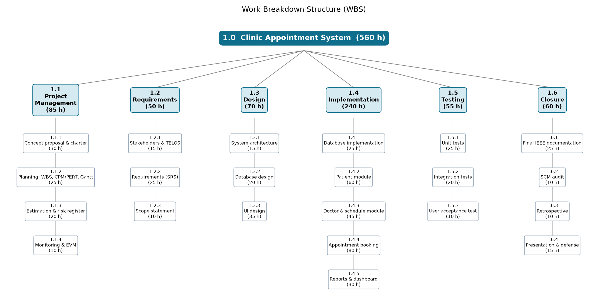

# Scope Statement, Assumptions & Constraints

| | |
|---|---|
| **Project** | Clinic Appointment System (CAS) |
| **Course** | SEN4100 Software Project Management, Haliç University |
| **Instructor** | Asst. Prof. M. Fatih Mintaş |
| **Milestone** | Milestone 1 (Week 4) |
| **Version / Date** | 1.0 / 23 October 2026 |
| **Team** | Burak Demir (20091000008), Davut Ayfer (20091000054), Enes Küçükkaya (22091000275), Alper Keskin (24352525053) |

The **Scope Statement** says exactly what we will build and what we will not build. Together with the WBS and the WBS Dictionary (Section 10) it forms the **scope baseline**: the approved scope that we measure changes against.

## 1. Product scope vs project scope

| | Meaning | For CAS |
|---|---|---|
| **Product scope** | The features of the software | A web system for patients, doctors, appointment booking with strict rules, and a manager dashboard, on Python 3 + Flask and Microsoft SQL Server |
| **Project scope** | All the work needed to deliver the product | Planning and management, requirements, design, coding, testing, documentation, source control (Git/GitHub), retrospective and oral defense |

## 2. Deliverables

| # | Deliverable | Milestone |
|---|---|---|
| D1 | Concept proposal, stakeholder analysis, project charter, scope statement, visual WBS and WBS dictionary for 3 core packages | M1 (23 Oct 2026) |
| D2 | Full WBS dictionary (all 22 packages), CPM/PERT network, baseline Gantt chart, effort estimation (FP, COCOMO), risk register | M2 (13 Nov 2026) |
| D3 | SQL Server database scripts: `create_database.sql`, `schema.sql`, `seed.sql` | Sprint 1 (Weeks 4-5) |
| D4 | Working Flask web application (patient, doctor, appointment modules, dashboard) | Sprints 1-3 (Weeks 4-9) |
| D5 | Automated test suite (Python unittest) and test report | Sprint 3 (Weeks 8-9) |
| D6 | Git repository with branch history, release branch `release/v1.0` and tag `v1.0.0` | M3 |
| D7 | Final IEEE documentation, EVM report, SCM audit | M3 (25 Dec 2026) |
| D8 | Retrospective and final presentation / oral defense | M3 (25 Dec 2026) |

## 3. Functional requirements (MoSCoW)

**MoSCoW** is a way to set priority: **M**ust have, **S**hould have, **C**ould have, **W**on't have (this time).

| ID | Requirement | Priority |
|---|---|---|
| FR-1 | The user can add, edit, search and delete patients. | Must |
| FR-2 | The system checks the Turkish national ID (TC Kimlik No) with its checksum rule and rejects invalid numbers. | Must |
| FR-3 | The user can manage departments and doctors, including each doctor's working hours. | Must |
| FR-4 | The system divides each doctor's working hours into 30-minute slots and shows only free slots. | Must |
| FR-5 | The system blocks double booking for a doctor (same doctor, same time). | Must |
| FR-6 | The system blocks double booking for a patient (same patient, same time). | Must |
| FR-7 | The system rejects bookings in the past, on weekends, outside working hours, or more than 90 days ahead. | Must |
| FR-8 | Each appointment has a status: BOOKED, COMPLETED or CANCELLED. The user can cancel or complete an appointment. | Must |
| FR-9 | The user can list and filter appointments (by date, doctor, status). | Should |
| FR-10 | The dashboard shows patient count, appointments today, cancellation rate and doctor utilization (booked slots / available slots this week). | Should |
| FR-11 | The free slots are loaded without reloading the page (JSON query). | Could |
| FR-12 | Online self-booking by patients, SMS reminders. | Won't (this version) |

## 4. Non-functional requirements

| ID | Type | Requirement |
|---|---|---|
| NFR-1 | Data integrity | Double booking is blocked **also in the database** with filtered UNIQUE indexes, foreign keys and check constraints. |
| NFR-2 | Privacy (KVKK) | Only test data is used in development. Personal data stays in the clinic's own SQL Server database. |
| NFR-3 | Usability | A receptionist can book an appointment with a few clicks, on simple screens, in a normal web browser. |
| NFR-4 | Reliability | All automated tests pass before each merge to `develop` and before release. Database tests use a separate test database `ClinicAppointmentDB_Test`. |
| NFR-5 | Portability | Runs on Windows with Python 3 and SQL Server LocalDB `(localdb)\MSSQLLocalDB`. |
| NFR-6 | Maintainability | Code is split into modules (db, scheduling, patients, doctors, appointments, reports) and kept in Git with pull requests. |
| NFR-7 | Cost | Only free or open-source software (0 TL licence cost). |

## 5. User acceptance criteria

The customer (clinic manager) and the sponsor accept the product when:

1. A patient with an invalid TC Kimlik No **cannot** be saved.
2. When booking, only free 30-minute slots inside the doctor's working hours are shown.
3. A second booking for the same doctor and time is **rejected**. A second booking for the same patient and time is **rejected**.
4. Bookings in the past, on Saturday/Sunday, outside the doctor's working hours, or more than 90 days ahead are **rejected**.
5. Cancelling an appointment frees the slot again.
6. The dashboard shows the four numbers and they match a manual count on the seed data.
7. 100% of automated tests pass on a clean install from the GitHub repository.
8. All "Must" requirements (FR-1 to FR-8) are demonstrated in the final demo.

## 6. Out of scope (we will NOT build)

- Online booking by patients (patient portal) and mobile app.
- SMS or e-mail reminders.
- Payments, invoices, insurance (SGK) integration.
- Electronic medical records, prescriptions, lab results.
- User login with roles and passwords (single clinic user in this version).
- Multiple clinics / branches.
- Cloud hosting or production deployment on a real server.
- Integration with the national e-Nabız or MHRS systems.

Note: user login was later moved into scope by change request CR-002 (approved on 5 Nov 2026), see Milestone 2, chapter 2.5.

## 7. Assumptions

- Each team member can work about 12 hours per week (capacity 576 person-hours).
- SQL Server LocalDB, Python 3 and the ODBC driver can be installed on all team laptops.
- The clinic works Monday to Friday. Appointments are 30 minutes.
- Requirements stay mostly stable after Milestone 1.
- The instructor (sponsor) is available for big change decisions.

## 8. Constraints

- **Time:** M1 23 Oct 2026, M2 13 Nov 2026, M3 25 Dec 2026. The system must be finished by 18 Dec 2026 (60 working days).
- **Cost:** effort budget 560 person-hours (BAC 84,000 TL) + 10% management reserve (56 h). No money for software.
- **Capacity:** the team capacity is 576 person-hours (4 x 12 weeks x ~12 h). Plan 560 h + reserve 56 h = 616 h, which is 40 h above capacity. Using the full reserve needs about 1 extra hour per person per week, or a scope cut decided by the Change Control Board (CCB).
- **People:** 4 students, part-time.
- **Technology:** Python 3 + Flask, Microsoft SQL Server (LocalDB), pyodbc, Git/GitHub.
- **Legal:** KVKK rules for personal health data.

## 9. Change control process

**Scope creep** means the scope slowly grows without approval. To stop it, every change follows these steps:

1. **Submit:** Anyone writes a **Change Request (CR)** (what, why, who asks). It is recorded in the backlog file and, on GitHub, as an issue with the label `change-request`.
2. **Log:** The PM gives it a number (CR-001, CR-002, ...) and adds it to the change log.
3. **Impact analysis:** The PM and the module owner estimate the effect on scope, effort (hours), schedule (critical path), cost, quality and risk. They also say which lower-priority item can drop out if needed.
4. **CCB review:** The Change Control Board (PM Burak Demir + module owner) decides. Big changes (milestone date, "Must" requirement, budget above 616 h) go to the instructor as sponsor.
5. **Decision:** Approved or rejected. The decision and the reason are written in the issue.
6. **Update baselines:** If approved, the PM updates the scope statement, WBS, schedule and budget, and the product backlog (`docs/backlog/Product_Backlog.csv` and the GitHub Projects board set up from it).
7. **Implement:** The work is done on a `feature/*` or `bugfix/*` branch and merged into `develop` with a pull request.
8. **Notify and close:** The team and affected stakeholders are informed; the issue is closed.

Small changes (8 person-hours or less, no milestone date change) can be approved by the PM alone, but are still logged.

## 10. Work Breakdown Structure (WBS)

A **WBS** breaks the total work into smaller pieces. It follows the **100% rule**: it holds all the work of the project and nothing more. Our WBS has three levels: the project (level 1), control accounts (level 2) and work packages (level 3). Each work package follows the **8/80 rule** (between 8 and 80 hours). Total = **560 person-hours**.

The WBS tree is shown in Figure 1.3-1. The table below gives the hours of each control account (see Figure 1.3-1 for the same structure as a picture).

| Level 2 (control account) | Work packages | Hours |
|---|---|---|
| 1.1 Project Management | 1.1.1 Concept & charter (30), 1.1.2 Planning (25), 1.1.3 Estimation & risk register (20), 1.1.4 Monitoring & EVM (10) | 85 |
| 1.2 Requirements | 1.2.1 Stakeholders & TELOS (15), 1.2.2 SRS (25), 1.2.3 Scope statement (10) | 50 |
| 1.3 Design | 1.3.1 Architecture (15), 1.3.2 Database design (20), 1.3.3 UI design (35) | 70 |
| 1.4 Implementation | 1.4.1 Database implementation (25), 1.4.2 Patient module (60), 1.4.3 Doctor & schedule module (45), 1.4.4 Appointment booking (80), 1.4.5 Reports & dashboard (30) | 240 |
| 1.5 Testing | 1.5.1 Unit tests (25), 1.5.2 Integration tests (20), 1.5.3 User acceptance test (10) | 55 |
| 1.6 Closure | 1.6.1 IEEE documentation, incl. README installation & backup guide and KVKK privacy notice (25), 1.6.2 SCM audit (10), 1.6.3 Retrospective (10), 1.6.4 Presentation & defense (15) | 60 |
| **Total** | | **560** |

### 10.1 WBS Dictionary (three core work packages)

The **WBS Dictionary** describes each work package so nobody is confused about what "done" means.

**1.4.1 Database implementation**

| Field | Value |
|---|---|
| Description | Create the SQL Server database `ClinicAppointmentDB` on `(localdb)\MSSQLLocalDB`. Write `create_database.sql`, `schema.sql` (tables departments, doctors, patients, appointments; keys, check constraints, filtered UNIQUE indexes against double booking) and `seed.sql` (test data). Write the connection layer `db.py` with pyodbc. |
| Owner | Davut Ayfer |
| CPM activity | E (Database design & implementation) |
| Planned start / finish | 14 Oct - 22 Oct 2026 (activity E) |
| Predecessors | B (Requirements & stakeholder analysis) |
| Deliverable | D3: `create_database.sql`, `schema.sql`, `seed.sql` and the connection layer `db.py` |
| Effort / cost | 25 person-hours = 3,750 TL |
| Branch | `feature/database` |
| Definition of Done | Scripts run without error on a clean LocalDB; all four tables and indexes exist; inserting a second BOOKED appointment for the same doctor and time fails in the database; `db.py` connects and is used by all modules; separate test database `ClinicAppointmentDB_Test` works; ready before the Sprint 1 demo (end of Week 5); merged into `develop` by pull request. |

**1.4.2 Patient module**

| Field | Value |
|---|---|
| Description | Screens and code to add, edit, search, list and delete patients (`patients.py` and templates). Includes TC Kimlik No checksum validation (FR-1, FR-2). |
| Owner | Enes Küçükkaya |
| CPM activity | F (Patient module) - on the critical path |
| Planned start / finish | 23 Oct - 4 Nov 2026 (activity F) |
| Predecessors | D (System & UI design), E (Database design & implementation) |
| Deliverable | Patient module of the web application (part of D4): `patients.py` and patient templates |
| Effort / cost | 60 person-hours = 9,000 TL |
| Branch | `feature/patient-module` |
| Definition of Done | All patient screens work in the browser; invalid national IDs are rejected with a clear message; duplicate national ID is rejected; search by name or ID works; unit tests for the checksum pass; a first version (FR-1, FR-2) is shown at the Sprint 1 demo (end of Week 5); the package is done when activity F finishes on 4 Nov 2026 (Sprint 2); code reviewed and merged into `develop`. |

**1.4.4 Appointment booking module**

| Field | Value |
|---|---|
| Description | The core of the system (`scheduling.py`, `appointments.py`, booking screen). Build 30-minute slots from doctor working hours, show only free slots, book / cancel / complete appointments, and enforce all rules: no double booking for doctor or patient, no past dates, no weekends, only inside working hours, max 90 days ahead (FR-4 to FR-8). |
| Owner | Burak Demir (accountable); Davut Ayfer contributes |
| CPM activity | H (Appointment booking module) - on the critical path |
| Planned start / finish | 4 Nov - 19 Nov 2026 (activity H) |
| Predecessors | F (Patient module), G (Doctor & schedule module) |
| Deliverable | Booking module of the web application (part of D4): `scheduling.py`, `appointments.py`, booking screen and slots API |
| Effort / cost | 80 person-hours = 12,000 TL |
| Branch | `feature/appointment-booking` |
| Definition of Done | Every booking rule has at least one automated test and all tests pass; a double booking is blocked both in the code and by the database index; cancelling frees the slot; statuses BOOKED, COMPLETED, CANCELLED work; a first version (FR-4, FR-5, FR-11) is shown at the Sprint 2 demo; H is planned to finish on 19 Nov 2026; FR-4 to FR-8 are accepted at the Sprint 3 demo (end of Week 9); merged into `develop` by pull request. |

## 11. Backlog and scope baseline repository

The approved scope is stored in our GitHub repository: https://github.com/burakdemirsw/Software-Project-Managment

- The product backlog is defined in `docs/backlog/Product_Backlog.csv`. It holds the user stories **US-1 to US-12** with story points and sprints. Each user story is linked to its requirement (FR-1 to FR-11; US-11 and US-12 cover NFR-1, NFR-4 and NFR-5) and to its WBS work package code. Later it also holds the change requests CR-001 to CR-004.
- The **GitHub Projects** board is set up from that file: one issue per backlog item (the user stories US-1 to US-12), a two-week **Iteration** field (Sprint 1, 2, 3) to match our Water-Scrum-Fall model, and a "Story points" number field. Change requests are issues with the label `change-request`.
- Board link: [GitHub Projects board link - to be added]
- This scope statement is the baseline. Any change after 23 October 2026 must go through the change control process in Section 9.
- Branching: `main` (releases only), `develop` (integration), `feature/*`, `bugfix/*`, `test/*`, `release/v1.0`. Work is merged with pull requests.

## 12. Lifecycle model and delivery cadence

The scope is delivered with a **Hybrid "Water-Scrum-Fall"** lifecycle (full justification in the Project Charter, section 1.2):

- **Water (Weeks 1-3):** concept, charter, scope statement and WBS for Milestone 1. Activity A (initiation) ended on 2 Oct 2026 with a **draft** charter. Work before 23 Oct 2026 ran under this draft charter. The formal charter approval is the M1 gate on 23 Oct 2026. Detailed planning for Milestone 2 (Function Points / COCOMO, CPM/PERT, risk register) continues in parallel until Week 7. This scope statement, the WBS and the WBS dictionary are the baseline. They change only through the change control process (Section 9).
- **Scrum (Weeks 4-9):** the "Must" and "Should" requirements are built in **three two-week sprints**:

| Sprint | Weeks | Dates | Main CPM activities | Requirements delivered | Demo |
|---|---|---|---|---|---|
| Sprint 1 | 4-5 | 19-30 Oct 2026 | E, F, G | Database scripts (D3, activity E) and doctor & schedule module (G, FR-3) finished; first version of the patient module (F): FR-1, FR-2 shown | End of Week 5 (30 Oct) |
| Sprint 2 | 6-7 | 2-13 Nov 2026 | F, H | Patient module (F) finished on 4 Nov; first version of booking (H): FR-4, FR-5, FR-11 | End of Week 7 (13 Nov) |
| Sprint 3 | 8-9 | 16-27 Nov 2026 | H, I, J | Booking (H) finished on 19 Nov: FR-6, FR-7, FR-8 accepted; FR-9, FR-10 dashboard (I); automated tests (J, D5), including the user acceptance test 1.5.3 that runs inside J | End of Week 9 (27 Nov) |

- Some activities cross a sprint boundary by a few days (for example F ends on 4 Nov and H ends on 19 Nov). The baseline Gantt chart in Milestone 2, chapter 2.3 shows the sprints as shaded bands.
- **Fall (Weeks 10-13):** final regression check, IEEE documentation, SCM audit, retrospective and oral defense (M3, 25 Dec 2026).

- **Why this fits the scope:** the requirements are stable (good for a fixed baseline), the riskiest requirements (FR-4 to FR-7, booking rules) are first shown in Sprint 2 and accepted in Sprint 3, so problems are found early, and the fixed course dates set the delivery cadence. The Flask + pyodbc + SQL Server LocalDB integration (with filtered UNIQUE indexes) was new for the team; activity E builds and tests this layer first, so architecture problems appear before the booking module (H).

