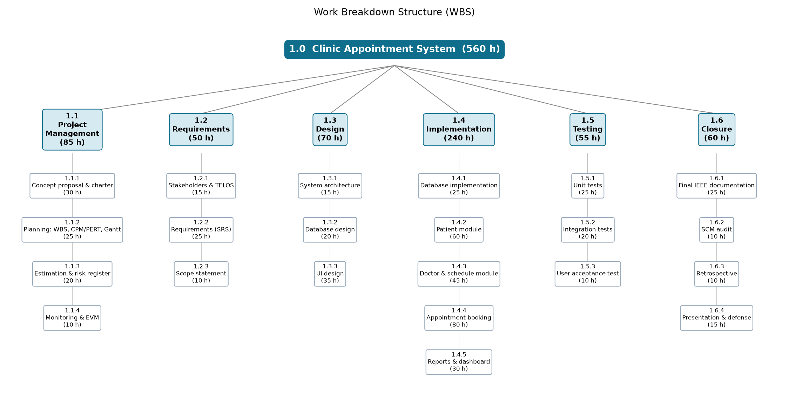
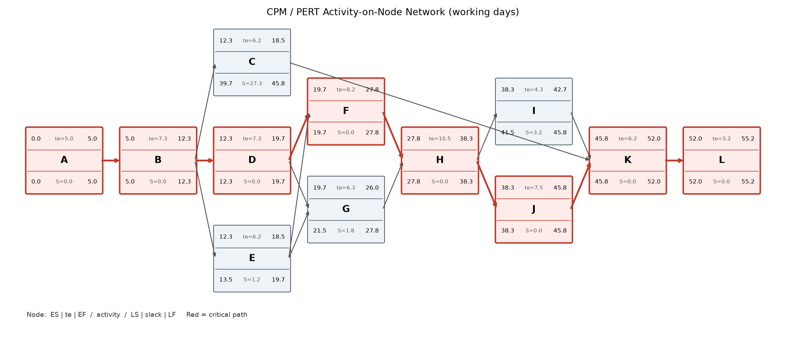
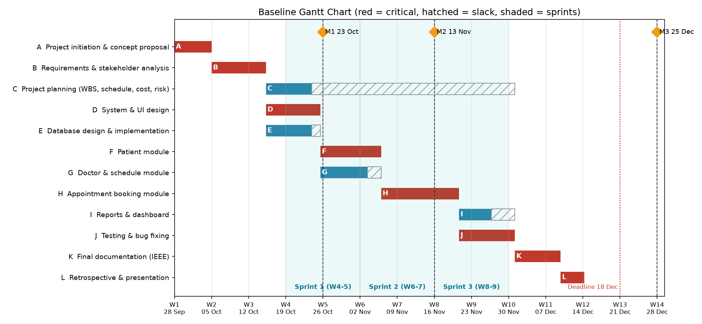
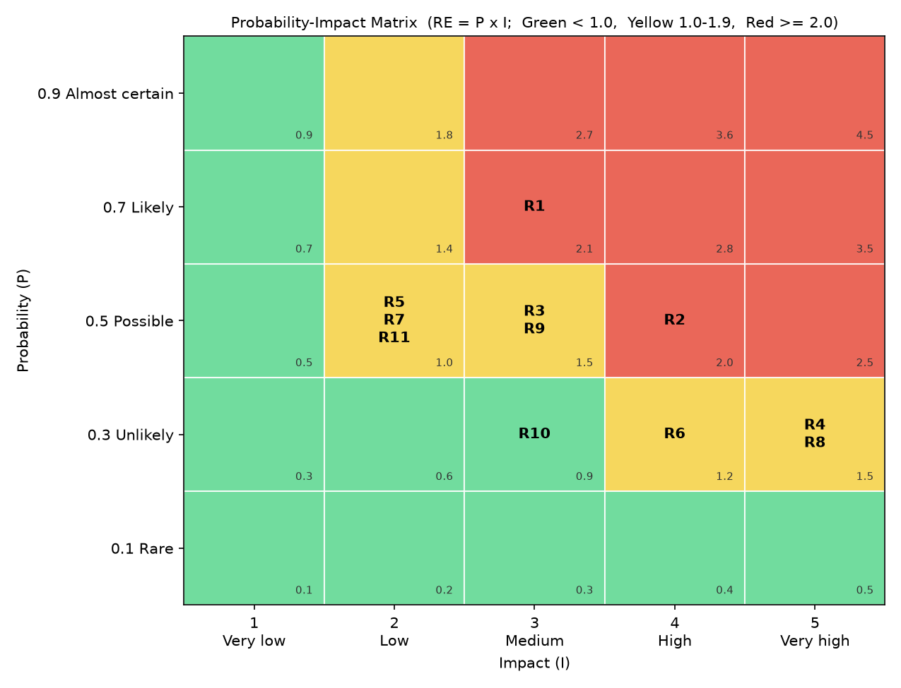

# Milestone 2 Report: Project Planning

| | |
|---|---|
| **Project** | Clinic Appointment System (CAS) |
| **Course** | SEN4100 Software Project Management, Haliç University |
| **Instructor** | Asst. Prof. M. Fatih Mintaş |
| **Milestone** | Milestone 2 (Week 7) |
| **Version / Date** | 1.0 / 13 November 2026 |
| **Team** | Burak Demir (20091000008), Davut Ayfer (20091000054), Enes Küçükkaya (22091000275), Alper Keskin (24352525053) |

This report contains all Milestone 2 deliverables of the Clinic Appointment System project: the WBS and WBS dictionary, the CPM/PERT network and critical path, the baseline Gantt chart with the effort estimation, and the initial risk register. All numbers come from one calculation script (tools/pm_calculations.py).

**Revision history**

| Version | Date | Change |
|---|---|---|
| 1.0 | 13 Nov 2026 | Milestone 2 deliverables: WBS dictionary, CPM/PERT, Gantt, estimation (FP, COCOMO, story points), risk register, resource levelling, change requests. |

## How this report covers the course requirements

| Course requirement (syllabus and lecture notes) | Where in this report |
|---|---|
| Comprehensive Work Breakdown Structure (WBS & Dictionary) (syllabus) | Chapter 2.1 |
| CPM / PERT Network Diagram & Critical Path Calculation (syllabus) | Chapter 2.2 |
| Baseline Gantt Chart & Algorithmic Effort Estimation (syllabus) | Chapter 2.3 Parts A and B |
| Initial Risk Register: identification, qualitative matrix (syllabus) | Chapter 2.4 |
| Effort estimate for every bottom-level work package (Week 5) | Chapter 2.1 sections 5-6 |
| Predictive part: algorithmic estimation, FP sizing converted to hours and cost (Weeks 4-5) | Chapter 2.3 Part B |
| Agile part: story points (Fibonacci) and projected sprint velocity (Weeks 2, 5) | Chapter 2.3 Part C |
| Estimates documented on the GitHub board (Week 4) | Chapter 2.3 Part C (C5); docs/backlog |
| Baseline schedule from the WBS with dependencies and critical path (Week 6) | Chapter 2.2, Chapter 2.3 Part A |
| Risk register with at least 5 risks, mitigation strategies and owners; P-I matrix (Week 6) | Chapter 2.4 |
| Resource loading and levelling of the schedule | Chapter 2.2 |
| Change control after the baseline (scope changes CR-001..CR-005) | Chapter 2.5 |

# 2.1 Work Breakdown Structure (WBS) and WBS Dictionary

## 1. What is a WBS?

A **Work Breakdown Structure (WBS)** is a tree that breaks the whole project scope into smaller pieces of work. It is based on **deliverables** (things we produce), not on time.

- A WBS is **not a schedule**. It does not show order or dependencies. The order is shown in the CPM network (document 2.2).
- A WBS is **not an organization chart**. It breaks down the product and the work, not the people.

Our WBS has three levels:

- **Level 1 - Project:** 1.0 Clinic Appointment System.
- **Level 2 - Control accounts:** big areas of work where we control cost and time. A **control account** is a part of the WBS where the project manager compares planned and actual cost and time. We have six: 1.1 Project Management, 1.2 Requirements, 1.3 Design, 1.4 Implementation, 1.5 Testing and 1.6 Closure.
- **Level 3 - Work packages:** the lowest level. Each work package has one accountable owner (other members may contribute), an effort estimate, a cost, planned dates and a clear "done" rule.

The 22 work packages are also the basis of our product backlog in `docs/backlog/Product_Backlog.csv`. Each backlog item (user stories US-1..US-12 with story points and sprints, and change requests CR-001..CR-004) has a "WBS" column that links it to a work package. This is our **board rule**: every item on the board belongs to a work package, so no work is done outside the WBS. The GitHub Projects board is **not created yet**. It will be set up from this file: a two-week Iteration field (Sprint 1-3), a "Story points" number field and one issue per backlog item. Board link: [GitHub Projects board link - to be added]

## 2. Two rules we follow

### 2.1 The 100% rule

The **100% rule** says: the WBS must contain **all** the work of the project (also project management work) and **nothing more**. If a task is not in the WBS, it gets no time and no budget. So we added management work (charter, planning, EVM report) and closing work (SCM audit, retrospective, presentation) as well.

### 2.2 The 8/80 rule

The **8/80 rule** says: a work package should take **at least 8 hours** and **at most 80 hours** of effort. A package bigger than 80 hours is a "black box" and must be split. A package smaller than 8 hours is too small to track.

## 3. WBS diagram

Figure 2.1-1 shows the WBS as a tree: the project (level 1), the six control accounts (level 2) and the 22 work packages (level 3). Every box shows its planned effort in person-hours, and the root box shows the project total of 560 h.

## 4. WBS outline (levels 1-3)

This outline is the text version of Figure 2.1-1.

- **1.0 Clinic Appointment System** (560 h)
  - **1.1 Project Management** (85 h)
    - 1.1.1 Concept proposal & project charter (30 h)
    - 1.1.2 Planning: WBS, CPM/PERT, Gantt (25 h)
    - 1.1.3 Effort estimation (FP, COCOMO) & risk register (20 h)
    - 1.1.4 Monitoring & EVM report (10 h)
  - **1.2 Requirements** (50 h)
    - 1.2.1 Stakeholder analysis & TELOS feasibility (15 h)
    - 1.2.2 Requirements specification (SRS) (25 h)
    - 1.2.3 Scope statement (10 h)
  - **1.3 Design** (70 h)
    - 1.3.1 System architecture (15 h)
    - 1.3.2 Database design (ER model) (20 h)
    - 1.3.3 User interface design (35 h)
  - **1.4 Implementation** (240 h)
    - 1.4.1 Database implementation (SQL Server scripts, connection layer) (25 h)
    - 1.4.2 Patient module (60 h)
    - 1.4.3 Doctor & schedule module (45 h)
    - 1.4.4 Appointment booking module (80 h)
    - 1.4.5 Reports & dashboard (30 h)
  - **1.5 Testing** (55 h)
    - 1.5.1 Unit tests (25 h)
    - 1.5.2 Integration tests (20 h)
    - 1.5.3 User acceptance test (10 h)
  - **1.6 Closure** (60 h)
    - 1.6.1 Final IEEE documentation (25 h)
    - 1.6.2 SCM audit (10 h)
    - 1.6.3 Retrospective (10 h)
    - 1.6.4 Final presentation & oral defense (15 h)

## 5. WBS Dictionary

The **WBS Dictionary** describes every work package, so that nobody is unsure what the package means. For each package we give the WBS code, name, description, accountable owner, effort, cost, the CPM activity it belongs to (see document 2.2), the planned start and finish dates, the deliverable, and the acceptance criteria.

- **Cost (TL)** = hours x 150 TL (our notional hourly rate). Example: 80 h -> 12,000 TL.
- **Owner** = the one **accountable owner** of the package. Other members may contribute (for example pair work), but one person answers for the result.
- **Planned start / finish** = the dates of the package's CPM activity in the baseline schedule (results.md, "Baseline schedule (calendar dates)"). An activity starts on working day floor(ES) and finishes on working day ceil(EF) - 1, so a successor may start on the same day. Several packages share one activity, so they share its dates. There are two exceptions: 1.1.2 and 1.1.3 run 14 Oct - 13 Nov 2026 (activity C plus updates until M2), and 1.1.4 is level-of-effort work from 23 Oct to 30 Nov 2026 (start of F to end of J). The acceptance criteria are our **Definition of Done (DoD)**: the package is finished only when all of them are true.

### 1.1 Project Management

| Field | 1.1.1 |
|---|---|
| **Name** | Concept proposal & project charter |
| **Description** | Write the project concept proposal (problem, goals, business case with NPV / ROI / payback) and the project charter that officially starts the project. |
| **Owner** | Burak Demir |
| **Effort** | 30 h |
| **Cost (TL)** | 4,500 TL (30 h x 150 TL) |
| **CPM activity** | A - Project initiation & concept proposal |
| **Planned start / finish** | 28 Sep 2026 - 2 Oct 2026 (activity A) |
| **Deliverable** | Concept proposal and project charter documents (Milestone 1) |
| **Acceptance criteria (DoD)** | Charter has objectives, scope summary, budget, milestones and roles; business case numbers are checked; team reviewed it. Activity A ends on 2 Oct 2026 with a **draft** charter; work before approval runs under this draft. Formal charter approval is the M1 gate on 23 Oct 2026. |

| Field | 1.1.2 |
|---|---|
| **Name** | Planning: WBS, CPM/PERT, Gantt |
| **Description** | Build the WBS and WBS Dictionary, the activity list with dependencies, PERT estimates, the CPM network and the baseline Gantt chart. |
| **Owner** | Burak Demir |
| **Effort** | 25 h |
| **Cost (TL)** | 3,750 TL (25 h x 150 TL) |
| **CPM activity** | C - Project planning |
| **Planned start / finish** | 14 Oct 2026 - 13 Nov 2026. Activity C runs 14 Oct - 22 Oct 2026; C has 27.33 days of slack, so the plan is updated in parallel until Week 7 (M2, 13 Nov 2026). |
| **Deliverable** | Documents 2.1, 2.2 and 2.3 Part A |
| **Acceptance criteria (DoD)** | WBS passes the 100% rule and 8/80 rule; every activity has predecessors; critical path and slack are calculated; Gantt dates match the CPM table. |

| Field | 1.1.3 |
|---|---|
| **Name** | Effort estimation (FP, COCOMO) & risk register |
| **Description** | Estimate size with Function Points, convert to KLOC, calculate Basic and Intermediate COCOMO, compare with the WBS estimate, and build the risk register. |
| **Owner** | Burak Demir |
| **Effort** | 20 h |
| **Cost (TL)** | 3,000 TL (20 h x 150 TL) |
| **CPM activity** | C - Project planning |
| **Planned start / finish** | 14 Oct 2026 - 13 Nov 2026. Activity C runs 14 Oct - 22 Oct 2026; the estimates and the risk register are updated inside the slack of C until Week 7 (M2, 13 Nov 2026). |
| **Deliverable** | Documents 2.3 Part B and 2.4 |
| **Acceptance criteria (DoD)** | All FP counts and COCOMO steps are shown; estimate is compared with team capacity; at least 5 risks with P, I, RE, response and owner. |

| Field | 1.1.4 |
|---|---|
| **Name** | Monitoring & EVM report |
| **Description** | Track progress during construction, collect actual hours, and calculate Earned Value metrics (PV, EV, AC, SV, CV, SPI, CPI, EAC). This is a **level-of-effort (LOE)** task: a support task with no own product, which runs alongside the other work. Progress is tracked **weekly from the start of F (23 Oct 2026) to the end of J (30 Nov 2026)** and reported in Milestone 3 (EVM report). For the budget, its 10 h are kept in activity K. |
| **Owner** | Burak Demir |
| **Effort** | 10 h |
| **Cost (TL)** | 1,500 TL (10 h x 150 TL) |
| **CPM activity** | K - Final documentation |
| **Planned start / finish** | 23 Oct 2026 - 30 Nov 2026 (level-of-effort, start of F to end of J). The 10 h budget is kept in activity K (30 Nov - 8 Dec 2026), where the EVM report is written. |
| **Deliverable** | EVM status report with S-curve (Milestone 3) |
| **Acceptance criteria (DoD)** | Actual hours are recorded for every activity; all EVM formulas are shown; a short corrective action plan is written. |

### 1.2 Requirements

| Field | 1.2.1 |
|---|---|
| **Name** | Stakeholder analysis & TELOS feasibility |
| **Description** | Identify stakeholders (receptionist, doctors, patients, clinic manager, instructor), map their power and interest, and check feasibility with TELOS (Technical, Economic, Legal, Operational, Schedule). |
| **Owner** | Burak Demir |
| **Effort** | 15 h |
| **Cost (TL)** | 2,250 TL (15 h x 150 TL) |
| **CPM activity** | B - Requirements & stakeholder analysis |
| **Planned start / finish** | 5 Oct 2026 - 14 Oct 2026 (activity B) |
| **Deliverable** | Stakeholder register and TELOS feasibility section |
| **Acceptance criteria (DoD)** | Every stakeholder has needs and an engagement strategy; each TELOS area has a clear result. |

| Field | 1.2.2 |
|---|---|
| **Name** | Requirements specification (SRS) |
| **Description** | Write functional requirements (patients, doctors, booking rules, dashboard) and non-functional requirements (security, usability, data rules). |
| **Owner** | Alper Keskin |
| **Effort** | 25 h |
| **Cost (TL)** | 3,750 TL (25 h x 150 TL) |
| **CPM activity** | B - Requirements & stakeholder analysis |
| **Planned start / finish** | 5 Oct 2026 - 14 Oct 2026 (activity B) |
| **Deliverable** | SRS document |
| **Acceptance criteria (DoD)** | Each requirement has an ID, is testable, and is approved by the team; all booking rules (30-minute slots, no double booking, no past dates, no weekends, working hours, max 90 days, TC Kimlik No check) are written down. |

| Field | 1.2.3 |
|---|---|
| **Name** | Scope statement |
| **Description** | Define what is in scope and out of scope, the main deliverables and the constraints and assumptions. |
| **Owner** | Burak Demir |
| **Effort** | 10 h |
| **Cost (TL)** | 1,500 TL (10 h x 150 TL) |
| **CPM activity** | B - Requirements & stakeholder analysis |
| **Planned start / finish** | 5 Oct 2026 - 14 Oct 2026 (activity B) |
| **Deliverable** | Project scope statement |
| **Acceptance criteria (DoD)** | In-scope and out-of-scope lists exist; scope is approved and becomes the scope baseline for change control. |

### 1.3 Design

| Field | 1.3.1 |
|---|---|
| **Name** | System architecture |
| **Description** | Design the structure of the Flask web application: modules, routes, templates and the connection to SQL Server through pyodbc. |
| **Owner** | Enes Küçükkaya |
| **Effort** | 15 h |
| **Cost (TL)** | 2,250 TL (15 h x 150 TL) |
| **CPM activity** | D - System & UI design |
| **Planned start / finish** | 14 Oct 2026 - 23 Oct 2026 (activity D) |
| **Deliverable** | Architecture diagram and short description |
| **Acceptance criteria (DoD)** | Every module (db, scheduling, patients, doctors, appointments, reports) has a clear job; the team agrees on the folder structure. |

| Field | 1.3.2 |
|---|---|
| **Name** | Database design (ER model) |
| **Description** | Design the ER model with the tables departments, doctors, patients and appointments, keys and constraints. |
| **Owner** | Davut Ayfer |
| **Effort** | 20 h |
| **Cost (TL)** | 3,000 TL (20 h x 150 TL) |
| **CPM activity** | E - Database design & implementation |
| **Planned start / finish** | 14 Oct 2026 - 22 Oct 2026 (activity E) |
| **Deliverable** | ER diagram and table definitions |
| **Acceptance criteria (DoD)** | All tables have primary and foreign keys; the double-booking rule is planned as filtered UNIQUE indexes; design is reviewed by the team. |

| Field | 1.3.3 |
|---|---|
| **Name** | User interface design |
| **Description** | Design the screens: dashboard, patient list and form, doctor list and form, appointment list and booking screen. |
| **Owner** | Enes Küçükkaya |
| **Effort** | 35 h |
| **Cost (TL)** | 5,250 TL (35 h x 150 TL) |
| **CPM activity** | D - System & UI design |
| **Planned start / finish** | 14 Oct 2026 - 23 Oct 2026 (activity D) |
| **Deliverable** | Screen mock-ups and base HTML/CSS layout |
| **Acceptance criteria (DoD)** | Every screen in the SRS has a mock-up; navigation is the same on all pages; the team approves the design. |

### 1.4 Implementation

| Field | 1.4.1 |
|---|---|
| **Name** | Database implementation (SQL Server scripts, connection layer) |
| **Description** | Write create_database.sql, schema.sql and seed.sql for ClinicAppointmentDB on SQL Server LocalDB, and the Python connection layer (db.py) with pyodbc. |
| **Owner** | Davut Ayfer |
| **Effort** | 25 h |
| **Cost (TL)** | 3,750 TL (25 h x 150 TL) |
| **CPM activity** | E - Database design & implementation |
| **Planned start / finish** | 14 Oct 2026 - 22 Oct 2026 (activity E) |
| **Deliverable** | SQL scripts and db.py, merged from feature/database |
| **Acceptance criteria (DoD)** | Scripts run without error on a clean LocalDB; filtered UNIQUE indexes exist; seed data loads; the app can connect; code is reviewed in a pull request. |

| Field | 1.4.2 |
|---|---|
| **Name** | Patient module |
| **Description** | Add, edit, delete and search patients, with TC Kimlik No checksum validation. |
| **Owner** | Enes Küçükkaya |
| **Effort** | 60 h |
| **Cost (TL)** | 9,000 TL (60 h x 150 TL) |
| **CPM activity** | F - Patient module |
| **Planned start / finish** | 23 Oct 2026 - 4 Nov 2026 (activity F) |
| **Deliverable** | patients.py and patient templates, merged from feature/patient-module |
| **Acceptance criteria (DoD)** | All patient screens work; a wrong TC Kimlik No is rejected; unit tests pass; pull request is reviewed and merged into develop. |

| Field | 1.4.3 |
|---|---|
| **Name** | Doctor & schedule module |
| **Description** | Add, edit and list doctors with department and working hours. |
| **Owner** | Davut Ayfer |
| **Effort** | 45 h |
| **Cost (TL)** | 6,750 TL (45 h x 150 TL) |
| **CPM activity** | G - Doctor & schedule module |
| **Planned start / finish** | 23 Oct 2026 - 2 Nov 2026 (activity G) |
| **Deliverable** | doctors.py and doctor templates, merged from feature/doctor-module |
| **Acceptance criteria (DoD)** | Doctors can be added and edited; working hours are stored and used for free slots; tests pass; pull request merged. |

| Field | 1.4.4 |
|---|---|
| **Name** | Appointment booking module |
| **Description** | Show only free 30-minute slots, book, cancel and complete appointments, and enforce all booking rules in the code (scheduling.py, appointments.py). |
| **Owner** | Burak Demir (accountable); Davut Ayfer contributes |
| **Effort** | 80 h |
| **Cost (TL)** | 12,000 TL (80 h x 150 TL) |
| **CPM activity** | H - Appointment booking module |
| **Planned start / finish** | 4 Nov 2026 - 19 Nov 2026 (activity H) |
| **Deliverable** | Booking feature, merged from feature/appointment-booking (and bugfix/double-booking-index) |
| **Acceptance criteria (DoD)** | No double booking for doctor or patient (code and database); no past dates, weekends, times outside working hours or more than 90 days ahead; statuses BOOKED / COMPLETED / CANCELLED work; tests pass. |

| Field | 1.4.5 |
|---|---|
| **Name** | Reports & dashboard |
| **Description** | Dashboard with patient count, appointments today, cancellation rate and doctor utilization (booked slots / available slots this week). |
| **Owner** | Enes Küçükkaya |
| **Effort** | 30 h |
| **Cost (TL)** | 4,500 TL (30 h x 150 TL) |
| **CPM activity** | I - Reports & dashboard |
| **Planned start / finish** | 19 Nov 2026 - 25 Nov 2026 (activity I) |
| **Deliverable** | reports.py and dashboard page, merged from feature/dashboard |
| **Acceptance criteria (DoD)** | All four numbers are shown and checked by hand against the database; page loads without error. |

### 1.5 Testing

| Field | 1.5.1 |
|---|---|
| **Name** | Unit tests |
| **Description** | Write automated tests with Python unittest for validation and scheduling rules. |
| **Owner** | Alper Keskin |
| **Effort** | 25 h |
| **Cost (TL)** | 3,750 TL (25 h x 150 TL) |
| **CPM activity** | J - Testing & bug fixing |
| **Planned start / finish** | 19 Nov 2026 - 30 Nov 2026 (activity J) |
| **Deliverable** | app/tests/test_clinic.py, merged from test/unit-tests |
| **Acceptance criteria (DoD)** | Every booking rule and the TC Kimlik No check has at least one test; all tests pass. |

| Field | 1.5.2 |
|---|---|
| **Name** | Integration tests |
| **Description** | Test the modules together with the real SQL Server test database ClinicAppointmentDB_Test. |
| **Owner** | Alper Keskin |
| **Effort** | 20 h |
| **Cost (TL)** | 3,000 TL (20 h x 150 TL) |
| **CPM activity** | J - Testing & bug fixing |
| **Planned start / finish** | 19 Nov 2026 - 30 Nov 2026 (activity J) |
| **Deliverable** | Database tests and test report |
| **Acceptance criteria (DoD)** | Tests run on the separate test database only; double booking is blocked by the database indexes; all found bugs are fixed or logged. |

| Field | 1.5.3 |
|---|---|
| **Name** | User acceptance test |
| **Description** | A user (acting as receptionist) runs real scenarios: register patient, book, cancel, complete, read dashboard. |
| **Owner** | Alper Keskin |
| **Effort** | 10 h |
| **Cost (TL)** | 1,500 TL (10 h x 150 TL) |
| **CPM activity** | J - Testing & bug fixing |
| **Planned start / finish** | 19 Nov 2026 - 30 Nov 2026 (activity J) |
| **Deliverable** | UAT checklist with results |
| **Acceptance criteria (DoD)** | All UAT scenarios pass; no open critical bugs; sign-off by the PM. |

### 1.6 Closure

| Field | 1.6.1 |
|---|---|
| **Name** | Final IEEE documentation |
| **Description** | Collect all project documents into the final report in IEEE format. |
| **Owner** | Alper Keskin |
| **Effort** | 25 h |
| **Cost (TL)** | 3,750 TL (25 h x 150 TL) |
| **CPM activity** | K - Final documentation (IEEE) |
| **Planned start / finish** | 30 Nov 2026 - 8 Dec 2026 (activity K) |
| **Deliverable** | Final project report (Milestone 3) |
| **Acceptance criteria (DoD)** | All sections are complete; figures and numbers match results.md; team has reviewed it. |

| Field | 1.6.2 |
|---|---|
| **Name** | SCM audit |
| **Description** | Check the Git repository: branches, pull requests, merges, release/v1.0 and tag v1.0.0. |
| **Owner** | Alper Keskin |
| **Effort** | 10 h |
| **Cost (TL)** | 1,500 TL (10 h x 150 TL) |
| **CPM activity** | K - Final documentation (IEEE) |
| **Planned start / finish** | 30 Nov 2026 - 8 Dec 2026 (activity K) |
| **Deliverable** | SCM audit report |
| **Acceptance criteria (DoD)** | Every planned branch exists and is merged by pull request; main has only releases; tag v1.0.0 points to the released code. |

| Field | 1.6.3 |
|---|---|
| **Name** | Retrospective |
| **Description** | Team meeting about what went well, what went badly and lessons learned. |
| **Owner** | Burak Demir (accountable); all members contribute |
| **Effort** | 10 h |
| **Cost (TL)** | 1,500 TL (10 h x 150 TL) |
| **CPM activity** | L - Retrospective & presentation |
| **Planned start / finish** | 9 Dec 2026 - 14 Dec 2026 (activity L) |
| **Deliverable** | Lessons-learned section |
| **Acceptance criteria (DoD)** | Every member gives input; at least three lessons with actions are written. |

| Field | 1.6.4 |
|---|---|
| **Name** | Final presentation & oral defense |
| **Description** | Prepare slides and a live demo, and present the project to the instructor. |
| **Owner** | Burak Demir (accountable); all members contribute |
| **Effort** | 15 h |
| **Cost (TL)** | 2,250 TL (15 h x 150 TL) |
| **CPM activity** | L - Retrospective & presentation |
| **Planned start / finish** | 9 Dec 2026 - 14 Dec 2026 (activity L) |
| **Deliverable** | Slides and live demo (Milestone 3, Week 13) |
| **Acceptance criteria (DoD)** | Demo runs without error; every member presents a part; questions are answered. |

## 6. Check of the 100% rule and the 8/80 rule

| WBS | Work package | Owner | Hours | 8 <= h <= 80? |
|---|---|---|---|---|
| 1.1.1 | Concept proposal & project charter | Burak Demir | 30 | Yes |
| 1.1.2 | Planning: WBS, CPM/PERT, Gantt | Burak Demir | 25 | Yes |
| 1.1.3 | Effort estimation (FP, COCOMO) & risk register | Burak Demir | 20 | Yes |
| 1.1.4 | Monitoring & EVM report | Burak Demir | 10 | Yes |
| 1.2.1 | Stakeholder analysis & TELOS feasibility | Burak Demir | 15 | Yes |
| 1.2.2 | Requirements specification (SRS) | Alper Keskin | 25 | Yes |
| 1.2.3 | Scope statement | Burak Demir | 10 | Yes |
| 1.3.1 | System architecture | Enes Küçükkaya | 15 | Yes |
| 1.3.2 | Database design (ER model) | Davut Ayfer | 20 | Yes |
| 1.3.3 | User interface design | Enes Küçükkaya | 35 | Yes |
| 1.4.1 | Database implementation | Davut Ayfer | 25 | Yes |
| 1.4.2 | Patient module | Enes Küçükkaya | 60 | Yes |
| 1.4.3 | Doctor & schedule module | Davut Ayfer | 45 | Yes |
| 1.4.4 | Appointment booking module | Burak Demir (Davut Ayfer contributes) | 80 | Yes (upper limit) |
| 1.4.5 | Reports & dashboard | Enes Küçükkaya | 30 | Yes |
| 1.5.1 | Unit tests | Alper Keskin | 25 | Yes |
| 1.5.2 | Integration tests | Alper Keskin | 20 | Yes |
| 1.5.3 | User acceptance test | Alper Keskin | 10 | Yes |
| 1.6.1 | Final IEEE documentation | Alper Keskin | 25 | Yes |
| 1.6.2 | SCM audit | Alper Keskin | 10 | Yes |
| 1.6.3 | Retrospective | Burak Demir (all contribute) | 10 | Yes |
| 1.6.4 | Final presentation & oral defense | Burak Demir (all contribute) | 15 | Yes |
| | **Total** | | **560** | |

**Totals per control account (100% rule):**

| Control account | Hours |
|---|---|
| 1.1 Project Management | 85 |
| 1.2 Requirements | 50 |
| 1.3 Design | 70 |
| 1.4 Implementation | 240 |
| 1.5 Testing | 55 |
| 1.6 Closure | 60 |
| **1.0 Project total** | **560** |

- **100% rule:** the 22 work packages add up to **560 person-hours**, the same as the six control accounts and the project total. No work is missing and no work is counted twice.
- **8/80 rule:** the smallest packages are 10 h and the largest is 80 h (1.4.4). All packages are inside the 8-80 h range. Package 1.4.4 is exactly at the upper limit, so we watch it closely (it is also on the critical path, see document 2.2). The change requests (section below) are separate CR work items, so they do not push 1.4.4 or any other package above 80 h.

**Cost per control account (hours x 150 TL):**

| Control account | Hours | Cost (TL) |
|---|---|---|
| 1.1 Project Management | 85 | 12,750 |
| 1.2 Requirements | 50 | 7,500 |
| 1.3 Design | 70 | 10,500 |
| 1.4 Implementation | 240 | 36,000 |
| 1.5 Testing | 55 | 8,250 |
| 1.6 Closure | 60 | 9,000 |
| **1.0 Project total** | **560** | **84,000** |

- **Cost:** 560 h x 150 TL = **84,000 TL** (Budget at Completion, BAC). A management reserve of 10% (56 h) is kept by the project manager for unknown problems.
- **Capacity:** the team capacity is 576 h (4 x 12 weeks x ~12 h). The plan (560 h) fits. Plan plus reserve is 560 + 56 = 616 h, which is 40 h above capacity. If the full reserve is used, each member needs about 1 extra hour per week, or the Change Control Board (CCB) decides a scope cut.
- **Change requests:** on 5 Nov 2026 (Week 6, after the M1 baseline, before the M2 submission) four change requests were requested and approved; the CCB (Burak Demir as chair, with the module owner) wrote its decision in the change log on 8 Nov 2026. The approved requests are CR-001 corporate UI and logo (12 h), CR-002 login with ADMIN/RECEPTIONIST roles (16 h; this moves "user login" from out of scope into scope), CR-003 departments and appointment reasons screens (12 h) and CR-004 reporting page with CSV export (14 h). They were implemented 5-8 Nov 2026. Together they need 54 h, taken from the 56 h management reserve (2 h left). CR-005 (appointment status structure) is **on hold**.
- **How change requests are tracked:** CR-001..CR-004 are **separate CR work items**. They are not added to the 22 work packages, so no package goes above 80 h, the 8/80 rule still holds, and the baseline of 560 h and BAC of 84,000 TL stay the same. Each CR item is linked to the package it changes:

| Change request | Hours (reserve) | Linked work package(s) |
|---|---|---|
| CR-001 Corporate UI and logo | 12 | 1.3.3 User interface design |
| CR-002 Login with roles | 16 | 1.4.1 Database implementation, 1.4.4 Appointment booking module |
| CR-003 Departments and appointment reasons | 12 | 1.4.3 Doctor & schedule module |
| CR-004 Reporting page with CSV export | 14 | 1.4.5 Reports & dashboard |
| **Total** | **54** | |

- **Packages affected by the changes:** 1.3.2, 1.3.3, 1.4.1, 1.4.3, 1.4.4 and 1.4.5. Package 1.3.2 (database design) is affected because CR-002 and CR-003 add the tables users and appointment_reasons to the ER model. See `docs/Change_Requests.md`.

# 2.2 CPM / PERT Network and Critical Path

## 1. Purpose

The WBS (document 2.1) tells us **what** work we must do. This document tells us **in what order** and **how long**. We use two methods:

- **CPM (Critical Path Method):** finds the longest chain of dependent activities. This chain gives the shortest possible project duration.
- **PERT (Program Evaluation and Review Technique):** uses three time estimates per activity to include uncertainty, and lets us calculate the chance of finishing on time.

All durations are in **working days** (5 days per week).

## 2. Activity list and dependencies

We grouped the 22 WBS work packages into 12 schedule activities (A to L). An **activity** is a piece of work on the time plan. A **predecessor** is an activity that must finish before another can start.

All dependencies are **Finish-to-Start (FS)**: the predecessor must finish before the next activity starts. We did not use Start-to-Start (SS), Finish-to-Finish (FF) or Start-to-Finish (SF) links, to keep the plan simple and clear.

| ID | Activity | Predecessors (FS) | WBS work packages | Hours (WBS) | Owner |
|---|---|---|---|---|---|
| A | Project initiation & concept proposal | - | 1.1.1 | 30 | Burak Demir |
| B | Requirements & stakeholder analysis | A | 1.2.1, 1.2.2, 1.2.3 | 50 | Burak Demir, Alper Keskin |
| C | Project planning (WBS, schedule, cost, risk) | B | 1.1.2, 1.1.3 | 45 | Burak Demir |
| D | System & UI design | B | 1.3.1, 1.3.3 | 50 | Enes Küçükkaya |
| E | Database design & implementation | B | 1.3.2, 1.4.1 | 45 | Davut Ayfer |
| F | Patient module | D, E | 1.4.2 | 60 | Enes Küçükkaya |
| G | Doctor & schedule module | D, E | 1.4.3 | 45 | Davut Ayfer |
| H | Appointment booking module | F, G | 1.4.4 | 80 | Burak Demir, Davut Ayfer |
| I | Reports & dashboard | H | 1.4.5 | 30 | Enes Küçükkaya |
| J | Testing & bug fixing | H | 1.5.1, 1.5.2, 1.5.3 | 55 | Alper Keskin |
| K | Final documentation (IEEE) | C, I, J | 1.1.4, 1.6.1, 1.6.2 | 45 | Alper Keskin (Burak Demir does 1.1.4 as level-of-effort from F to J) |
| L | Retrospective & presentation | K | 1.6.3, 1.6.4 | 25 | All members |
| | **Total** | | **22 work packages** | **560** | |

Every WBS work package belongs to exactly one activity, and the hours add up to 560 h. So the schedule also covers 100% of the scope.

## 3. PERT three-point estimates

For each activity the owner gave three estimates:

- **O (Optimistic):** everything goes perfectly.
- **M (Most likely):** normal work.
- **P (Pessimistic):** many things go wrong.

Formulas:

- Expected time: **te = (O + 4M + P) / 6**
- Variance: **Var = ((P - O) / 6)^2**

| ID | Activity | Predecessors | O | M | P | te = (O+4M+P)/6 | Variance ((P-O)/6)^2 |
|---|---|---|---|---|---|---|---|
| A | Project initiation & concept proposal | - | 3 | 5 | 7 | 5.00 | 0.444 |
| B | Requirements & stakeholder analysis | A | 5 | 7 | 11 | 7.33 | 1.000 |
| C | Project planning (WBS, schedule, cost, risk) | B | 4 | 6 | 9 | 6.17 | 0.694 |
| D | System & UI design | B | 5 | 7 | 11 | 7.33 | 1.000 |
| E | Database design & implementation | B | 4 | 6 | 9 | 6.17 | 0.694 |
| F | Patient module | D, E | 5 | 8 | 12 | 8.17 | 1.361 |
| G | Doctor & schedule module | D, E | 4 | 6 | 10 | 6.33 | 1.000 |
| H | Appointment booking module | F, G | 7 | 10 | 16 | 10.50 | 2.250 |
| I | Reports & dashboard | H | 3 | 4 | 7 | 4.33 | 0.444 |
| J | Testing & bug fixing | H | 5 | 7 | 12 | 7.50 | 1.361 |
| K | Final documentation (IEEE) | C, I, J | 4 | 6 | 9 | 6.17 | 0.694 |
| L | Retrospective & presentation | K | 2 | 3 | 5 | 3.17 | 0.250 |

Example for activity H: te = (7 + 4 x 10 + 16) / 6 = 63 / 6 = 10.50 days. Variance = ((16 - 7) / 6)^2 = 1.5^2 = 2.250.

The PERT formula gives most weight to M, but P pulls the result a little higher. This gives a safer plan than one single guess.

**Effort (h) and people per activity**

The durations above are **calendar working days**, not effort. **Duration** is how long an activity is open on the calendar. **Effort** is how many person-hours of work it needs (from the WBS, document 2.1). If we divide effort by duration (and by the number of people), we get the **planned load**: how many hours per working day each person must work on that activity.

| ID | Effort (h) | People (from the baseline schedule) | No. of people | te (days) | Planned load (h per person per working day) |
|---|---|---|---|---|---|
| A | 30 | Burak Demir | 1 | 5.00 | 6.0 |
| B | 50 | Burak Demir, Alper Keskin | 2 | 7.33 | 3.4 |
| C | 45 | Burak Demir | 1 | 6.17 | 7.3 |
| D | 50 | Enes Küçükkaya | 1 | 7.33 | 6.8 |
| E | 45 | Davut Ayfer | 1 | 6.17 | 7.3 |
| F | 60 | Enes Küçükkaya | 1 | 8.17 | 7.3 |
| G | 45 | Davut Ayfer | 1 | 6.33 | 7.1 |
| H | 80 | Burak Demir, Davut Ayfer | 2 | 10.50 | 3.8 |
| I | 30 | Enes Küçükkaya | 1 | 4.33 | 6.9 |
| J | 55 | Alper Keskin | 1 | 7.50 | 7.3 |
| K | 45 | Alper Keskin | 1 | 6.17 | 7.3 |
| L | 25 | All members | 4 | 3.17 | 2.0 |
| **Total** | **560** | | | | |

Example for activity F: 60 h / 8.17 days = about 7.3 h per working day for Enes. Our normal capacity is about 12 h per person per week, which is about 2.4 h per working day. So many activities need much more than a normal day when one person does them alone. Section 8 (Resource loading) shows this week by week and explains how we level it.

## 4. AON network diagram

In an **Activity-on-Node (AON)** diagram, each box is an activity and each arrow is a dependency. The red path is the critical path (see Figure 2.2-1).

Figure 2.2-1 shows all 12 activities A to L. Each box holds ES, te and EF on the top line, and LS, slack and LF on the bottom line (values rounded to one decimal). The red boxes and arrows form the critical path A -> B -> D -> F -> H -> J -> K -> L.

## 5. Forward pass and backward pass

### 5.1 Forward pass (early dates)

The **forward pass** goes from the start to the end of the network.

- **ES (Early Start):** the earliest day an activity can start. ES = the largest EF of all its predecessors (0 for the first activity).
- **EF (Early Finish):** EF = ES + te.

Examples:

- F has two predecessors, D (EF 19.67) and E (EF 18.50). So ES(F) = max(19.67, 18.50) = 19.67.
- H waits for F (EF 27.83) and G (EF 26.00). So ES(H) = 27.83.
- K waits for C (EF 18.50), I (EF 42.67) and J (EF 45.83). So ES(K) = 45.83.
- The last activity L finishes at EF = **55.17**. This is the expected project duration.

### 5.2 Backward pass (late dates)

The **backward pass** goes from the end back to the start. We start with LF(L) = 55.17.

- **LF (Late Finish):** the latest day an activity can finish without delaying the project. LF = the smallest LS of all its successors.
- **LS (Late Start):** LS = LF - te.

Examples:

- H has two successors, I (LS 41.50) and J (LS 38.33). So LF(H) = min(41.50, 38.33) = 38.33.
- B has three successors, C (LS 39.67), D (LS 12.33) and E (LS 13.50). So LF(B) = 12.33.

### 5.3 Slack

**Slack (float)** is how many days an activity can be late without making the whole project late.

**Slack = LS - ES = LF - EF**

### 5.4 CPM table

| ID | te | ES | EF | LS | LF | Slack | Critical |
|---|---|---|---|---|---|---|---|
| A | 5.00 | 0.00 | 5.00 | 0.00 | 5.00 | 0.00 | YES |
| B | 7.33 | 5.00 | 12.33 | 5.00 | 12.33 | 0.00 | YES |
| C | 6.17 | 12.33 | 18.50 | 39.67 | 45.83 | 27.33 | no |
| D | 7.33 | 12.33 | 19.67 | 12.33 | 19.67 | 0.00 | YES |
| E | 6.17 | 12.33 | 18.50 | 13.50 | 19.67 | 1.17 | no |
| F | 8.17 | 19.67 | 27.83 | 19.67 | 27.83 | 0.00 | YES |
| G | 6.33 | 19.67 | 26.00 | 21.50 | 27.83 | 1.83 | no |
| H | 10.50 | 27.83 | 38.33 | 27.83 | 38.33 | 0.00 | YES |
| I | 4.33 | 38.33 | 42.67 | 41.50 | 45.83 | 3.17 | no |
| J | 7.50 | 38.33 | 45.83 | 38.33 | 45.83 | 0.00 | YES |
| K | 6.17 | 45.83 | 52.00 | 45.83 | 52.00 | 0.00 | YES |
| L | 3.17 | 52.00 | 55.17 | 52.00 | 55.17 | 0.00 | YES |

## 6. Critical path

The **critical path** is the longest path through the network. All its activities have **zero slack**. If one of them is 1 day late, the whole project is 1 day late.

- **Critical path: A -> B -> D -> F -> H -> J -> K -> L**
- Length: 5.00 + 7.33 + 7.33 + 8.17 + 10.50 + 7.50 + 6.17 + 3.17 = **55.17 working days** (about 11.0 weeks).

Non-critical activities and their slack:

| ID | Activity | Slack (days) | What it means |
|---|---|---|---|
| C | Project planning | 27.33 | Very flexible. It only must be done before final documentation (K). But Milestone 2 is due on 13 Nov, so we do the main planning early (14-22 Oct) and update the plan documents (1.1.2, 1.1.3) until M2. |
| E | Database design & implementation | 1.17 | Almost critical. A delay of more than about 1 day makes it critical. |
| G | Doctor & schedule module | 1.83 | Almost critical. Watch closely. |
| I | Reports & dashboard | 3.17 | Small buffer. |

**Management focus:** the appointment booking module (H) is the longest activity (10.50 days), has the largest variance (2.250), and is on the critical path. The PM checks its progress twice a week.

## 7. Probability of meeting the deadline

Our deadline is **60 working days** (end of Week 12, 18 December 2026).

Step 1 - Variance of the critical path = sum of the variances of the critical activities:

0.444 + 1.000 + 1.000 + 1.361 + 2.250 + 1.361 + 0.694 + 0.250 = **8.361**

Step 2 - Standard deviation: sigma = square root of 8.361 = **2.89 days**

Step 3 - Z value (how many standard deviations the deadline is above the expected time):

Z = (Deadline - Expected duration) / sigma = (60 - 55.17) / 2.89 = **1.67**

Step 4 - We look up Z = 1.67 in the standard **normal distribution** table:

**P(T <= 60) = 95.3%**

So there is about a **95% chance** that we finish within 60 working days. We also calculated other target days:

| Target (working days) | Probability to finish by then |
|---|---|
| 55 | 47.7% |
| 58 | 83.6% |
| 60 (deadline) | **95.3%** |
| 62 | 99.1% |

Note: finishing in 55 days has only about a 50% chance, because 55 is close to the expected value. PERT assumes the critical path stays the same; the near-critical activities E and G could change this a little.

## 8. Resource loading

CPM assumes that every activity gets the people it needs. **Resource loading** checks if this is true: we spread the WBS hours of each activity over the weeks in which it runs, and add them up per person. The tables show the planned hours per person per week (W1 = Week 1, starting 28 Sep 2026).

- **Over-allocation** means a person is planned for more hours than they can really work in that week. We use more than 20 h in one week as the warning level.
- **Resource levelling** means we move work between people (or spread it over a longer window), so the weekly peaks become lower. We do not change the durations of critical activities, because that would delay the whole project.

### 8.1 Before levelling (owners only)

In this first table each activity is done only by its owner(s).

| Member | W1 | W2 | W3 | W4 | W5 | W6 | W7 | W8 | W9 | W10 | W11 | W12 | Total | Max/week |
|---|---|---|---|---|---|---|---|---|---|---|---|---|---|---|
| Burak Demir | 30 | 17 | 27 | 26 | 0 | 8 | 19 | 13 | 0 | 0 | 6 | 0 | 146 | 30 |
| Davut Ayfer | 0 | 0 | 19 | 28 | 36 | 15 | 19 | 13 | 0 | 0 | 6 | 0 | 136 | 36 |
| Enes Küçükkaya | 0 | 0 | 18 | 34 | 37 | 21 | 0 | 12 | 18 | 0 | 6 | 0 | 146 | 37 |
| Alper Keskin | 0 | 17 | 8 | 0 | 0 | 0 | 0 | 12 | 37 | 37 | 21 | 0 | 131 | 37 |
| **Team** | 30 | 34 | 73 | 88 | 72 | 44 | 38 | 49 | 55 | 37 | 38 | 1 | 560 | 88 |

### 8.2 After levelling (baseline)

This second table is the **baseline**: it includes the levelling actions below.

| Member | W1 | W2 | W3 | W4 | W5 | W6 | W7 | W8 | W9 | W10 | W11 | W12 | Total | Max/week |
|---|---|---|---|---|---|---|---|---|---|---|---|---|---|---|
| Burak Demir | 30 | 17 | 27 | 26 | 2 | 10 | 21 | 17 | 9 | 2 | 6 | 0 | 167 | 30 |
| Davut Ayfer | 0 | 0 | 19 | 27 | 25 | 13 | 19 | 15 | 6 | 1 | 6 | 0 | 131 | 27 |
| Enes Küçükkaya | 0 | 0 | 13 | 24 | 26 | 15 | 0 | 13 | 24 | 1 | 6 | 0 | 122 | 26 |
| Alper Keskin | 0 | 17 | 13 | 11 | 22 | 8 | 0 | 6 | 18 | 27 | 17 | 0 | 140 | 27 |
| **Team** | 30 | 34 | 73 | 88 | 74 | 46 | 40 | 51 | 57 | 30 | 35 | 1 | 560 | 88 |

The values are rounded to whole hours, so a row or column may differ from its total by about 1 h.

### 8.3 What the tables show

- Average load is 560 h / 4 people / 12 weeks = about 11.7 h per person per week (plan: ~12 h). So the **total** fits our capacity, but the load is not even.
- **Over-allocation before levelling** (more than 20 h in one week): Burak W1 (30 h), Burak W3 (27 h), Burak W4 (26 h), Davut W4 (28 h), Davut W5 (36 h), Enes W4 (34 h), Enes W5 (37 h), Enes W6 (21 h), Alper W9 (37 h), Alper W10 (37 h), Alper W11 (21 h).
- **Levelling actions in the baseline:** Alper Keskin pairs with the module owners in Sprint 1-2 and takes 30% of F (patient module) and G (doctor module); the PM's 1.1.4 Monitoring & EVM (10 h) is spread from the start of F to the end of J as level-of-effort work. Durations do not change, so the critical path stays the same.
- **Remaining peak after levelling:** Burak Demir in Week 1 with 30 h. Peak weeks are planned outside exam days and are watched under risks R1 (member not available) and R3 (effort underestimated).

In simple words: before levelling, the highest weekly load was 37 h (Enes W5, Alper W9 and W10). After levelling, the highest weekly load is 30 h (Burak W1). The peaks happen because one person owns each activity and the activity is short on the calendar (see the planned load in section 3). Levelling moves some hours to a person who has free time in that week (Alper in Weeks 4-6) or spreads them over a longer window (1.1.4). Some weeks are still above 20 h; the PM checks the real hours every week and repeats this check at each sprint planning.

## 9. What if we must finish earlier?

The lecture (Week 6) gives only two real options when the critical path is too long for a deadline:

- **Crashing:** add more people or hours to critical activities. For example, Alper could help on the booking module (H). This **increases cost**. Also, by Brooks's law, a new person on a late task needs time to learn the code, so the gain is small.
- **Fast-tracking:** run activities in parallel that are now in sequence. For example, Alper could start writing unit tests (J) while H is still being built, instead of waiting for H to finish. This **increases risk**, because tests may need rework if the code changes.

At the moment we do **not** need either option: the expected finish (55.17 days) is about 4.8 days before the deadline (60 days), and the probability of success is 95.3%.

# 2.3 Baseline Gantt Chart and Effort Estimation

This document has three parts:

- **Part A** - the baseline schedule (Gantt chart, calendar dates, sprints, milestones).
- **Part B** - algorithmic effort estimation (Function Points and COCOMO), compared with our bottom-up WBS estimate.
- **Part C** - agile estimation for the sprints (story points, velocity, backlog and GitHub Projects board).

---

## Part A - Baseline Schedule

### A1. What is a baseline Gantt chart?

A **Gantt chart** is a bar chart. Each bar is one activity, drawn from its start date to its finish date. It is the easiest way to show the plan to the instructor and other stakeholders.

A **baseline** is the approved version of the plan. We do not change it quietly. Later (Milestone 3) we compare the real progress with this baseline, for example with Earned Value Management (EVM). A change to the baseline needs approval by the Change Control Board.

The dates come from the CPM early dates (ES, EF) in document 2.2. The project starts on **Monday 28 September 2026**. We count only working days (Monday to Friday).

**Date rule:** ES and EF are counted in working days from 28 Sep 2026 (day 0). An activity starts on working day **floor(ES)** and finishes on working day **ceil(EF) - 1**. So a part-day at the end is shown on the last day that the activity uses, and a successor may start on the same day (for example, B finishes on 14 Oct and C, D and E start on 14 Oct).

### A2. Baseline Gantt chart

How to read Figure 2.3-1:

- Each bar is one activity (A to L), drawn from its start date to its finish date. The axis shows course weeks W1 to W14 with the Monday date of each week.
- **Red bars** are critical activities (zero slack). **Blue bars** are non-critical activities. The **hatched** part after a blue bar is its slack (C, E, G and I).
- The **shaded bands** are the three Scrum sprints: Sprint 1 (W4-5), Sprint 2 (W6-7) and Sprint 3 (W8-9).
- The **diamonds** are the course milestones: M1 on 23 Oct, M2 on 13 Nov and M3 on 25 Dec, each with a dashed vertical line.
- The **red dotted line** is the plan deadline, 18 Dec 2026 (working day 60).
- Some activities cross a sprint boundary by a few days, for example G (ends Mon 2 Nov), F (ends Wed 4 Nov), H (ends Thu 19 Nov) and J (ends Mon 30 Nov, one day after Sprint 3). This is normal: the sprint plans the work, and an activity can continue into the next sprint.
- The planned finish is Mon 14 Dec 2026 (end of L), 4 working days before the deadline.

### A3. Baseline calendar

| ID | Activity | Owner | Start | Finish | Duration (days) | Critical |
|---|---|---|---|---|---|---|
| A | Project initiation & concept proposal | Burak Demir | 2026-09-28 | 2026-10-02 | 5.0 | YES |
| B | Requirements & stakeholder analysis | Burak Demir, Alper Keskin | 2026-10-05 | 2026-10-14 | 7.3 | YES |
| C | Project planning (WBS, schedule, cost, risk) | Burak Demir | 2026-10-14 | 2026-10-22 | 6.2 | no |
| D | System & UI design | Enes Küçükkaya | 2026-10-14 | 2026-10-23 | 7.3 | YES |
| E | Database design & implementation | Davut Ayfer | 2026-10-14 | 2026-10-22 | 6.2 | no |
| F | Patient module | Enes Küçükkaya | 2026-10-23 | 2026-11-04 | 8.2 | YES |
| G | Doctor & schedule module | Davut Ayfer | 2026-10-23 | 2026-11-02 | 6.3 | no |
| H | Appointment booking module | Burak Demir, Davut Ayfer | 2026-11-04 | 2026-11-19 | 10.5 | YES |
| I | Reports & dashboard | Enes Küçükkaya | 2026-11-19 | 2026-11-25 | 4.3 | no |
| J | Testing & bug fixing | Alper Keskin | 2026-11-19 | 2026-11-30 | 7.5 | YES |
| K | Final documentation (IEEE) | Alper Keskin | 2026-11-30 | 2026-12-08 | 6.2 | YES |
| L | Retrospective & presentation | All members | 2026-12-09 | 2026-12-14 | 3.2 | YES |

Notes:

- Activities C, D and E run **in parallel** after B, because they are done by different people.
- F and G also run in parallel. Both must finish before H (booking) can start, because booking needs patients and doctors. Because of the date rule, H starts on 4 Nov, the same day on which F uses its last part-day.
- Alper Keskin pairs with Enes on F and with Davut on G in Sprints 1-2 (resource levelling, see document 2.2 section 8). Durations do not change.
- Work packages 1.1.2 and 1.1.3 (in C) run from 14 Oct to 13 Nov: the main planning is done in C, and the plan documents are updated until M2.
- Work package 1.1.4 Monitoring & EVM (Burak Demir) is **level-of-effort** work from 23 Oct to 30 Nov (start of F to end of J). Its budget stays in activity K.
- Activity A ends on 2 Oct 2026 with a **draft** charter. The formal charter approval is the M1 gate on 23 Oct 2026. Work before that date ran under the draft charter.

### A3.1 Lifecycle phases and sprints

Our lifecycle is hybrid **"Water-Scrum-Fall"**:

- **Water (Weeks 1-3):** concept, charter, scope and WBS for M1. Detailed planning (FP/COCOMO, CPM/PERT, risk register for M2) continues in parallel until Week 7.
- **Scrum (Weeks 4-9):** three two-week sprints. Each sprint ends with a demo (end of Weeks 5, 7 and 9).
- **Fall (Weeks 10-13):** final regression check, IEEE documentation, SCM audit, retrospective and oral defense. (The user acceptance test, WBS 1.5.3, runs inside activity J in Sprint 3.)

The Flask + pyodbc + SQL Server LocalDB integration (with filtered UNIQUE indexes) was new for the team; activity E builds and tests this layer first, so architecture problems appear before the booking module (H).

| Sprint | Weeks | Dates | Main activities |
|---|---|---|---|
| Sprint 1 | 4-5 | 2026-10-19 to 2026-10-30 | E, F, G |
| Sprint 2 | 6-7 | 2026-11-02 to 2026-11-13 | F, H |
| Sprint 3 | 8-9 | 2026-11-16 to 2026-11-27 | H, I, J |

Activities may cross a sprint boundary by a few days. For example, F starts in Sprint 1 and ends on 4 Nov in Sprint 2, and H starts in Sprint 2 and ends on 19 Nov in Sprint 3. G ends on Mon 2 Nov, the first day of Sprint 2; this day is kept for fixes after the Sprint 1 demo. Figure 2.3-1 shows this with the shaded sprint bands.

What each sprint demo shows:

- **Sprint 1 demo (end of W5, 30 Oct):** database (E) and doctor & schedule module (G) finished; first version of the patient module (F), with FR-1 and FR-2 shown.
- **Sprint 2 demo (end of W7, 13 Nov):** patient module (F) finished (4 Nov); first version of booking (H) with FR-4, FR-5 and FR-11.
- **Sprint 3 demo (end of W9, 27 Nov):** booking finished on 19 Nov (FR-6, FR-7 and FR-8 accepted), appointment list FR-9 and dashboard FR-10 (I), tests (J, deliverable D5) including the user acceptance test (1.5.3), which runs inside J.

### A4. Milestones

A **milestone** is an important point in time with zero duration, for example a due date.

| Milestone | Date | Week | What is delivered |
|---|---|---|---|
| Project start | Mon 28 Sep 2026 | 1 | Kick-off, start of activity A |
| Draft charter | Fri 2 Oct 2026 | 1 | End of activity A; work continues under the draft charter |
| Milestone 1 | Fri 23 Oct 2026 | 4 | Concept proposal, formal charter approval, stakeholder analysis, first WBS |
| Sprint 1 demo | Fri 30 Oct 2026 | 5 | End of Sprint 1: database (E) and doctor & schedule module (G) finished; patient module (F) first version (FR-1, FR-2) |
| Milestone 2 + Sprint 2 demo | Fri 13 Nov 2026 | 7 | WBS + dictionary, CPM/PERT, baseline Gantt, effort estimation, risk register (this set of documents); end of Sprint 2: F finished, first version of booking (FR-4, FR-5, FR-11) |
| Booking module done | Thu 19 Nov 2026 | 8 | End of activity H, all main features built |
| Sprint 3 demo | Fri 27 Nov 2026 | 9 | End of Sprint 3: FR-6 to FR-10 accepted, tests and user acceptance test shown |
| Testing done | Mon 30 Nov 2026 | 10 | End of activity J, all tests pass |
| Final documentation done | Tue 8 Dec 2026 | 11 | End of activity K |
| Planned project finish | Mon 14 Dec 2026 | 12 | End of activity L (day 55.17) |
| Plan deadline | Fri 18 Dec 2026 | 12 | Day 60, about 4.8 working days of buffer after the planned finish |
| Milestone 3 | Fri 25 Dec 2026 | 13 | Final report, live demo, presentation and oral defense |

---

## Part B - Algorithmic Effort Estimation

Our lifecycle is hybrid, but the up-front planning part is **predictive** (plan-driven). The lecture says a predictive plan should use **algorithmic estimation**. So we use:

1. **Function Point Analysis (FP)** to measure the size of the software.
2. A conversion from FP to **KLOC** (thousands of lines of code), with a three-point LOC check.
3. **COCOMO** (Basic and Intermediate) to turn size into effort and duration.
4. A comparison with our **bottom-up WBS estimate** (560 h) and the team capacity.

### B1. Function Point Analysis

**Function Points** measure size by the functions the user gets, not by lines of code. So the result does not depend on the programming language.

We count five types of items:

- **EI (External Input):** a form or action where the user enters or changes data.
- **EO (External Output):** a screen or report with calculated data.
- **EQ (External Inquiry):** a simple read-only search or list.
- **ILF (Internal Logical File):** a data table that our system maintains.
- **EIF (External Interface File):** data kept by another system that we only read.

Each item gets a weight based on its complexity (Simple, Average, Complex).

#### B1.1 Counted items

| Type | Item | Complexity | Weight |
|---|---|---|---|
| EI | Add patient form | Average | 4 |
| EI | Edit patient form | Average | 4 |
| EI | Delete patient | Simple | 3 |
| EI | Add doctor form | Average | 4 |
| EI | Edit doctor form | Average | 4 |
| EI | Book appointment (with rule checks) | Complex | 6 |
| EI | Cancel appointment | Simple | 3 |
| EI | Complete appointment | Simple | 3 |
| EO | Dashboard (counts, cancellation rate) | Complex | 7 |
| EO | Doctor utilization report | Average | 5 |
| EQ | Search patients | Average | 4 |
| EQ | List doctors | Simple | 3 |
| EQ | List / filter appointments | Average | 4 |
| EQ | Free slots query (JSON) | Average | 4 |
| ILF | Patients table | Simple | 7 |
| ILF | Doctors table | Simple | 7 |
| ILF | Appointments table | Average | 10 |
| ILF | Departments table | Simple | 7 |
| | **Unadjusted Function Points (UFP)** | | **89** |

#### B1.2 Summary by type

| Type | Count | Weighted total |
|---|---|---|
| EI | 8 | 31 |
| EO | 2 | 12 |
| EQ | 4 | 15 |
| ILF | 4 | 31 |
| EIF | 0 | 0 |
| **UFP** | **18** | **89** |

**EIF = 0** because CAS does not read data from any other system. All data lives in our own SQL Server database.

#### B1.3 The 14 General System Characteristics (GSC)

Each characteristic is rated from 0 (no influence) to 5 (strong influence). The sum is the **Total Degree of Influence (TDI)**.

| # | General System Characteristic | Rating (0-5) |
|---|---|---|
| 1 | Data communications | 3 |
| 2 | Distributed data processing | 1 |
| 3 | Performance | 2 |
| 4 | Heavily used configuration | 1 |
| 5 | Transaction rate | 2 |
| 6 | Online data entry | 5 |
| 7 | End-user efficiency | 4 |
| 8 | Online update | 4 |
| 9 | Complex processing | 2 |
| 10 | Reusability | 2 |
| 11 | Installation ease | 2 |
| 12 | Operational ease | 3 |
| 13 | Multiple sites | 1 |
| 14 | Facilitate change | 3 |
| | **Total Degree of Influence (TDI)** | **35** |

Online data entry gets the highest rating (5), because almost all work in CAS is done through web forms.

#### B1.4 Adjusted Function Points

- **VAF (Value Adjustment Factor)** = 0.65 + 0.01 x TDI = 0.65 + 0.01 x 35 = **1.00**
- **FP** = UFP x VAF = 89 x 1.00 = **89.0 function points**

The VAF is exactly 1.00. This means the system characteristics are "average": they do not make the system bigger or smaller.

### B2. From Function Points to KLOC

COCOMO needs size in KLOC. We convert with a factor of **20 LOC per function point** (a typical value for a high-level language like Python, together with HTML and SQL):

- **Size = FP x 20 LOC/FP = 89 x 20 = 1780 LOC = 1.78 KLOC**

#### B2.1 Cross-check: three-point LOC estimate per module

To check this number, each module owner estimated lines of code with three values (O, M, P), like PERT:

| Module | O | M | P | Expected (O+4M+P)/6 |
|---|---|---|---|---|
| Database layer (schema, connection, seed) | 100 | 150 | 250 | 158 |
| Patient module | 150 | 230 | 350 | 237 |
| Doctor module | 120 | 180 | 300 | 190 |
| Appointment booking + rules | 250 | 330 | 500 | 345 |
| Reports & dashboard | 100 | 160 | 250 | 165 |
| User interface (HTML templates, CSS, JS) | 250 | 330 | 500 | 345 |
| Automated tests | 150 | 230 | 350 | 237 |
| **Total** | | | | **1677 LOC = 1.68 KLOC** |

The FP size (1.78 KLOC) and the module estimate (1.68 KLOC) differ by only **+6.2%**. The two methods agree well. We use the FP size (1.78 KLOC) for COCOMO, because it is a little larger and therefore safer.

### B3. Basic COCOMO (organic mode)

**COCOMO** (COnstructive COst MOdel, by Barry Boehm) turns size into effort and time. It is based on data from many past projects.

For **organic mode** the formulas are:

- Effort: **E = 2.4 x KLOC^1.05** (person-months)
- Duration: **D = 2.5 x E^0.38** (months)
- Average staff: **E / D**

Results:

- Effort E = 2.4 x 1.78^1.05 = **4.40 person-months**
- Duration D = 2.5 x 4.40^0.38 = **4.39 months**
- Average staff = E / D = **1.00 full-time people**
- Effort in hours = 4.40 x 152 h per person-month = **668 person-hours**

Basic COCOMO only uses size. It does not know anything about our team or tools. So we also use Intermediate COCOMO.

### B4. Intermediate COCOMO (organic mode)

Intermediate COCOMO adds **15 cost drivers**. Each driver is rated and gives a multiplier. The product of all multipliers is the **EAF (Effort Adjustment Factor)**. A multiplier above 1 increases effort; below 1 decreases it.

| Cost driver | Rating | Multiplier |
|---|---|---|
| RELY - Required reliability | High (health data) | 1.15 |
| DATA - Database size | Low | 0.94 |
| CPLX - Product complexity | Low | 0.85 |
| TIME - Execution time constraint | Nominal | 1.00 |
| STOR - Main storage constraint | Nominal | 1.00 |
| VIRT - Platform volatility | Low | 0.87 |
| TURN - Turnaround time | Low | 0.87 |
| ACAP - Analyst capability | Nominal | 1.00 |
| AEXP - Application experience | Low (students) | 1.13 |
| PCAP - Programmer capability | Nominal | 1.00 |
| VEXP - Platform experience | Nominal | 1.00 |
| LEXP - Language experience | High (Python) | 0.95 |
| MODP - Modern practices | High (Git, tests) | 0.91 |
| TOOL - Software tools | High | 0.91 |
| SCED - Schedule constraint | Nominal | 1.00 |
| **EAF (product)** | | **0.618** |

Why some ratings:

- **RELY High (1.15):** the system stores patient data and a booking error (double booking) affects real people.
- **AEXP Low (1.13):** we are students and have no experience with clinic software.
- **LEXP High, MODP High, TOOL High (below 1):** we know Python, and we use Git, pull requests and automated tests.
- **CPLX Low, DATA Low:** the logic is simple CRUD plus booking rules, and the database is small.
- **SCED Nominal (1.00):** SCED is High only when a plan is **compressed**, that is, when a longer normal plan is squeezed into less time. Our 60-working-day plan is the normal calendar of the course (one semester), not a compressed version of a longer plan. So SCED stays Nominal.

For organic mode, Intermediate COCOMO uses a = 3.2 (instead of 2.4):

- Nominal effort = 3.2 x 1.78^1.05 = 5.86 PM
- Adjusted effort E = 5.86 x 0.618 = **3.62 person-months = 551 person-hours**
- Duration D = 2.5 x 3.62^0.38 = **4.08 months**
- Average staff = **0.89 full-time people**

### B5. Comparison with the bottom-up WBS estimate and team capacity

The **bottom-up estimate** is the sum of the hours of all WBS work packages (document 2.1).

| Method | Effort (person-hours) | Effort (person-months) |
|---|---|---|
| Basic COCOMO (organic) | 668 | 4.40 |
| Intermediate COCOMO (organic, EAF 0.618) | 551 | 3.62 |
| **Bottom-up WBS estimate** | **560** | **3.68** |
| Team capacity (4 students x 12 weeks x ~12 h/week) | 576 | - |

- **Intermediate COCOMO vs WBS:** 551 h vs 560 h, a difference of only **-1.6%**. Two independent methods give almost the same answer. This gives us confidence in the 560 h plan.
- **Basic COCOMO** gives 668 h, which is 108 h more. This is expected: Basic COCOMO does not include our good tools and Python skills.
- **Coverage:** COCOMO covers design, coding, testing and project management of the software; the whole WBS (560 h) has the same coverage, so the full WBS is compared.
- **Capacity:** our capacity (576 h) is a little higher than the plan (560 h), so the plan itself is realistic. The management reserve (56 h, 10%) is kept by the PM. But plan + reserve = 560 h + 56 h = 616 h, which is 40 h above the capacity. So if we use the full reserve, each person needs about 1 extra hour per week, or the Change Control Board (CCB) must decide a scope cut.
- **Reserve use so far:** the change requests CR-001 to CR-004 (requested and approved on 5 Nov 2026, implemented 5-8 Nov) use 54 h of the 56 h reserve, so 2 h are left. They are separate CR work items, not new work packages, so the baseline (22 work packages, 560 h, BAC 84,000 TL) does not change (see docs/Change_Requests.md).
- **Duration:** COCOMO says about 4 months with about **one** full-time person (average staff 0.89-1.00). We are four **part-time** students (about 12 h per week each), so we share this effort between four people. The real time limit is our schedule: 55.17 expected working days inside a 60-day deadline (document 2.2).
- **Cost view:** Basic 668 h x 150 TL = 100,251 TL; Intermediate 551 h x 150 TL = 82,641 TL; WBS 560 h x 150 TL = 84,000 TL (BAC).
- **Budget:** we use the WBS value as the baseline budget: 560 h x 150 TL = **84,000 TL** (BAC, Budget at Completion).

### B6. Conclusion

- **Why organic mode?** Our team is small (4 people), the domain (appointment booking) is familiar and easy to understand, there are no hardware limits, and the requirements are fairly flexible. This is the definition of organic mode. It is not embedded mode, because CAS is not safety-critical firmware and has no hardware constraints.
- **Cone of uncertainty:** at the start of a project, estimates can be wrong by up to 4 times. Our estimate is now better because we made it after the WBS and the requirements were ready, and because three methods (WBS, FP + COCOMO, LOC three-point) agree. We will update the estimate with real hours in Milestone 3 (EVM).
- **Brooks's law:** "adding people to a late software project makes it later", because new people need training and create more communication paths (n(n-1)/2). So if we are late, we will first use the reserve hours and reduce scope, not add new people.

## Part C - Agile Estimation for the Sprints (Story Points)

Our charter declares a **hybrid** lifecycle. The predictive part is estimated with algorithmic models (Part B). The three construction **sprints** (Weeks 4-9, see section A3.1) are planned with **story points**, as the course asks for agile work.

### C1. Story points and Planning Poker

- A **story point** is a relative unit for the size of a backlog item. It mixes volume (how much work), complexity (how hard) and uncertainty (how many unknowns).
- We use the **Fibonacci** scale: 1, 2, 3, 5, 8, 13, 21.
- We estimated with **Planning Poker**: every member chose a card in secret, all cards were shown at the same time, and the highest and lowest voters explained their reasons before a second vote. This avoids **anchoring bias** (people copying the first number they hear).
- The baseline item is US-2 (national ID check) = **2 points**. Other items are compared with it.

### C2. Product backlog with story points

| ID | User story ("As a ... I want ... so that ...") | Requirement | WBS | Points | Sprint |
|---|---|---|---|---|---|
| US-11 | As the team, we want the SQL Server database scripts and connection layer, so that all modules can store data. | NFR-1, NFR-5 | 1.4.1 | 5 | 1 |
| US-1 | As a receptionist, I want to add, edit, search and delete patients, so that patient data is correct. | FR-1 | 1.4.2 | 5 | 1 |
| US-2 | As a receptionist, I want the national ID to be checked, so that wrong IDs are not saved. | FR-2 | 1.4.2 | 2 | 1 |
| US-3 | As an admin, I want to manage departments and doctors with working hours, so that slots can be created. | FR-3 | 1.4.3 | 5 | 1 |
| US-4 | As a receptionist, I want to see only the free 30-minute slots of a doctor, so that I can book quickly. | FR-4, FR-11 | 1.4.4 | 5 | 2 |
| US-5 | As a doctor, I want the system to block double booking, so that I never have two patients at the same time. | FR-5, NFR-1 | 1.4.4 | 3 | 2 |
| US-6 | As a patient, I want the system to block two appointments for me at the same time. | FR-6 | 1.4.4 | 2 | 2 (accepted early in 3) |
| US-7 | As a receptionist, I want past, weekend and out-of-hours bookings to be rejected. | FR-7 | 1.4.4 | 3 | 2 (accepted early in 3) |
| US-8 | As a receptionist, I want to cancel or complete an appointment, so that the status is up to date. | FR-8 | 1.4.4 | 3 | 2 (accepted early in 3) |
| US-9 | As a receptionist, I want to list and filter appointments by date and status. | FR-9 | 1.4.4 | 3 | 3 |
| US-10 | As the clinic manager, I want a dashboard with utilization and cancellation rate, so that I can plan. | FR-10 | 1.4.5 | 5 | 3 |
| US-12 | As the quality lead, I want automated unit and integration tests, so that every merge is safe. | NFR-4 | 1.5.1, 1.5.2 | 8 | 3 |
| | **Total** | | | **49** | |

### C3. Sprint plan and projected velocity

**Velocity** is the number of story points a team finishes in one sprint. We have no velocity from earlier sprints, so we **derive** the planned velocity from our capacity:

- The stories cover WBS 1.4 (construction, 240 h) + 1.5.1 (25 h) + 1.5.2 (20 h) = **285 h**. So 285 h / 49 points = about **5.8 hours per story point**.
- The capacity of one sprint is 4 people x 2 weeks x 12 h = **96 h**.
- 96 h / 5.8 h per point = about 16.5 points. **Planned velocity = 16 story points per sprint** (rounded down to be safe). This also fits 49 points / 3 sprints = about 16.

| Sprint | Weeks | Dates | Stories | Planned points |
|---|---|---|---|---|
| Sprint 1 | 4-5 | 2026-10-19 to 2026-10-30 | US-11, US-1, US-2, US-3 | 17 |
| Sprint 2 | 6-7 | 2026-11-02 to 2026-11-13 | US-4, US-5, US-6, US-7, US-8 | 16 |
| Sprint 3 | 8-9 | 2026-11-16 to 2026-11-27 | US-9, US-10, US-12 | 16 |
| **Total** | | | | **49** |

**Booking stories US-6, US-7, US-8:** they are planned in Sprint 2 and their work starts there. But the booking activity H ends on 19 Nov, so these three stories are finished early in Sprint 3. A story is counted only when it is accepted at a demo, so their 8 points are counted at the Sprint 3 demo. At the Sprint 2 demo we expect 8 accepted points (US-4, US-5); this is planned and is not a velocity problem.

**Check per sprint (hours = points x 5.8 h):**

| Sprint | Points | Planned hours | Capacity | Difference |
|---|---|---|---|---|
| Sprint 1 | 17 | about 99 h | 96 h | +3 h |
| Sprint 2 | 16 | about 93 h | 96 h | -3 h |
| Sprint 3 | 16 | about 93 h + 10 h UAT = 103 h | 96 h | +7 h |
| **Total** | **49** | **285 h + 10 h = 295 h** | **288 h** | **+7 h** |

- **Sprint 1** has 17 points (about 99 h), 3 h over the 96 h capacity. We accept this, because it is covered by pair work (Alper Keskin pairs on D, F and G).
- **User acceptance test:** WBS 1.5.3 (10 h) is not a story, but it runs inside activity J in Sprint 3. So the sprint work is 285 h of stories + 10 h UAT = **295 h**, while three sprints give 3 x 96 h = **288 h**. The 7 h difference is covered by pair work and the spare hours of Sprint 2. So the sprint plan and the WBS estimate match closely.
- After each sprint we compare the accepted points with the plan. If the real velocity is lower, the PM moves the lowest-priority (Should) story to the next sprint.

### C4. Change requests and the backlog

On 5 Nov 2026 four change requests were requested and approved by the Change Control Board (CCB): Burak Demir (chair) with the module owner, Enes Küçükkaya for CR-001 and CR-004, and Davut Ayfer for CR-002 and CR-003. The CCB decision was written in the change log on 8 Nov 2026 (full text in docs/Change_Requests.md):

| ID | Change | Effort (h) | Story points |
|---|---|---|---|
| CR-001 | Corporate UI and logo | 12 | 3 |
| CR-002 | Login with ADMIN / RECEPTIONIST roles (moves "user login" from out of scope into scope) | 16 | 5 |
| CR-003 | Departments and appointment reasons screens | 12 | 3 |
| CR-004 | Reporting page with CSV export | 14 | 5 |
| **Total** | | **54** | **16** |

- CR-001 to CR-004 are in the product backlog (3 + 5 + 3 + 5 = 16 points).
- They are **funded from the management reserve** (54 h of 56 h, 2 h left), not from the 560 h baseline. So they are **outside the 49-point velocity baseline**.
- They were implemented on 5-8 Nov 2026 (Week 6, inside Sprint 2) with these reserve hours. They are separate CR work items and are not added to the 22 work packages, so the 8/80 rule and the 560 h baseline stay valid. The sprint plan of the baseline (C3) does not change (see chapter 2.5).
- CR-005 (a new structure for appointment statuses) is **on hold** and is not in the backlog plan.

### C5. GitHub Projects board

The course asks us to keep the estimates on a GitHub board. The board is **not created yet**.

- The backlog is defined in **docs/backlog/Product_Backlog.csv**: user stories US-1 to US-12 with story points and sprints, plus change requests CR-001 to CR-004.
- The GitHub Projects board is set up from that file:
  - one **issue** per backlog item (16 issues),
  - a two-week **Iteration** field with Sprint 1, Sprint 2 and Sprint 3 (dates as in C3),
  - a **"Story points"** number field.
- Board link: [GitHub Projects board link - to be added]
- A screenshot of the board will be added as Figure 2.3-2 (file figures/github_board.png) when the board is ready.

# 2.4 Risk Register

## 1. Purpose

Our schedule (documents 2.2 and 2.3) is only a plan. Many things can go wrong. **Risk management** means we find these possible problems early and decide what to do about them before they happen.

A **risk** is an uncertain future event. If it happens, it has an effect on the project (time, cost, scope or quality).

## 2. Risk categories (taxonomy)

A **risk taxonomy** is a list of risk groups. It helps us look for risks in every area. We use the four groups from the lecture:

| Category | Meaning | Example in CAS |
|---|---|---|
| **Technical** | Problems with technology, code, tools or quality | Double booking bug, LocalDB setup fails |
| **Project Management** | Problems with estimates, schedule, scope or resources | Effort is underestimated, scope creep |
| **Organizational** | Problems inside the team or organization | A member is not available, poor communication |
| **External** | Problems from outside the project (laws, vendors) | Health data privacy law (KVKK) |

## 3. How we score risks

For every risk we give two numbers:

- **P (Probability):** how likely the risk is to happen, from 0.1 (very unlikely) to 0.9 (very likely).
- **I (Impact):** how bad the effect is if it happens, from 1 (very small) to 5 (very large).

Then we calculate the **Risk Exposure**:

**RE = P x I**

Example: R1 has P = 0.7 and I = 3, so RE = 0.7 x 3 = 2.1.

We put each risk into a zone:

| Zone | RE | What we do |
|---|---|---|
| **Red** | RE >= 2.0 | Critical. Immediate, strong action plan. |
| **Yellow** | 1.0 <= RE < 2.0 | Monitored. We set a trigger and watch it. |
| **Green** | RE < 1.0 | Accepted. Kept on a watch list with little active work. |

## 4. Response strategies

For each risk we choose one strategy:

- **Mitigate:** act now to lower the probability or the impact.
- **Avoid:** change the plan so the risk cannot happen.
- **Transfer:** move the impact to a third party (for example insurance or an outside service).
- **Accept:** do nothing now, because action costs more than the impact. We keep a reserve (our 56 h management reserve) for it. Note: after the change requests of Week 6 (approved on 5 November 2026, logged on 8 November 2026), only 2 h of this reserve are left (see section 6.1 and chapter 2.5).

A **trigger** is an early warning sign that the risk is starting to happen. The **risk owner** is the team member who watches the trigger and starts the action.

## 5. Probability-Impact matrix

A **Probability-Impact matrix** is a grid. Probability is on one axis and impact on the other. Each risk is placed in its cell, and the cell colour shows its zone (Red, Yellow or Green). Figure 2.4-1 shows the 11 baseline risks. R1 and R2 are in the red area. R10 is the only green risk.

The matrix shows the **baseline** scores of 13 November 2026 (version 1.0). The changes after the change requests are described in section 6.1, not drawn in the figure.

## 6. Risk Register

The register is sorted by Risk Exposure (highest first). The description uses the form **cause -> risk -> effect**. The P, I and RE values are the **baseline** values. Section 6.1 shows the status of each risk after the change requests CR-001 to CR-004.

| ID | Description (cause -> risk -> effect) | Category | P | I | RE | Zone | Strategy | Action | Trigger | Owner |
|---|---|---|---|---|---|---|---|---|---|---|
| R1 | Exams, illness or other courses -> a team member is not available for some days -> his work packages are late and the critical path moves. | Organizational | 0.7 | 3 | 2.1 | Red | Mitigate | Shared exam calendar; each module has a second person who knows it (pair reviews in pull requests); code and notes always pushed to GitHub. | A member reports less than 6 h of work in a week, or misses two meetings. | Burak Demir |
| R2 | The instructor or users ask for new or different features after the scope is approved -> requirements change late -> rework and delay of the booking module and tests. | Project Management | 0.5 | 4 | 2.0 | Red | Mitigate | Scope baseline from M1; every change goes through the Change Control Board with an impact check (hours, days); show demos early so feedback comes early. | A change request arrives after Week 7, or a demo gets major comments. | Burak Demir |
| R3 | We are students with little estimation experience -> effort is underestimated -> work takes more hours than the 560 h plan and we pass the deadline. | Project Management | 0.5 | 3 | 1.5 | Yellow | Mitigate | Three estimation methods compared (WBS, FP + COCOMO, LOC); 10% management reserve (56 h); weekly tracking of actual hours; EVM in Milestone 3. | Actual hours of an activity are more than 10% above its plan, or SPI < 0.95. | Burak Demir |
| R4 | Complex booking rules and two users booking at the same time -> a double booking bug in scheduling -> two patients get the same doctor slot; trust in the system is lost. | Technical | 0.3 | 5 | 1.5 | Yellow | Mitigate | Check in the code AND filtered UNIQUE indexes in SQL Server; unit tests for every booking rule; separate bugfix/double-booking-index branch. | A test or a user shows two BOOKED appointments for the same doctor or patient at the same time. | Burak Demir |
| R8 | The system stores names and TC Kimlik No of patients -> a personal health data privacy (KVKK) issue -> legal problem and loss of grade or trust. | External | 0.3 | 5 | 1.5 | Yellow | Avoid | Use only fake test data (seed.sql), never real patient data; database stays on local machines (LocalDB); no data in GitHub except test data. | Someone wants to load real patient data, or real personal data is found in the repo. | Davut Ayfer |
| R9 | Team members like to add "nice" extras -> scope creep (extra features) -> hours are used for things not in the WBS and core work is late. | Project Management | 0.5 | 3 | 1.5 | Yellow | Avoid | Only WBS work is done; new ideas go to a "future work" list; no feature branch without a WBS code; any extra feature needs an approved change request (chapter 2.5). | A pull request contains a feature that is not in the WBS or SRS, or a new change request is written. | Burak Demir |
| R6 | No regular backup of the local database -> data loss (no database backup) -> test data and work are lost and must be rebuilt. | Technical | 0.3 | 4 | 1.2 | Yellow | Mitigate | The whole database can be rebuilt from create_database.sql, schema.sql and seed.sql in Git; tests use a separate database ClinicAppointmentDB_Test. | A script change is not committed, or a laptop or disk problem is reported. | Davut Ayfer |
| R5 | Most of the team has not used Flask and pyodbc before -> low experience with Flask / pyodbc -> slow progress in the first modules. | Technical | 0.5 | 2 | 1.0 | Yellow | Mitigate | Activity E (14-22 Oct, Week 3-4) builds and tests the Flask + pyodbc + LocalDB layer first, as a short learning spike, so problems appear before the booking module H (4-19 Nov); shared code examples for routes and database access; pair programming on the first modules F and G (from 23 Oct). | A member is blocked on a framework problem for more than one day. | Enes Küçükkaya |
| R7 | Four people change the same files at the same time -> merge conflicts in Git -> lost time and broken code in develop. | Technical | 0.5 | 2 | 1.0 | Yellow | Mitigate | GitFlow-light: one feature branch per module, small pull requests, pull develop often, --no-ff merges with review. | A merge conflict takes more than one hour, or develop does not run after a merge. | Alper Keskin |
| R11 | Different Windows versions and drivers on student laptops -> SQL Server LocalDB setup fails on a laptop -> that member cannot run or test the app. | Technical | 0.5 | 2 | 1.0 | Yellow | Mitigate | Written setup guide (LocalDB + ODBC driver); one setup session for all members; a member can use a teammate's machine while it is fixed. | The app cannot connect to (localdb)\MSSQLLocalDB on a member's laptop. | Davut Ayfer |
| R10 | Busy schedules and only online contact -> poor communication in team -> duplicate work or missed tasks. | Organizational | 0.3 | 3 | 0.9 | Green | Accept | Keep normal practice: weekly meeting, group chat, task list in docs/backlog/Product_Backlog.csv. No extra action needed. | A task is done twice, or nobody knows who owns a task. | Burak Demir |

### Summary

| Zone | Risks | Count |
|---|---|---|
| Red | R1, R2 | 2 |
| Yellow | R3, R4, R8, R9, R6, R5, R7, R11 | 8 |
| Green | R10 | 1 |
| **Total** | | **11** |

- The two **red** risks (R1, R2) are about people and scope, not technology. The PM reviews them every week.
- R4 and R8 have the highest impact (5). Even if they are not likely, they would hurt the project badly, so they have strong actions.
- **Why no Transfer?** In a student project there is no insurance or outside company that can take over the impact. The closest thing is that GitHub keeps a copy of our code and scripts, but the risk itself stays with us. So we use Mitigate, Avoid and Accept.

### 6.1 Status after the change requests (Week 6)

Five change requests came in Week 6. They were requested and approved on **5 November 2026** and implemented on **5-8 November 2026** (Week 6). The CCB decision was written in the log on **8 November 2026**. The CCB approved four of them: CR-001 corporate UI and logo (12 h), CR-002 login with ADMIN/RECEPTIONIST roles (16 h), CR-003 departments and appointment reasons screens (12 h) and CR-004 reporting page with CSV export (14 h). Together they use **54 h of the 56 h management reserve**. Only **2 h** are left. CR-005 (appointment status structure) is **on hold**. Details are in chapter 2.5.

The CRs are **separate CR work items**. They are not added to the 22 work packages of the WBS. So the 8/80 rule for the work packages and the baseline (560 h, BAC 84,000 TL) stay valid.

We keep the baseline P x I numbers above, so the M3 report can compare against them. The table below gives the status of every risk after the change requests.

| ID | Baseline RE / Zone | Status after CRs | Strategy after CRs | Owner |
|---|---|---|---|---|
| R1 | 2.1 / Red | No change. Still the top risk. If a member is away, there is almost no reserve to absorb his hours. | Mitigate | Burak Demir |
| R2 | 2.0 / Red | Five change requests came in Week 6 (four approved, CR-005 on hold), before the Week 7 trigger. All went through the CCB (requested and approved 5 Nov, logged 8 Nov). The critical path did not change. Risk stays open. | Mitigate | Burak Demir |
| R3 | 1.5 / Yellow | **Residual exposure is higher.** Any underestimate can now use only 2 h of reserve. Plan 560 h + 54 h CR work = 614 h, which is 38 h above the 576 h team capacity. Response: weekly tracking of actual hours; about 1 extra hour per person per week, or a scope cut decided by the CCB. | Mitigate | Burak Demir |
| R4 | 1.5 / Yellow | No change. CR-003 changed the appointments table (reason_id + notes); the filtered UNIQUE indexes and booking tests still pass (33 tests, measured on 8 Nov 2026). Booking (activity H) runs 4-19 Nov, so the trigger is watched closely in Weeks 6-8. | Mitigate | Burak Demir |
| R8 | 1.5 / Yellow | **Reduced.** CR-002 login: every page needs a signed-in user, passwords are scrypt hashes, and each appointment stores created_by. Fake data and local database rules still apply. | Avoid | Davut Ayfer |
| R9 | 1.5 / Yellow | **Occurred in a controlled way.** Scope grew through CR-001 to CR-004. All four were logged and approved by the CCB; no feature was added without a CR. But 54 of 56 reserve hours are used, so **residual exposure is higher**: the next extra feature has no reserve to pay for it. | Avoid (no new feature without an approved CR and a new estimate; CR-005 stays on hold) | Burak Demir |
| R6 | 1.2 / Yellow | No change. New tables (users, appointment_reasons) are in schema.sql and seed.sql in Git. | Mitigate | Davut Ayfer |
| R5 | 1.0 / Yellow | Slightly higher because of CR-001 (more templates and CSS). | Mitigate | Enes Küçükkaya |
| R7 | 1.0 / Yellow | No change. More files changed, so small pull requests matter more. | Mitigate | Alper Keskin |
| R11 | 1.0 / Yellow | No change. | Mitigate | Davut Ayfer |
| R10 | 0.9 / Green | No change. | Accept | Burak Demir |

- Every risk still has a strategy and an owner.
- **Key message:** the change requests turned R9 from a possible event into a real, controlled one. The danger now is not one more feature, but that **R3 and R9 have no reserve left**. Any new change request must bring its own estimate and a CCB decision on where the hours come from.

## 7. Risk vs issue

A **risk** has not happened yet. It has a probability, and we plan for it. An **issue** is a problem that **has already happened**. It needs action now, not probability analysis.

Example: "A team member may be ill during exam week" is a **risk** (R1). "Enes is ill today and cannot work this week" is an **issue**. When a risk trigger fires and the event happens, the owner moves it to the issue log, and the PM solves it at once (for example, by moving work to the backup person or using reserve hours).

## 8. Monitoring

- The register is reviewed in the **weekly team meeting**.
- Each owner checks his triggers and reports changes in P or I.
- New risks are added; closed risks are marked as closed (not deleted).
- In Milestone 3 we will report which risks happened and how well our responses worked.

## 9. Revision history

| Version | Date | Change |
|---|---|---|
| 1.0 | 13 Nov 2026 | M2 baseline risk register (11 risks) |
| 1.1 | 13 Nov 2026 | Status after change requests CR-001 to CR-005 added (section 6.1); R9 trigger updated; numbered figure caption |
| 1.2 | 13 Nov 2026 | Dates aligned with the new baseline calendar (E 14-22 Oct, H 4-19 Nov); CR timing (approved 5 Nov, logged 8 Nov, implemented 5-8 Nov); CR work items kept separate from the 22 work packages |

# 2.5 Change Requests after the Baseline

## 1. Purpose

The scope baseline was approved at the M1 gate on 23 October 2026. After that, the clinic manager asked for new features. This chapter shows how we handled these requests with **change control**.

A **change request (CR)** is a written request to change the approved scope. We follow the change control process in the Scope Statement (M1 document 1.3, section 9):

1. The request is written down.
2. Its impact on hours, schedule, cost and risks is checked.
3. The **Change Control Board (CCB)** decides. The CCB is the small group that approves or rejects changes. Its chair is the Project Manager (Burak Demir). For each CR he decides together with the owner of the module that the CR changes.
4. The baselines and documents are updated.

Timeline of this round (all in Week 6):

| Step | Date |
|---|---|
| Five change requests written down (CR-001 to CR-005) | 5 Nov 2026 |
| Impact check and CCB approval (CR-001 to CR-004 approved, CR-005 on hold) | 5 Nov 2026 |
| Implementation of CR-001 to CR-004 | 5-8 Nov 2026 |
| CCB decision written in the change log; code size and tests measured | 8 Nov 2026 |

This is after the M1 baseline (23 Oct 2026) and before the M2 submission on 13 November 2026.

## 2. Rule: the baseline is not changed silently

- The scope, schedule and cost **baselines of M1 and M2 stay the same**.
- The baseline effort stays **560 person-hours**. The budget stays **BAC 84,000 TL** (BAC = Budget at Completion, the total planned cost).
- The extra effort of approved changes is taken from the **management reserve (56 hours)**. A management reserve is extra time kept for unknown work. It is not part of the baseline.
- Each CR is a **separate CR work item**. It is **not added** to the 22 work packages of the WBS. So the 8/80 rule for the work packages and the 560 h baseline stay valid.
- This keeps the M2 baseline valid for the Earned Value report in Milestone 3.

## 3. Summary of change requests

| ID | Change | Requested by | Date | Extra effort | Decision |
|---|---|---|---|---|---|
| CR-001 | Corporate user interface and a project logo | Burak Demir (PM, for the clinic manager) | 5 Nov 2026 | 12 h | Approved |
| CR-002 | Login system with user roles | Burak Demir | 5 Nov 2026 | 16 h | Approved |
| CR-003 | Master data screens for departments and appointment reasons | Burak Demir | 5 Nov 2026 | 12 h | Approved |
| CR-004 | Reporting page with filters and Excel (CSV) export | Burak Demir | 5 Nov 2026 | 14 h | Approved |
| CR-005 | Structure for appointment statuses (status table / workflow) | Burak Demir | 5 Nov 2026 | not estimated | **On hold** |
| | **Total approved** | | | **54 h** | Reserve left: **2 h** |

Reserve check: 12 + 16 + 12 + 14 = 54 h. 56 h - 54 h = 2 h left.

All five requests were written down on 5 Nov 2026. CR-001 to CR-004 were approved the same day and implemented on 5-8 Nov 2026 (Week 6). The CCB decision was written in the log on 8 Nov 2026.

## 4. Details

### 4.1 CR-001 Corporate user interface and logo

- **Description:** A new corporate look: sidebar menu, top bar with the signed-in user, KPI cards, consistent tables and forms, and a logo (calendar + medical cross + confirmation tick).
- **Reason:** The clinic manager wants a professional look for the demo and for daily use.
- **Impact:** Only the presentation layer (templates and CSS). No change to business rules. Risk R5 (low Flask experience) is slightly higher. No schedule impact: the work was done on 5-8 Nov (Week 6) with reserve hours, so no activity duration changed.
- **Related WBS package:** 1.3.3 User interface design (the CR is a separate work item).

### 4.2 CR-002 Login system with user roles

- **Description:** Users must sign in. There are two roles:
  - **ADMIN** manages users, departments, reasons and doctors.
  - **RECEPTIONIST** manages patients and appointments.
- Passwords are stored only as salted hashes (scrypt). Each new appointment stores the user who created it. Users can change their own password.
- **Reason:** Patient data is personal health data (KVKK). Only staff may see it (risk R8).
- **Impact:** The M1 scope listed "user login" as **out of scope**. With this CR it moves **into scope**. There is a new table `users` and a new column `appointments.created_by`. All pages now need a signed-in user. This **reduces risk R8** (privacy). New tests cover login, roles and password hashing.
- **Related WBS packages:** 1.4.1 Database implementation and 1.4.4 Appointment module (the CR is a separate work item).

### 4.3 CR-003 Departments and appointment reasons

- **Description:** Admin screens to add and edit departments (name, description, active) and standard appointment reasons. A reason can be general or belong to one department. The booking form shows only the reasons that fit the doctor's department.
- **Reason:** Free-text reasons could not be counted in reports.
- **Impact:** New table `appointment_reasons`. The free-text column `appointments.reason` became `reason_id` + `notes`. Departments got `description` and `is_active`.
- **Related WBS packages:** 1.3.2 Database design, 1.4.3 Doctor & schedule module (the CR is a separate work item).

### 4.4 CR-004 Reporting

- **Description:** A "Reports" page with a date range and a department filter. It shows totals, completed, still booked and cancellation rate. It also shows breakdowns by doctor (with utilization), department, appointment reason, day of the week and hour. All rows can be exported to a CSV file that opens in Excel.
- **Reason:** The clinic manager needs numbers for decisions (objective O3 in the charter).
- **Impact:** Read-only SQL queries. No change to existing data.
- **Related WBS package:** 1.4.5 Reports & dashboard (the CR is a separate work item).

### 4.5 CR-005 Appointment status structure (on hold)

- **Description:** A separate structure for appointment statuses (for example a status table, more statuses such as "no-show", and status history).
- **Decision:** **On hold** by the PM. The current three statuses (BOOKED, COMPLETED, CANCELLED) stay as they are. The team will decide later. If it is approved, it needs a new estimate, because only 2 h of the management reserve are left.

## 5. Baseline and document impact

| Item | Impact |
|---|---|
| Scope statement (M1 1.3) | "User login" moves from out of scope to in scope (CR-002). New features for reasons, departments and reports. |
| WBS (M2 2.1) | No new work packages. The CRs are separate CR work items, paid from the reserve. The 22 work packages, the 8/80 rule and the 560 h baseline do not change. |
| Schedule (M2 2.2, 2.3) | No change to the critical path. The CR work was done on 5-8 Nov (Week 6) with reserve hours; no activity duration changed (booking H still ends 19 Nov, project expected finish 14 Dec, deadline 18 Dec). |
| Cost (M2 2.3) | Baseline stays 560 h / BAC 84,000 TL. Reserve used: 54 of 56 h. |
| Risks (M2 2.4) | R8 (privacy) is lower because of login. R9 (scope creep) **happened in a controlled way**: all changes went through this log. R3 and R9 now have a higher residual exposure, because almost no reserve is left (see 2.4, section 6.1). |
| Code size | Measured size grew from 920 to 1,933 non-blank lines (measured on 8 Nov 2026; the FP estimate was 1.78 KLOC). |
| Tests | Grew from 19 to 33 automated tests (measured on 8 Nov 2026). All pass. |

## 6. Capacity check

- Team capacity is **576 person-hours** (4 members x 12 weeks x ~12 h).
- Baseline plan 560 h + full reserve 56 h = 616 h. This is **40 h above capacity**.
- After the CRs, the plan uses 560 h + 54 h = 614 h.
- So using the reserve needs about **1 extra hour per person per week**, or a **scope cut decided by the CCB**.
- Any new change request (for example CR-005) must come with a new estimate and a decision on where the hours come from.

## 7. Backlog

- CR-001 to CR-004 are added to the product backlog file `docs/backlog/Product_Backlog.csv`, next to the user stories US-1 to US-12. Each CR has its own story points (CR-001 3, CR-002 5, CR-003 3, CR-004 5). These points are kept apart from the 49 user story points, because the CRs are separate work items.
- The GitHub Projects board is **not created yet**. It will be set up from this file: a two-week Iteration field (Sprint 1-3), a "Story points" number field, and one issue per backlog item.
- Board link: [GitHub Projects board link - to be added]

## 8. Approval

| Name | Role | Decision | Approved | Logged |
|---|---|---|---|---|
| Burak Demir | Project Manager, CCB chair (all CRs) | Approved CR-001 to CR-004, CR-005 on hold | 5 Nov 2026 | 8 Nov 2026 |
| Enes Küçükkaya | CCB member, module owner for CR-001 (UI) and CR-004 (reports) | Approved CR-001 and CR-004 | 5 Nov 2026 | 8 Nov 2026 |
| Davut Ayfer | CCB member, module owner for CR-002 (database, users) and CR-003 (departments, reasons) | Approved CR-002 and CR-003 | 5 Nov 2026 | 8 Nov 2026 |
| Asst. Prof. M. Fatih Mintaş | Sponsor | Informed (no milestone date or budget change) | | |

## 9. Revision history

| Version | Date | Change |
|---|---|---|
| 1.0 | 13 Nov 2026 | M2 baseline documents (2.1 to 2.4) |
| 1.1 | 13 Nov 2026 | Change requests CR-001 to CR-005 added (this chapter); risk register 2.4 updated |
| 1.2 | 13 Nov 2026 | CR timeline (approved 5 Nov, implemented 5-8 Nov, logged 8 Nov); CCB table with module owners; CRs kept as separate work items; dates aligned with the new baseline calendar |
