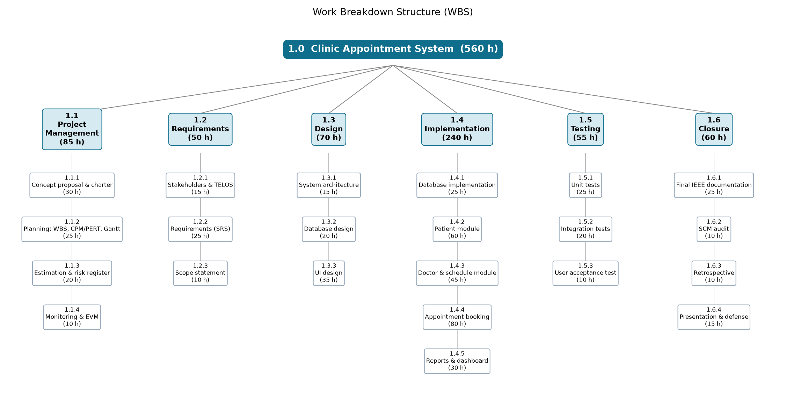

# 2.1 Work Breakdown Structure (WBS) and WBS Dictionary

| | |
|---|---|
| **Project** | Clinic Appointment System (CAS) |
| **Course** | SEN4100 Software Project Management, Haliç University |
| **Instructor** | Asst. Prof. M. Fatih Mintaş |
| **Milestone** | Milestone 2 (Week 7) |
| **Version / Date** | 1.0 / 13 November 2026 |
| **Team** | Burak Demir (20091000008), Davut Ayfer (20091000054), Enes Küçükkaya (22091000275), Alper Keskin (24352525053) |

## 1. What is a WBS?

A **Work Breakdown Structure (WBS)** is a tree that breaks the whole project scope into smaller pieces of work. It is based on **deliverables** (things we produce), not on time.

- A WBS is **not a schedule**. It does not show order or dependencies. The order is shown in the CPM network (document 2.2).
- A WBS is **not an organization chart**. It breaks down the product and the work, not the people.

Our WBS has three levels:

- **Level 1 - Project:** 1.0 Clinic Appointment System.
- **Level 2 - Control accounts:** big areas of work where we control cost and time. A **control account** is a part of the WBS where the project manager compares planned and actual cost and time. We have six: 1.1 Project Management, 1.2 Requirements, 1.3 Design, 1.4 Implementation, 1.5 Testing and 1.6 Closure.
- **Level 3 - Work packages:** the lowest level. Each work package has one accountable owner (other members may contribute), an effort estimate, a cost, planned dates and a clear "done" rule.

The 22 work packages are also the basis of our product backlog in `docs/backlog/Product_Backlog.csv`. Each backlog item (user stories US-1..US-12 with story points and sprints, and change requests CR-001..CR-004) has a "WBS" column that links it to a work package. This is our **board rule**: every item on the board belongs to a work package, so no work is done outside the WBS. The GitHub Projects board is **not created yet**. It will be set up from this file: a two-week Iteration field (Sprint 1-3), a "Story points" number field and one issue per backlog item. Board link: [GitHub Projects board link - to be added]

## 2. Two rules we follow

### 2.1 The 100% rule

The **100% rule** says: the WBS must contain **all** the work of the project (also project management work) and **nothing more**. If a task is not in the WBS, it gets no time and no budget. So we added management work (charter, planning, EVM report) and closing work (SCM audit, retrospective, presentation) as well.

### 2.2 The 8/80 rule

The **8/80 rule** says: a work package should take **at least 8 hours** and **at most 80 hours** of effort. A package bigger than 80 hours is a "black box" and must be split. A package smaller than 8 hours is too small to track.

## 3. WBS diagram

Figure 2.1-1 shows the WBS as a tree: the project (level 1), the six control accounts (level 2) and the 22 work packages (level 3). Every box shows its planned effort in person-hours, and the root box shows the project total of 560 h.

## 4. WBS outline (levels 1-3)

This outline is the text version of Figure 2.1-1.

- **1.0 Clinic Appointment System** (560 h)
  - **1.1 Project Management** (85 h)
    - 1.1.1 Concept proposal & project charter (30 h)
    - 1.1.2 Planning: WBS, CPM/PERT, Gantt (25 h)
    - 1.1.3 Effort estimation (FP, COCOMO) & risk register (20 h)
    - 1.1.4 Monitoring & EVM report (10 h)
  - **1.2 Requirements** (50 h)
    - 1.2.1 Stakeholder analysis & TELOS feasibility (15 h)
    - 1.2.2 Requirements specification (SRS) (25 h)
    - 1.2.3 Scope statement (10 h)
  - **1.3 Design** (70 h)
    - 1.3.1 System architecture (15 h)
    - 1.3.2 Database design (ER model) (20 h)
    - 1.3.3 User interface design (35 h)
  - **1.4 Implementation** (240 h)
    - 1.4.1 Database implementation (SQL Server scripts, connection layer) (25 h)
    - 1.4.2 Patient module (60 h)
    - 1.4.3 Doctor & schedule module (45 h)
    - 1.4.4 Appointment booking module (80 h)
    - 1.4.5 Reports & dashboard (30 h)
  - **1.5 Testing** (55 h)
    - 1.5.1 Unit tests (25 h)
    - 1.5.2 Integration tests (20 h)
    - 1.5.3 User acceptance test (10 h)
  - **1.6 Closure** (60 h)
    - 1.6.1 Final IEEE documentation (25 h)
    - 1.6.2 SCM audit (10 h)
    - 1.6.3 Retrospective (10 h)
    - 1.6.4 Final presentation & oral defense (15 h)

## 5. WBS Dictionary

The **WBS Dictionary** describes every work package, so that nobody is unsure what the package means. For each package we give the WBS code, name, description, accountable owner, effort, cost, the CPM activity it belongs to (see document 2.2), the planned start and finish dates, the deliverable, and the acceptance criteria.

- **Cost (TL)** = hours x 150 TL (our notional hourly rate). Example: 80 h -> 12,000 TL.
- **Owner** = the one **accountable owner** of the package. Other members may contribute (for example pair work), but one person answers for the result.
- **Planned start / finish** = the dates of the package's CPM activity in the baseline schedule (results.md, "Baseline schedule (calendar dates)"). An activity starts on working day floor(ES) and finishes on working day ceil(EF) - 1, so a successor may start on the same day. Several packages share one activity, so they share its dates. There are two exceptions: 1.1.2 and 1.1.3 run 14 Oct - 13 Nov 2026 (activity C plus updates until M2), and 1.1.4 is level-of-effort work from 23 Oct to 30 Nov 2026 (start of F to end of J). The acceptance criteria are our **Definition of Done (DoD)**: the package is finished only when all of them are true.

### 1.1 Project Management

| Field | 1.1.1 |
|---|---|
| **Name** | Concept proposal & project charter |
| **Description** | Write the project concept proposal (problem, goals, business case with NPV / ROI / payback) and the project charter that officially starts the project. |
| **Owner** | Burak Demir |
| **Effort** | 30 h |
| **Cost (TL)** | 4,500 TL (30 h x 150 TL) |
| **CPM activity** | A - Project initiation & concept proposal |
| **Planned start / finish** | 28 Sep 2026 - 2 Oct 2026 (activity A) |
| **Deliverable** | Concept proposal and project charter documents (Milestone 1) |
| **Acceptance criteria (DoD)** | Charter has objectives, scope summary, budget, milestones and roles; business case numbers are checked; team reviewed it. Activity A ends on 2 Oct 2026 with a **draft** charter; work before approval runs under this draft. Formal charter approval is the M1 gate on 23 Oct 2026. |

| Field | 1.1.2 |
|---|---|
| **Name** | Planning: WBS, CPM/PERT, Gantt |
| **Description** | Build the WBS and WBS Dictionary, the activity list with dependencies, PERT estimates, the CPM network and the baseline Gantt chart. |
| **Owner** | Burak Demir |
| **Effort** | 25 h |
| **Cost (TL)** | 3,750 TL (25 h x 150 TL) |
| **CPM activity** | C - Project planning |
| **Planned start / finish** | 14 Oct 2026 - 13 Nov 2026. Activity C runs 14 Oct - 22 Oct 2026; C has 27.33 days of slack, so the plan is updated in parallel until Week 7 (M2, 13 Nov 2026). |
| **Deliverable** | Documents 2.1, 2.2 and 2.3 Part A |
| **Acceptance criteria (DoD)** | WBS passes the 100% rule and 8/80 rule; every activity has predecessors; critical path and slack are calculated; Gantt dates match the CPM table. |

| Field | 1.1.3 |
|---|---|
| **Name** | Effort estimation (FP, COCOMO) & risk register |
| **Description** | Estimate size with Function Points, convert to KLOC, calculate Basic and Intermediate COCOMO, compare with the WBS estimate, and build the risk register. |
| **Owner** | Burak Demir |
| **Effort** | 20 h |
| **Cost (TL)** | 3,000 TL (20 h x 150 TL) |
| **CPM activity** | C - Project planning |
| **Planned start / finish** | 14 Oct 2026 - 13 Nov 2026. Activity C runs 14 Oct - 22 Oct 2026; the estimates and the risk register are updated inside the slack of C until Week 7 (M2, 13 Nov 2026). |
| **Deliverable** | Documents 2.3 Part B and 2.4 |
| **Acceptance criteria (DoD)** | All FP counts and COCOMO steps are shown; estimate is compared with team capacity; at least 5 risks with P, I, RE, response and owner. |

| Field | 1.1.4 |
|---|---|
| **Name** | Monitoring & EVM report |
| **Description** | Track progress during construction, collect actual hours, and calculate Earned Value metrics (PV, EV, AC, SV, CV, SPI, CPI, EAC). This is a **level-of-effort (LOE)** task: a support task with no own product, which runs alongside the other work. Progress is tracked **weekly from the start of F (23 Oct 2026) to the end of J (30 Nov 2026)** and reported in Milestone 3 (EVM report). For the budget, its 10 h are kept in activity K. |
| **Owner** | Burak Demir |
| **Effort** | 10 h |
| **Cost (TL)** | 1,500 TL (10 h x 150 TL) |
| **CPM activity** | K - Final documentation |
| **Planned start / finish** | 23 Oct 2026 - 30 Nov 2026 (level-of-effort, start of F to end of J). The 10 h budget is kept in activity K (30 Nov - 8 Dec 2026), where the EVM report is written. |
| **Deliverable** | EVM status report with S-curve (Milestone 3) |
| **Acceptance criteria (DoD)** | Actual hours are recorded for every activity; all EVM formulas are shown; a short corrective action plan is written. |

### 1.2 Requirements

| Field | 1.2.1 |
|---|---|
| **Name** | Stakeholder analysis & TELOS feasibility |
| **Description** | Identify stakeholders (receptionist, doctors, patients, clinic manager, instructor), map their power and interest, and check feasibility with TELOS (Technical, Economic, Legal, Operational, Schedule). |
| **Owner** | Burak Demir |
| **Effort** | 15 h |
| **Cost (TL)** | 2,250 TL (15 h x 150 TL) |
| **CPM activity** | B - Requirements & stakeholder analysis |
| **Planned start / finish** | 5 Oct 2026 - 14 Oct 2026 (activity B) |
| **Deliverable** | Stakeholder register and TELOS feasibility section |
| **Acceptance criteria (DoD)** | Every stakeholder has needs and an engagement strategy; each TELOS area has a clear result. |

| Field | 1.2.2 |
|---|---|
| **Name** | Requirements specification (SRS) |
| **Description** | Write functional requirements (patients, doctors, booking rules, dashboard) and non-functional requirements (security, usability, data rules). |
| **Owner** | Alper Keskin |
| **Effort** | 25 h |
| **Cost (TL)** | 3,750 TL (25 h x 150 TL) |
| **CPM activity** | B - Requirements & stakeholder analysis |
| **Planned start / finish** | 5 Oct 2026 - 14 Oct 2026 (activity B) |
| **Deliverable** | SRS document |
| **Acceptance criteria (DoD)** | Each requirement has an ID, is testable, and is approved by the team; all booking rules (30-minute slots, no double booking, no past dates, no weekends, working hours, max 90 days, TC Kimlik No check) are written down. |

| Field | 1.2.3 |
|---|---|
| **Name** | Scope statement |
| **Description** | Define what is in scope and out of scope, the main deliverables and the constraints and assumptions. |
| **Owner** | Burak Demir |
| **Effort** | 10 h |
| **Cost (TL)** | 1,500 TL (10 h x 150 TL) |
| **CPM activity** | B - Requirements & stakeholder analysis |
| **Planned start / finish** | 5 Oct 2026 - 14 Oct 2026 (activity B) |
| **Deliverable** | Project scope statement |
| **Acceptance criteria (DoD)** | In-scope and out-of-scope lists exist; scope is approved and becomes the scope baseline for change control. |

### 1.3 Design

| Field | 1.3.1 |
|---|---|
| **Name** | System architecture |
| **Description** | Design the structure of the Flask web application: modules, routes, templates and the connection to SQL Server through pyodbc. |
| **Owner** | Enes Küçükkaya |
| **Effort** | 15 h |
| **Cost (TL)** | 2,250 TL (15 h x 150 TL) |
| **CPM activity** | D - System & UI design |
| **Planned start / finish** | 14 Oct 2026 - 23 Oct 2026 (activity D) |
| **Deliverable** | Architecture diagram and short description |
| **Acceptance criteria (DoD)** | Every module (db, scheduling, patients, doctors, appointments, reports) has a clear job; the team agrees on the folder structure. |

| Field | 1.3.2 |
|---|---|
| **Name** | Database design (ER model) |
| **Description** | Design the ER model with the tables departments, doctors, patients and appointments, keys and constraints. |
| **Owner** | Davut Ayfer |
| **Effort** | 20 h |
| **Cost (TL)** | 3,000 TL (20 h x 150 TL) |
| **CPM activity** | E - Database design & implementation |
| **Planned start / finish** | 14 Oct 2026 - 22 Oct 2026 (activity E) |
| **Deliverable** | ER diagram and table definitions |
| **Acceptance criteria (DoD)** | All tables have primary and foreign keys; the double-booking rule is planned as filtered UNIQUE indexes; design is reviewed by the team. |

| Field | 1.3.3 |
|---|---|
| **Name** | User interface design |
| **Description** | Design the screens: dashboard, patient list and form, doctor list and form, appointment list and booking screen. |
| **Owner** | Enes Küçükkaya |
| **Effort** | 35 h |
| **Cost (TL)** | 5,250 TL (35 h x 150 TL) |
| **CPM activity** | D - System & UI design |
| **Planned start / finish** | 14 Oct 2026 - 23 Oct 2026 (activity D) |
| **Deliverable** | Screen mock-ups and base HTML/CSS layout |
| **Acceptance criteria (DoD)** | Every screen in the SRS has a mock-up; navigation is the same on all pages; the team approves the design. |

### 1.4 Implementation

| Field | 1.4.1 |
|---|---|
| **Name** | Database implementation (SQL Server scripts, connection layer) |
| **Description** | Write create_database.sql, schema.sql and seed.sql for ClinicAppointmentDB on SQL Server LocalDB, and the Python connection layer (db.py) with pyodbc. |
| **Owner** | Davut Ayfer |
| **Effort** | 25 h |
| **Cost (TL)** | 3,750 TL (25 h x 150 TL) |
| **CPM activity** | E - Database design & implementation |
| **Planned start / finish** | 14 Oct 2026 - 22 Oct 2026 (activity E) |
| **Deliverable** | SQL scripts and db.py, merged from feature/database |
| **Acceptance criteria (DoD)** | Scripts run without error on a clean LocalDB; filtered UNIQUE indexes exist; seed data loads; the app can connect; code is reviewed in a pull request. |

| Field | 1.4.2 |
|---|---|
| **Name** | Patient module |
| **Description** | Add, edit, delete and search patients, with TC Kimlik No checksum validation. |
| **Owner** | Enes Küçükkaya |
| **Effort** | 60 h |
| **Cost (TL)** | 9,000 TL (60 h x 150 TL) |
| **CPM activity** | F - Patient module |
| **Planned start / finish** | 23 Oct 2026 - 4 Nov 2026 (activity F) |
| **Deliverable** | patients.py and patient templates, merged from feature/patient-module |
| **Acceptance criteria (DoD)** | All patient screens work; a wrong TC Kimlik No is rejected; unit tests pass; pull request is reviewed and merged into develop. |

| Field | 1.4.3 |
|---|---|
| **Name** | Doctor & schedule module |
| **Description** | Add, edit and list doctors with department and working hours. |
| **Owner** | Davut Ayfer |
| **Effort** | 45 h |
| **Cost (TL)** | 6,750 TL (45 h x 150 TL) |
| **CPM activity** | G - Doctor & schedule module |
| **Planned start / finish** | 23 Oct 2026 - 2 Nov 2026 (activity G) |
| **Deliverable** | doctors.py and doctor templates, merged from feature/doctor-module |
| **Acceptance criteria (DoD)** | Doctors can be added and edited; working hours are stored and used for free slots; tests pass; pull request merged. |

| Field | 1.4.4 |
|---|---|
| **Name** | Appointment booking module |
| **Description** | Show only free 30-minute slots, book, cancel and complete appointments, and enforce all booking rules in the code (scheduling.py, appointments.py). |
| **Owner** | Burak Demir (accountable); Davut Ayfer contributes |
| **Effort** | 80 h |
| **Cost (TL)** | 12,000 TL (80 h x 150 TL) |
| **CPM activity** | H - Appointment booking module |
| **Planned start / finish** | 4 Nov 2026 - 19 Nov 2026 (activity H) |
| **Deliverable** | Booking feature, merged from feature/appointment-booking (and bugfix/double-booking-index) |
| **Acceptance criteria (DoD)** | No double booking for doctor or patient (code and database); no past dates, weekends, times outside working hours or more than 90 days ahead; statuses BOOKED / COMPLETED / CANCELLED work; tests pass. |

| Field | 1.4.5 |
|---|---|
| **Name** | Reports & dashboard |
| **Description** | Dashboard with patient count, appointments today, cancellation rate and doctor utilization (booked slots / available slots this week). |
| **Owner** | Enes Küçükkaya |
| **Effort** | 30 h |
| **Cost (TL)** | 4,500 TL (30 h x 150 TL) |
| **CPM activity** | I - Reports & dashboard |
| **Planned start / finish** | 19 Nov 2026 - 25 Nov 2026 (activity I) |
| **Deliverable** | reports.py and dashboard page, merged from feature/dashboard |
| **Acceptance criteria (DoD)** | All four numbers are shown and checked by hand against the database; page loads without error. |

### 1.5 Testing

| Field | 1.5.1 |
|---|---|
| **Name** | Unit tests |
| **Description** | Write automated tests with Python unittest for validation and scheduling rules. |
| **Owner** | Alper Keskin |
| **Effort** | 25 h |
| **Cost (TL)** | 3,750 TL (25 h x 150 TL) |
| **CPM activity** | J - Testing & bug fixing |
| **Planned start / finish** | 19 Nov 2026 - 30 Nov 2026 (activity J) |
| **Deliverable** | app/tests/test_clinic.py, merged from test/unit-tests |
| **Acceptance criteria (DoD)** | Every booking rule and the TC Kimlik No check has at least one test; all tests pass. |

| Field | 1.5.2 |
|---|---|
| **Name** | Integration tests |
| **Description** | Test the modules together with the real SQL Server test database ClinicAppointmentDB_Test. |
| **Owner** | Alper Keskin |
| **Effort** | 20 h |
| **Cost (TL)** | 3,000 TL (20 h x 150 TL) |
| **CPM activity** | J - Testing & bug fixing |
| **Planned start / finish** | 19 Nov 2026 - 30 Nov 2026 (activity J) |
| **Deliverable** | Database tests and test report |
| **Acceptance criteria (DoD)** | Tests run on the separate test database only; double booking is blocked by the database indexes; all found bugs are fixed or logged. |

| Field | 1.5.3 |
|---|---|
| **Name** | User acceptance test |
| **Description** | A user (acting as receptionist) runs real scenarios: register patient, book, cancel, complete, read dashboard. |
| **Owner** | Alper Keskin |
| **Effort** | 10 h |
| **Cost (TL)** | 1,500 TL (10 h x 150 TL) |
| **CPM activity** | J - Testing & bug fixing |
| **Planned start / finish** | 19 Nov 2026 - 30 Nov 2026 (activity J) |
| **Deliverable** | UAT checklist with results |
| **Acceptance criteria (DoD)** | All UAT scenarios pass; no open critical bugs; sign-off by the PM. |

### 1.6 Closure

| Field | 1.6.1 |
|---|---|
| **Name** | Final IEEE documentation |
| **Description** | Collect all project documents into the final report in IEEE format. |
| **Owner** | Alper Keskin |
| **Effort** | 25 h |
| **Cost (TL)** | 3,750 TL (25 h x 150 TL) |
| **CPM activity** | K - Final documentation (IEEE) |
| **Planned start / finish** | 30 Nov 2026 - 8 Dec 2026 (activity K) |
| **Deliverable** | Final project report (Milestone 3) |
| **Acceptance criteria (DoD)** | All sections are complete; figures and numbers match results.md; team has reviewed it. |

| Field | 1.6.2 |
|---|---|
| **Name** | SCM audit |
| **Description** | Check the Git repository: branches, pull requests, merges, release/v1.0 and tag v1.0.0. |
| **Owner** | Alper Keskin |
| **Effort** | 10 h |
| **Cost (TL)** | 1,500 TL (10 h x 150 TL) |
| **CPM activity** | K - Final documentation (IEEE) |
| **Planned start / finish** | 30 Nov 2026 - 8 Dec 2026 (activity K) |
| **Deliverable** | SCM audit report |
| **Acceptance criteria (DoD)** | Every planned branch exists and is merged by pull request; main has only releases; tag v1.0.0 points to the released code. |

| Field | 1.6.3 |
|---|---|
| **Name** | Retrospective |
| **Description** | Team meeting about what went well, what went badly and lessons learned. |
| **Owner** | Burak Demir (accountable); all members contribute |
| **Effort** | 10 h |
| **Cost (TL)** | 1,500 TL (10 h x 150 TL) |
| **CPM activity** | L - Retrospective & presentation |
| **Planned start / finish** | 9 Dec 2026 - 14 Dec 2026 (activity L) |
| **Deliverable** | Lessons-learned section |
| **Acceptance criteria (DoD)** | Every member gives input; at least three lessons with actions are written. |

| Field | 1.6.4 |
|---|---|
| **Name** | Final presentation & oral defense |
| **Description** | Prepare slides and a live demo, and present the project to the instructor. |
| **Owner** | Burak Demir (accountable); all members contribute |
| **Effort** | 15 h |
| **Cost (TL)** | 2,250 TL (15 h x 150 TL) |
| **CPM activity** | L - Retrospective & presentation |
| **Planned start / finish** | 9 Dec 2026 - 14 Dec 2026 (activity L) |
| **Deliverable** | Slides and live demo (Milestone 3, Week 13) |
| **Acceptance criteria (DoD)** | Demo runs without error; every member presents a part; questions are answered. |

## 6. Check of the 100% rule and the 8/80 rule

| WBS | Work package | Owner | Hours | 8 <= h <= 80? |
|---|---|---|---|---|
| 1.1.1 | Concept proposal & project charter | Burak Demir | 30 | Yes |
| 1.1.2 | Planning: WBS, CPM/PERT, Gantt | Burak Demir | 25 | Yes |
| 1.1.3 | Effort estimation (FP, COCOMO) & risk register | Burak Demir | 20 | Yes |
| 1.1.4 | Monitoring & EVM report | Burak Demir | 10 | Yes |
| 1.2.1 | Stakeholder analysis & TELOS feasibility | Burak Demir | 15 | Yes |
| 1.2.2 | Requirements specification (SRS) | Alper Keskin | 25 | Yes |
| 1.2.3 | Scope statement | Burak Demir | 10 | Yes |
| 1.3.1 | System architecture | Enes Küçükkaya | 15 | Yes |
| 1.3.2 | Database design (ER model) | Davut Ayfer | 20 | Yes |
| 1.3.3 | User interface design | Enes Küçükkaya | 35 | Yes |
| 1.4.1 | Database implementation | Davut Ayfer | 25 | Yes |
| 1.4.2 | Patient module | Enes Küçükkaya | 60 | Yes |
| 1.4.3 | Doctor & schedule module | Davut Ayfer | 45 | Yes |
| 1.4.4 | Appointment booking module | Burak Demir (Davut Ayfer contributes) | 80 | Yes (upper limit) |
| 1.4.5 | Reports & dashboard | Enes Küçükkaya | 30 | Yes |
| 1.5.1 | Unit tests | Alper Keskin | 25 | Yes |
| 1.5.2 | Integration tests | Alper Keskin | 20 | Yes |
| 1.5.3 | User acceptance test | Alper Keskin | 10 | Yes |
| 1.6.1 | Final IEEE documentation | Alper Keskin | 25 | Yes |
| 1.6.2 | SCM audit | Alper Keskin | 10 | Yes |
| 1.6.3 | Retrospective | Burak Demir (all contribute) | 10 | Yes |
| 1.6.4 | Final presentation & oral defense | Burak Demir (all contribute) | 15 | Yes |
| | **Total** | | **560** | |

**Totals per control account (100% rule):**

| Control account | Hours |
|---|---|
| 1.1 Project Management | 85 |
| 1.2 Requirements | 50 |
| 1.3 Design | 70 |
| 1.4 Implementation | 240 |
| 1.5 Testing | 55 |
| 1.6 Closure | 60 |
| **1.0 Project total** | **560** |

- **100% rule:** the 22 work packages add up to **560 person-hours**, the same as the six control accounts and the project total. No work is missing and no work is counted twice.
- **8/80 rule:** the smallest packages are 10 h and the largest is 80 h (1.4.4). All packages are inside the 8-80 h range. Package 1.4.4 is exactly at the upper limit, so we watch it closely (it is also on the critical path, see document 2.2). The change requests (section below) are separate CR work items, so they do not push 1.4.4 or any other package above 80 h.

**Cost per control account (hours x 150 TL):**

| Control account | Hours | Cost (TL) |
|---|---|---|
| 1.1 Project Management | 85 | 12,750 |
| 1.2 Requirements | 50 | 7,500 |
| 1.3 Design | 70 | 10,500 |
| 1.4 Implementation | 240 | 36,000 |
| 1.5 Testing | 55 | 8,250 |
| 1.6 Closure | 60 | 9,000 |
| **1.0 Project total** | **560** | **84,000** |

- **Cost:** 560 h x 150 TL = **84,000 TL** (Budget at Completion, BAC). A management reserve of 10% (56 h) is kept by the project manager for unknown problems.
- **Capacity:** the team capacity is 576 h (4 x 12 weeks x ~12 h). The plan (560 h) fits. Plan plus reserve is 560 + 56 = 616 h, which is 40 h above capacity. If the full reserve is used, each member needs about 1 extra hour per week, or the Change Control Board (CCB) decides a scope cut.
- **Change requests:** on 5 Nov 2026 (Week 6, after the M1 baseline, before the M2 submission) four change requests were requested and approved; the CCB (Burak Demir as chair, with the module owner) wrote its decision in the change log on 8 Nov 2026. The approved requests are CR-001 corporate UI and logo (12 h), CR-002 login with ADMIN/RECEPTIONIST roles (16 h; this moves "user login" from out of scope into scope), CR-003 departments and appointment reasons screens (12 h) and CR-004 reporting page with CSV export (14 h). They were implemented 5-8 Nov 2026. Together they need 54 h, taken from the 56 h management reserve (2 h left). CR-005 (appointment status structure) is **on hold**.
- **How change requests are tracked:** CR-001..CR-004 are **separate CR work items**. They are not added to the 22 work packages, so no package goes above 80 h, the 8/80 rule still holds, and the baseline of 560 h and BAC of 84,000 TL stay the same. Each CR item is linked to the package it changes:

| Change request | Hours (reserve) | Linked work package(s) |
|---|---|---|
| CR-001 Corporate UI and logo | 12 | 1.3.3 User interface design |
| CR-002 Login with roles | 16 | 1.4.1 Database implementation, 1.4.4 Appointment booking module |
| CR-003 Departments and appointment reasons | 12 | 1.4.3 Doctor & schedule module |
| CR-004 Reporting page with CSV export | 14 | 1.4.5 Reports & dashboard |
| **Total** | **54** | |

- **Packages affected by the changes:** 1.3.2, 1.3.3, 1.4.1, 1.4.3, 1.4.4 and 1.4.5. Package 1.3.2 (database design) is affected because CR-002 and CR-003 add the tables users and appointment_reasons to the ER model. See `docs/Change_Requests.md`.
