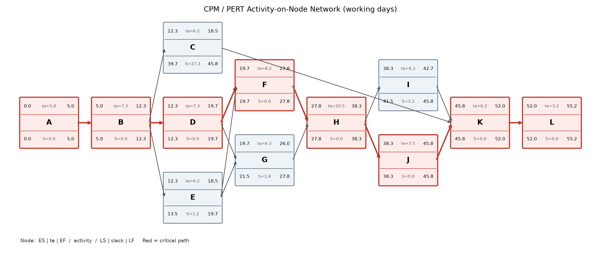

# 2.2 CPM / PERT Network and Critical Path

| | |
|---|---|
| **Project** | Clinic Appointment System (CAS) |
| **Course** | SEN4100 Software Project Management, Haliç University |
| **Instructor** | Asst. Prof. M. Fatih Mintaş |
| **Milestone** | Milestone 2 (Week 7) |
| **Version / Date** | 1.0 / 13 November 2026 |
| **Team** | Burak Demir (20091000008), Davut Ayfer (20091000054), Enes Küçükkaya (22091000275), Alper Keskin (24352525053) |

## 1. Purpose

The WBS (document 2.1) tells us **what** work we must do. This document tells us **in what order** and **how long**. We use two methods:

- **CPM (Critical Path Method):** finds the longest chain of dependent activities. This chain gives the shortest possible project duration.
- **PERT (Program Evaluation and Review Technique):** uses three time estimates per activity to include uncertainty, and lets us calculate the chance of finishing on time.

All durations are in **working days** (5 days per week).

## 2. Activity list and dependencies

We grouped the 22 WBS work packages into 12 schedule activities (A to L). An **activity** is a piece of work on the time plan. A **predecessor** is an activity that must finish before another can start.

All dependencies are **Finish-to-Start (FS)**: the predecessor must finish before the next activity starts. We did not use Start-to-Start (SS), Finish-to-Finish (FF) or Start-to-Finish (SF) links, to keep the plan simple and clear.

| ID | Activity | Predecessors (FS) | WBS work packages | Hours (WBS) | Owner |
|---|---|---|---|---|---|
| A | Project initiation & concept proposal | - | 1.1.1 | 30 | Burak Demir |
| B | Requirements & stakeholder analysis | A | 1.2.1, 1.2.2, 1.2.3 | 50 | Burak Demir, Alper Keskin |
| C | Project planning (WBS, schedule, cost, risk) | B | 1.1.2, 1.1.3 | 45 | Burak Demir |
| D | System & UI design | B | 1.3.1, 1.3.3 | 50 | Enes Küçükkaya |
| E | Database design & implementation | B | 1.3.2, 1.4.1 | 45 | Davut Ayfer |
| F | Patient module | D, E | 1.4.2 | 60 | Enes Küçükkaya |
| G | Doctor & schedule module | D, E | 1.4.3 | 45 | Davut Ayfer |
| H | Appointment booking module | F, G | 1.4.4 | 80 | Burak Demir, Davut Ayfer |
| I | Reports & dashboard | H | 1.4.5 | 30 | Enes Küçükkaya |
| J | Testing & bug fixing | H | 1.5.1, 1.5.2, 1.5.3 | 55 | Alper Keskin |
| K | Final documentation (IEEE) | C, I, J | 1.1.4, 1.6.1, 1.6.2 | 45 | Alper Keskin (Burak Demir does 1.1.4 as level-of-effort from F to J) |
| L | Retrospective & presentation | K | 1.6.3, 1.6.4 | 25 | All members |
| | **Total** | | **22 work packages** | **560** | |

Every WBS work package belongs to exactly one activity, and the hours add up to 560 h. So the schedule also covers 100% of the scope.

## 3. PERT three-point estimates

For each activity the owner gave three estimates:

- **O (Optimistic):** everything goes perfectly.
- **M (Most likely):** normal work.
- **P (Pessimistic):** many things go wrong.

Formulas:

- Expected time: **te = (O + 4M + P) / 6**
- Variance: **Var = ((P - O) / 6)^2**

| ID | Activity | Predecessors | O | M | P | te = (O+4M+P)/6 | Variance ((P-O)/6)^2 |
|---|---|---|---|---|---|---|---|
| A | Project initiation & concept proposal | - | 3 | 5 | 7 | 5.00 | 0.444 |
| B | Requirements & stakeholder analysis | A | 5 | 7 | 11 | 7.33 | 1.000 |
| C | Project planning (WBS, schedule, cost, risk) | B | 4 | 6 | 9 | 6.17 | 0.694 |
| D | System & UI design | B | 5 | 7 | 11 | 7.33 | 1.000 |
| E | Database design & implementation | B | 4 | 6 | 9 | 6.17 | 0.694 |
| F | Patient module | D, E | 5 | 8 | 12 | 8.17 | 1.361 |
| G | Doctor & schedule module | D, E | 4 | 6 | 10 | 6.33 | 1.000 |
| H | Appointment booking module | F, G | 7 | 10 | 16 | 10.50 | 2.250 |
| I | Reports & dashboard | H | 3 | 4 | 7 | 4.33 | 0.444 |
| J | Testing & bug fixing | H | 5 | 7 | 12 | 7.50 | 1.361 |
| K | Final documentation (IEEE) | C, I, J | 4 | 6 | 9 | 6.17 | 0.694 |
| L | Retrospective & presentation | K | 2 | 3 | 5 | 3.17 | 0.250 |

Example for activity H: te = (7 + 4 x 10 + 16) / 6 = 63 / 6 = 10.50 days. Variance = ((16 - 7) / 6)^2 = 1.5^2 = 2.250.

The PERT formula gives most weight to M, but P pulls the result a little higher. This gives a safer plan than one single guess.

**Effort (h) and people per activity**

The durations above are **calendar working days**, not effort. **Duration** is how long an activity is open on the calendar. **Effort** is how many person-hours of work it needs (from the WBS, document 2.1). If we divide effort by duration (and by the number of people), we get the **planned load**: how many hours per working day each person must work on that activity.

| ID | Effort (h) | People (from the baseline schedule) | No. of people | te (days) | Planned load (h per person per working day) |
|---|---|---|---|---|---|
| A | 30 | Burak Demir | 1 | 5.00 | 6.0 |
| B | 50 | Burak Demir, Alper Keskin | 2 | 7.33 | 3.4 |
| C | 45 | Burak Demir | 1 | 6.17 | 7.3 |
| D | 50 | Enes Küçükkaya | 1 | 7.33 | 6.8 |
| E | 45 | Davut Ayfer | 1 | 6.17 | 7.3 |
| F | 60 | Enes Küçükkaya | 1 | 8.17 | 7.3 |
| G | 45 | Davut Ayfer | 1 | 6.33 | 7.1 |
| H | 80 | Burak Demir, Davut Ayfer | 2 | 10.50 | 3.8 |
| I | 30 | Enes Küçükkaya | 1 | 4.33 | 6.9 |
| J | 55 | Alper Keskin | 1 | 7.50 | 7.3 |
| K | 45 | Alper Keskin | 1 | 6.17 | 7.3 |
| L | 25 | All members | 4 | 3.17 | 2.0 |
| **Total** | **560** | | | | |

Example for activity F: 60 h / 8.17 days = about 7.3 h per working day for Enes. Our normal capacity is about 12 h per person per week, which is about 2.4 h per working day. So many activities need much more than a normal day when one person does them alone. Section 8 (Resource loading) shows this week by week and explains how we level it.

## 4. AON network diagram

In an **Activity-on-Node (AON)** diagram, each box is an activity and each arrow is a dependency. The red path is the critical path (see Figure 2.2-1).

Figure 2.2-1 shows all 12 activities A to L. Each box holds ES, te and EF on the top line, and LS, slack and LF on the bottom line (values rounded to one decimal). The red boxes and arrows form the critical path A -> B -> D -> F -> H -> J -> K -> L.

## 5. Forward pass and backward pass

### 5.1 Forward pass (early dates)

The **forward pass** goes from the start to the end of the network.

- **ES (Early Start):** the earliest day an activity can start. ES = the largest EF of all its predecessors (0 for the first activity).
- **EF (Early Finish):** EF = ES + te.

Examples:

- F has two predecessors, D (EF 19.67) and E (EF 18.50). So ES(F) = max(19.67, 18.50) = 19.67.
- H waits for F (EF 27.83) and G (EF 26.00). So ES(H) = 27.83.
- K waits for C (EF 18.50), I (EF 42.67) and J (EF 45.83). So ES(K) = 45.83.
- The last activity L finishes at EF = **55.17**. This is the expected project duration.

### 5.2 Backward pass (late dates)

The **backward pass** goes from the end back to the start. We start with LF(L) = 55.17.

- **LF (Late Finish):** the latest day an activity can finish without delaying the project. LF = the smallest LS of all its successors.
- **LS (Late Start):** LS = LF - te.

Examples:

- H has two successors, I (LS 41.50) and J (LS 38.33). So LF(H) = min(41.50, 38.33) = 38.33.
- B has three successors, C (LS 39.67), D (LS 12.33) and E (LS 13.50). So LF(B) = 12.33.

### 5.3 Slack

**Slack (float)** is how many days an activity can be late without making the whole project late.

**Slack = LS - ES = LF - EF**

### 5.4 CPM table

| ID | te | ES | EF | LS | LF | Slack | Critical |
|---|---|---|---|---|---|---|---|
| A | 5.00 | 0.00 | 5.00 | 0.00 | 5.00 | 0.00 | YES |
| B | 7.33 | 5.00 | 12.33 | 5.00 | 12.33 | 0.00 | YES |
| C | 6.17 | 12.33 | 18.50 | 39.67 | 45.83 | 27.33 | no |
| D | 7.33 | 12.33 | 19.67 | 12.33 | 19.67 | 0.00 | YES |
| E | 6.17 | 12.33 | 18.50 | 13.50 | 19.67 | 1.17 | no |
| F | 8.17 | 19.67 | 27.83 | 19.67 | 27.83 | 0.00 | YES |
| G | 6.33 | 19.67 | 26.00 | 21.50 | 27.83 | 1.83 | no |
| H | 10.50 | 27.83 | 38.33 | 27.83 | 38.33 | 0.00 | YES |
| I | 4.33 | 38.33 | 42.67 | 41.50 | 45.83 | 3.17 | no |
| J | 7.50 | 38.33 | 45.83 | 38.33 | 45.83 | 0.00 | YES |
| K | 6.17 | 45.83 | 52.00 | 45.83 | 52.00 | 0.00 | YES |
| L | 3.17 | 52.00 | 55.17 | 52.00 | 55.17 | 0.00 | YES |

## 6. Critical path

The **critical path** is the longest path through the network. All its activities have **zero slack**. If one of them is 1 day late, the whole project is 1 day late.

- **Critical path: A -> B -> D -> F -> H -> J -> K -> L**
- Length: 5.00 + 7.33 + 7.33 + 8.17 + 10.50 + 7.50 + 6.17 + 3.17 = **55.17 working days** (about 11.0 weeks).

Non-critical activities and their slack:

| ID | Activity | Slack (days) | What it means |
|---|---|---|---|
| C | Project planning | 27.33 | Very flexible. It only must be done before final documentation (K). But Milestone 2 is due on 13 Nov, so we do the main planning early (14-22 Oct) and update the plan documents (1.1.2, 1.1.3) until M2. |
| E | Database design & implementation | 1.17 | Almost critical. A delay of more than about 1 day makes it critical. |
| G | Doctor & schedule module | 1.83 | Almost critical. Watch closely. |
| I | Reports & dashboard | 3.17 | Small buffer. |

**Management focus:** the appointment booking module (H) is the longest activity (10.50 days), has the largest variance (2.250), and is on the critical path. The PM checks its progress twice a week.

## 7. Probability of meeting the deadline

Our deadline is **60 working days** (end of Week 12, 18 December 2026).

Step 1 - Variance of the critical path = sum of the variances of the critical activities:

0.444 + 1.000 + 1.000 + 1.361 + 2.250 + 1.361 + 0.694 + 0.250 = **8.361**

Step 2 - Standard deviation: sigma = square root of 8.361 = **2.89 days**

Step 3 - Z value (how many standard deviations the deadline is above the expected time):

Z = (Deadline - Expected duration) / sigma = (60 - 55.17) / 2.89 = **1.67**

Step 4 - We look up Z = 1.67 in the standard **normal distribution** table:

**P(T <= 60) = 95.3%**

So there is about a **95% chance** that we finish within 60 working days. We also calculated other target days:

| Target (working days) | Probability to finish by then |
|---|---|
| 55 | 47.7% |
| 58 | 83.6% |
| 60 (deadline) | **95.3%** |
| 62 | 99.1% |

Note: finishing in 55 days has only about a 50% chance, because 55 is close to the expected value. PERT assumes the critical path stays the same; the near-critical activities E and G could change this a little.

## 8. Resource loading

CPM assumes that every activity gets the people it needs. **Resource loading** checks if this is true: we spread the WBS hours of each activity over the weeks in which it runs, and add them up per person. The tables show the planned hours per person per week (W1 = Week 1, starting 28 Sep 2026).

- **Over-allocation** means a person is planned for more hours than they can really work in that week. We use more than 20 h in one week as the warning level.
- **Resource levelling** means we move work between people (or spread it over a longer window), so the weekly peaks become lower. We do not change the durations of critical activities, because that would delay the whole project.

### 8.1 Before levelling (owners only)

In this first table each activity is done only by its owner(s).

| Member | W1 | W2 | W3 | W4 | W5 | W6 | W7 | W8 | W9 | W10 | W11 | W12 | Total | Max/week |
|---|---|---|---|---|---|---|---|---|---|---|---|---|---|---|
| Burak Demir | 30 | 17 | 27 | 26 | 0 | 8 | 19 | 13 | 0 | 0 | 6 | 0 | 146 | 30 |
| Davut Ayfer | 0 | 0 | 19 | 28 | 36 | 15 | 19 | 13 | 0 | 0 | 6 | 0 | 136 | 36 |
| Enes Küçükkaya | 0 | 0 | 18 | 34 | 37 | 21 | 0 | 12 | 18 | 0 | 6 | 0 | 146 | 37 |
| Alper Keskin | 0 | 17 | 8 | 0 | 0 | 0 | 0 | 12 | 37 | 37 | 21 | 0 | 131 | 37 |
| **Team** | 30 | 34 | 73 | 88 | 72 | 44 | 38 | 49 | 55 | 37 | 38 | 1 | 560 | 88 |

### 8.2 After levelling (baseline)

This second table is the **baseline**: it includes the levelling actions below.

| Member | W1 | W2 | W3 | W4 | W5 | W6 | W7 | W8 | W9 | W10 | W11 | W12 | Total | Max/week |
|---|---|---|---|---|---|---|---|---|---|---|---|---|---|---|
| Burak Demir | 30 | 17 | 27 | 26 | 2 | 10 | 21 | 17 | 9 | 2 | 6 | 0 | 167 | 30 |
| Davut Ayfer | 0 | 0 | 19 | 27 | 25 | 13 | 19 | 15 | 6 | 1 | 6 | 0 | 131 | 27 |
| Enes Küçükkaya | 0 | 0 | 13 | 24 | 26 | 15 | 0 | 13 | 24 | 1 | 6 | 0 | 122 | 26 |
| Alper Keskin | 0 | 17 | 13 | 11 | 22 | 8 | 0 | 6 | 18 | 27 | 17 | 0 | 140 | 27 |
| **Team** | 30 | 34 | 73 | 88 | 74 | 46 | 40 | 51 | 57 | 30 | 35 | 1 | 560 | 88 |

The values are rounded to whole hours, so a row or column may differ from its total by about 1 h.

### 8.3 What the tables show

- Average load is 560 h / 4 people / 12 weeks = about 11.7 h per person per week (plan: ~12 h). So the **total** fits our capacity, but the load is not even.
- **Over-allocation before levelling** (more than 20 h in one week): Burak W1 (30 h), Burak W3 (27 h), Burak W4 (26 h), Davut W4 (28 h), Davut W5 (36 h), Enes W4 (34 h), Enes W5 (37 h), Enes W6 (21 h), Alper W9 (37 h), Alper W10 (37 h), Alper W11 (21 h).
- **Levelling actions in the baseline:** Alper Keskin pairs with the module owners in Sprint 1-2 and takes 30% of F (patient module) and G (doctor module); the PM's 1.1.4 Monitoring & EVM (10 h) is spread from the start of F to the end of J as level-of-effort work. Durations do not change, so the critical path stays the same.
- **Remaining peak after levelling:** Burak Demir in Week 1 with 30 h. Peak weeks are planned outside exam days and are watched under risks R1 (member not available) and R3 (effort underestimated).

In simple words: before levelling, the highest weekly load was 37 h (Enes W5, Alper W9 and W10). After levelling, the highest weekly load is 30 h (Burak W1). The peaks happen because one person owns each activity and the activity is short on the calendar (see the planned load in section 3). Levelling moves some hours to a person who has free time in that week (Alper in Weeks 4-6) or spreads them over a longer window (1.1.4). Some weeks are still above 20 h; the PM checks the real hours every week and repeats this check at each sprint planning.

## 9. What if we must finish earlier?

The lecture (Week 6) gives only two real options when the critical path is too long for a deadline:

- **Crashing:** add more people or hours to critical activities. For example, Alper could help on the booking module (H). This **increases cost**. Also, by Brooks's law, a new person on a late task needs time to learn the code, so the gain is small.
- **Fast-tracking:** run activities in parallel that are now in sequence. For example, Alper could start writing unit tests (J) while H is still being built, instead of waiting for H to finish. This **increases risk**, because tests may need rework if the code changes.

At the moment we do **not** need either option: the expected finish (55.17 days) is about 4.8 days before the deadline (60 days), and the probability of success is 95.3%.
