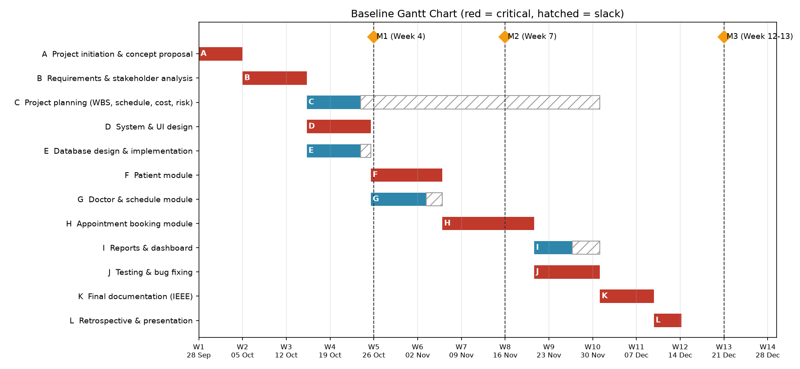

# 2.3 Baseline Gantt Chart and Effort Estimation

| | |
|---|---|
| **Project** | Clinic Appointment System (CAS) |
| **Course** | SEN4100 Software Project Management, Haliç University |
| **Instructor** | Asst. Prof. M. Fatih Mintaş |
| **Milestone** | Milestone 2 (Week 7) |
| **Version / Date** | 1.0 / 13 November 2026 |
| **Team** | Burak Demir (20091000008), Davut Ayfer (20091000054), Enes Küçükkaya (22091000275), Alper Keskin (24352525053) |

This document has two parts:

- **Part A** - the baseline schedule (Gantt chart, calendar dates, milestones).
- **Part B** - algorithmic effort estimation (Function Points and COCOMO), compared with our bottom-up WBS estimate.

---

# Part A - Baseline Schedule

## A1. What is a baseline Gantt chart?

A **Gantt chart** is a bar chart. Each bar is one activity, drawn from its start date to its finish date. It is the easiest way to show the plan to the instructor and other stakeholders.

A **baseline** is the approved version of the plan. We do not change it quietly. Later (Milestone 3) we compare the real progress with this baseline, for example with Earned Value Management (EVM). A change to the baseline needs approval by the Change Control Board.

The dates come from the CPM early dates (ES, EF) in document 2.2. The project starts on **Monday 28 September 2026**. We count only working days (Monday to Friday).

## A2. Baseline Gantt chart

## A3. Baseline calendar

| ID | Activity | Owner | Start | Finish | Duration (days) | Critical |
|---|---|---|---|---|---|---|
| A | Project initiation & concept proposal | Burak Demir | 2026-09-28 | 2026-10-02 | 5.0 | YES |
| B | Requirements & stakeholder analysis | Burak Demir, Alper Keskin | 2026-10-05 | 2026-10-13 | 7.3 | YES |
| C | Project planning (WBS, schedule, cost, risk) | Burak Demir | 2026-10-14 | 2026-10-21 | 6.2 | no |
| D | System & UI design | Enes Küçükkaya | 2026-10-14 | 2026-10-22 | 7.3 | YES |
| E | Database design & implementation | Davut Ayfer | 2026-10-14 | 2026-10-21 | 6.2 | no |
| F | Patient module | Enes Küçükkaya | 2026-10-23 | 2026-11-03 | 8.2 | YES |
| G | Doctor & schedule module | Davut Ayfer | 2026-10-23 | 2026-10-30 | 6.3 | no |
| H | Appointment booking module | Burak Demir, Davut Ayfer | 2026-11-04 | 2026-11-18 | 10.5 | YES |
| I | Reports & dashboard | Enes Küçükkaya | 2026-11-19 | 2026-11-24 | 4.3 | no |
| J | Testing & bug fixing | Alper Keskin | 2026-11-19 | 2026-11-27 | 7.5 | YES |
| K | Final documentation (IEEE) | Alper Keskin | 2026-11-30 | 2026-12-07 | 6.2 | YES |
| L | Retrospective & presentation | All members | 2026-12-08 | 2026-12-11 | 3.2 | YES |

Notes:

- Activities C, D and E run **in parallel** after B, because they are done by different people.
- F and G also run in parallel. Both must finish before H (booking) can start, because booking needs patients and doctors.
- The construction work (F to J) is done in short increments, each ending with a demo to the team, as planned in our hybrid "Water-Scrum-Fall" lifecycle.

## A4. Milestones

A **milestone** is an important point in time with zero duration, for example a due date.

| Milestone | Date | Week | What is delivered |
|---|---|---|---|
| Project start | Mon 28 Sep 2026 | 1 | Kick-off, start of activity A |
| Milestone 1 | Fri 23 Oct 2026 | 4 | Concept proposal, charter, stakeholder analysis, first WBS |
| Milestone 2 | Fri 13 Nov 2026 | 7 | WBS + dictionary, CPM/PERT, baseline Gantt, effort estimation, risk register (this set of documents) |
| Booking module done | Wed 18 Nov 2026 | 8 | End of activity H, all main features built |
| Testing done | Fri 27 Nov 2026 | 9 | End of activity J, all tests pass |
| Final documentation done | Mon 7 Dec 2026 | 11 | End of activity K |
| Planned project finish | Fri 11 Dec 2026 | 11 | End of activity L (day 55.17) |
| Plan deadline | Fri 18 Dec 2026 | 12 | Day 60, about 4.8 days of buffer after the planned finish |
| Milestone 3 | Fri 25 Dec 2026 | 13 | Final report, live demo, presentation and oral defense |

---

# Part B - Algorithmic Effort Estimation

Our lifecycle is hybrid, but the up-front planning part is **predictive** (plan-driven). The lecture says a predictive plan should use **algorithmic estimation**. So we use:

1. **Function Point Analysis (FP)** to measure the size of the software.
2. A conversion from FP to **KLOC** (thousands of lines of code), with a three-point LOC check.
3. **COCOMO** (Basic and Intermediate) to turn size into effort and duration.
4. A comparison with our **bottom-up WBS estimate** (560 h) and the team capacity.

## B1. Function Point Analysis

**Function Points** measure size by the functions the user gets, not by lines of code. So the result does not depend on the programming language.

We count five types of items:

- **EI (External Input):** a form or action where the user enters or changes data.
- **EO (External Output):** a screen or report with calculated data.
- **EQ (External Inquiry):** a simple read-only search or list.
- **ILF (Internal Logical File):** a data table that our system maintains.
- **EIF (External Interface File):** data kept by another system that we only read.

Each item gets a weight based on its complexity (Simple, Average, Complex).

### B1.1 Counted items

| Type | Item | Complexity | Weight |
|---|---|---|---|
| EI | Add patient form | Average | 4 |
| EI | Edit patient form | Average | 4 |
| EI | Delete patient | Simple | 3 |
| EI | Add doctor form | Average | 4 |
| EI | Edit doctor form | Average | 4 |
| EI | Book appointment (with rule checks) | Complex | 6 |
| EI | Cancel appointment | Simple | 3 |
| EI | Complete appointment | Simple | 3 |
| EO | Dashboard (counts, cancellation rate) | Complex | 7 |
| EO | Doctor utilization report | Average | 5 |
| EQ | Search patients | Average | 4 |
| EQ | List doctors | Simple | 3 |
| EQ | List / filter appointments | Average | 4 |
| EQ | Free slots query (JSON) | Average | 4 |
| ILF | Patients table | Simple | 7 |
| ILF | Doctors table | Simple | 7 |
| ILF | Appointments table | Average | 10 |
| ILF | Departments table | Simple | 7 |
| | **Unadjusted Function Points (UFP)** | | **89** |

### B1.2 Summary by type

| Type | Count | Weighted total |
|---|---|---|
| EI | 8 | 31 |
| EO | 2 | 12 |
| EQ | 4 | 15 |
| ILF | 4 | 31 |
| EIF | 0 | 0 |
| **UFP** | **18** | **89** |

**EIF = 0** because CAS does not read data from any other system. All data lives in our own SQL Server database.

### B1.3 The 14 General System Characteristics (GSC)

Each characteristic is rated from 0 (no influence) to 5 (strong influence). The sum is the **Total Degree of Influence (TDI)**.

| # | General System Characteristic | Rating (0-5) |
|---|---|---|
| 1 | Data communications | 3 |
| 2 | Distributed data processing | 1 |
| 3 | Performance | 2 |
| 4 | Heavily used configuration | 1 |
| 5 | Transaction rate | 2 |
| 6 | Online data entry | 5 |
| 7 | End-user efficiency | 4 |
| 8 | Online update | 4 |
| 9 | Complex processing | 2 |
| 10 | Reusability | 2 |
| 11 | Installation ease | 2 |
| 12 | Operational ease | 3 |
| 13 | Multiple sites | 1 |
| 14 | Facilitate change | 3 |
| | **Total Degree of Influence (TDI)** | **35** |

Online data entry gets the highest rating (5), because almost all work in CAS is done through web forms.

### B1.4 Adjusted Function Points

- **VAF (Value Adjustment Factor)** = 0.65 + 0.01 x TDI = 0.65 + 0.01 x 35 = **1.00**
- **FP** = UFP x VAF = 89 x 1.00 = **89.0 function points**

The VAF is exactly 1.00. This means the system characteristics are "average": they do not make the system bigger or smaller.

## B2. From Function Points to KLOC

COCOMO needs size in KLOC. We convert with a factor of **20 LOC per function point** (a typical value for a high-level language like Python, together with HTML and SQL):

- **Size = FP x 20 LOC/FP = 89 x 20 = 1780 LOC = 1.78 KLOC**

### B2.1 Cross-check: three-point LOC estimate per module

To check this number, each module owner estimated lines of code with three values (O, M, P), like PERT:

| Module | O | M | P | Expected (O+4M+P)/6 |
|---|---|---|---|---|
| Database layer (schema, connection, seed) | 100 | 150 | 250 | 158 |
| Patient module | 150 | 230 | 350 | 237 |
| Doctor module | 120 | 180 | 300 | 190 |
| Appointment booking + rules | 250 | 330 | 500 | 345 |
| Reports & dashboard | 100 | 160 | 250 | 165 |
| User interface (HTML templates, CSS, JS) | 250 | 330 | 500 | 345 |
| Automated tests | 150 | 230 | 350 | 237 |
| **Total** | | | | **1677 LOC = 1.68 KLOC** |

The FP size (1.78 KLOC) and the module estimate (1.68 KLOC) differ by only **+6.2%**. The two methods agree well. We use the FP size (1.78 KLOC) for COCOMO, because it is a little larger and therefore safer.

## B3. Basic COCOMO (organic mode)

**COCOMO** (COnstructive COst MOdel, by Barry Boehm) turns size into effort and time. It is based on data from many past projects.

For **organic mode** the formulas are:

- Effort: **E = 2.4 x KLOC^1.05** (person-months)
- Duration: **D = 2.5 x E^0.38** (months)
- Average staff: **E / D**

Results:

- Effort E = 2.4 x 1.78^1.05 = **4.40 person-months**
- Duration D = 2.5 x 4.40^0.38 = **4.39 months**
- Average staff = E / D = **1.00 full-time people**
- Effort in hours = 4.40 x 152 h per person-month = **668 person-hours**

Basic COCOMO only uses size. It does not know anything about our team or tools. So we also use Intermediate COCOMO.

## B4. Intermediate COCOMO (organic mode)

Intermediate COCOMO adds **15 cost drivers**. Each driver is rated and gives a multiplier. The product of all multipliers is the **EAF (Effort Adjustment Factor)**. A multiplier above 1 increases effort; below 1 decreases it.

| Cost driver | Rating | Multiplier |
|---|---|---|
| RELY - Required reliability | High (health data) | 1.15 |
| DATA - Database size | Low | 0.94 |
| CPLX - Product complexity | Low | 0.85 |
| TIME - Execution time constraint | Nominal | 1.00 |
| STOR - Main storage constraint | Nominal | 1.00 |
| VIRT - Platform volatility | Low | 0.87 |
| TURN - Turnaround time | Low | 0.87 |
| ACAP - Analyst capability | Nominal | 1.00 |
| AEXP - Application experience | Low (students) | 1.13 |
| PCAP - Programmer capability | Nominal | 1.00 |
| VEXP - Platform experience | Nominal | 1.00 |
| LEXP - Language experience | High (Python) | 0.95 |
| MODP - Modern practices | High (Git, tests) | 0.91 |
| TOOL - Software tools | High | 0.91 |
| SCED - Schedule constraint | Nominal | 1.00 |
| **EAF (product)** | | **0.618** |

Why some ratings:

- **RELY High (1.15):** the system stores patient data and a booking error (double booking) affects real people.
- **AEXP Low (1.13):** we are students and have no experience with clinic software.
- **LEXP High, MODP High, TOOL High (below 1):** we know Python, and we use Git, pull requests and automated tests.
- **CPLX Low, DATA Low:** the logic is simple CRUD plus booking rules, and the database is small.

For organic mode, Intermediate COCOMO uses a = 3.2 (instead of 2.4):

- Nominal effort = 3.2 x 1.78^1.05 = 5.86 PM
- Adjusted effort E = 5.86 x 0.618 = **3.62 person-months = 551 person-hours**
- Duration D = 2.5 x 3.62^0.38 = **4.08 months**
- Average staff = **0.89 full-time people**

## B5. Comparison with the bottom-up WBS estimate and team capacity

The **bottom-up estimate** is the sum of the hours of all WBS work packages (document 2.1).

| Method | Effort (person-hours) | Effort (person-months) |
|---|---|---|
| Basic COCOMO (organic) | 668 | 4.40 |
| Intermediate COCOMO (organic, EAF 0.618) | 551 | 3.62 |
| **Bottom-up WBS estimate** | **560** | **3.68** |
| Team capacity (4 students x 12 weeks x ~12 h/week) | 576 | - |

- **Intermediate COCOMO vs WBS:** 551 h vs 560 h, a difference of only **-1.6%**. Two independent methods give almost the same answer. This gives us confidence in the 560 h plan.
- **Basic COCOMO** gives 668 h, which is 108 h more. This is expected: Basic COCOMO does not include our good tools and Python skills.
- **Capacity:** our capacity (576 h) is a little higher than the plan (560 h), so the plan is realistic. The management reserve (56 h, 10%) is kept by the PM. If we need it, the team will add a few extra hours per week.
- **Duration:** COCOMO says about 4 months with about **one** full-time person (average staff 0.89-1.00). We are four **part-time** students (about 12 h per week each), so we share this effort between four people. The real time limit is our schedule: 55.17 expected working days inside a 60-day deadline (document 2.2).
- **Budget:** 560 h x 150 TL = **84,000 TL** (BAC).

## B6. Conclusion

- **Why organic mode?** Our team is small (4 people), the domain (appointment booking) is familiar and easy to understand, there are no hardware limits, and the requirements are fairly flexible. This is the definition of organic mode. It is not embedded mode, because CAS is not safety-critical firmware and has no hardware constraints.
- **Cone of uncertainty:** at the start of a project, estimates can be wrong by up to 4 times. Our estimate is now better because we made it after the WBS and the requirements were ready, and because three methods (WBS, FP + COCOMO, LOC three-point) agree. We will update the estimate with real hours in Milestone 3 (EVM).
- **Brooks's law:** "adding people to a late software project makes it later", because new people need training and create more communication paths (n(n-1)/2). So if we are late, we will first use the reserve hours and reduce scope, not add new people.
