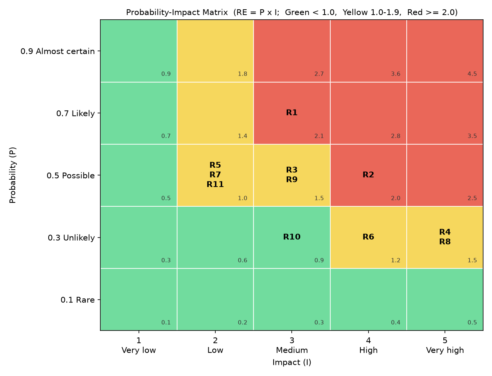

# 2.4 Risk Register

| | |
|---|---|
| **Project** | Clinic Appointment System (CAS) |
| **Course** | SEN4100 Software Project Management, Haliç University |
| **Instructor** | Asst. Prof. M. Fatih Mintaş |
| **Milestone** | Milestone 2 (Week 7) |
| **Version / Date** | 1.2 / 13 November 2026 |
| **Team** | Burak Demir (20091000008), Davut Ayfer (20091000054), Enes Küçükkaya (22091000275), Alper Keskin (24352525053) |

## 1. Purpose

Our schedule (documents 2.2 and 2.3) is only a plan. Many things can go wrong. **Risk management** means we find these possible problems early and decide what to do about them before they happen.

A **risk** is an uncertain future event. If it happens, it has an effect on the project (time, cost, scope or quality).

## 2. Risk categories (taxonomy)

A **risk taxonomy** is a list of risk groups. It helps us look for risks in every area. We use the four groups from the lecture:

| Category | Meaning | Example in CAS |
|---|---|---|
| **Technical** | Problems with technology, code, tools or quality | Double booking bug, LocalDB setup fails |
| **Project Management** | Problems with estimates, schedule, scope or resources | Effort is underestimated, scope creep |
| **Organizational** | Problems inside the team or organization | A member is not available, poor communication |
| **External** | Problems from outside the project (laws, vendors) | Health data privacy law (KVKK) |

## 3. How we score risks

For every risk we give two numbers:

- **P (Probability):** how likely the risk is to happen, from 0.1 (very unlikely) to 0.9 (very likely).
- **I (Impact):** how bad the effect is if it happens, from 1 (very small) to 5 (very large).

Then we calculate the **Risk Exposure**:

**RE = P x I**

Example: R1 has P = 0.7 and I = 3, so RE = 0.7 x 3 = 2.1.

We put each risk into a zone:

| Zone | RE | What we do |
|---|---|---|
| **Red** | RE >= 2.0 | Critical. Immediate, strong action plan. |
| **Yellow** | 1.0 <= RE < 2.0 | Monitored. We set a trigger and watch it. |
| **Green** | RE < 1.0 | Accepted. Kept on a watch list with little active work. |

## 4. Response strategies

For each risk we choose one strategy:

- **Mitigate:** act now to lower the probability or the impact.
- **Avoid:** change the plan so the risk cannot happen.
- **Transfer:** move the impact to a third party (for example insurance or an outside service).
- **Accept:** do nothing now, because action costs more than the impact. We keep a reserve (our 56 h management reserve) for it. Note: after the change requests of Week 6 (approved on 5 November 2026, logged on 8 November 2026), only 2 h of this reserve are left (see section 6.1 and chapter 2.5).

A **trigger** is an early warning sign that the risk is starting to happen. The **risk owner** is the team member who watches the trigger and starts the action.

## 5. Probability-Impact matrix

A **Probability-Impact matrix** is a grid. Probability is on one axis and impact on the other. Each risk is placed in its cell, and the cell colour shows its zone (Red, Yellow or Green). Figure 2.4-1 shows the 11 baseline risks. R1 and R2 are in the red area. R10 is the only green risk.

The matrix shows the **baseline** scores of 13 November 2026 (version 1.0). The changes after the change requests are described in section 6.1, not drawn in the figure.

## 6. Risk Register

The register is sorted by Risk Exposure (highest first). The description uses the form **cause -> risk -> effect**. The P, I and RE values are the **baseline** values. Section 6.1 shows the status of each risk after the change requests CR-001 to CR-004.

| ID | Description (cause -> risk -> effect) | Category | P | I | RE | Zone | Strategy | Action | Trigger | Owner |
|---|---|---|---|---|---|---|---|---|---|---|
| R1 | Exams, illness or other courses -> a team member is not available for some days -> his work packages are late and the critical path moves. | Organizational | 0.7 | 3 | 2.1 | Red | Mitigate | Shared exam calendar; each module has a second person who knows it (pair reviews in pull requests); code and notes always pushed to GitHub. | A member reports less than 6 h of work in a week, or misses two meetings. | Burak Demir |
| R2 | The instructor or users ask for new or different features after the scope is approved -> requirements change late -> rework and delay of the booking module and tests. | Project Management | 0.5 | 4 | 2.0 | Red | Mitigate | Scope baseline from M1; every change goes through the Change Control Board with an impact check (hours, days); show demos early so feedback comes early. | A change request arrives after Week 7, or a demo gets major comments. | Burak Demir |
| R3 | We are students with little estimation experience -> effort is underestimated -> work takes more hours than the 560 h plan and we pass the deadline. | Project Management | 0.5 | 3 | 1.5 | Yellow | Mitigate | Three estimation methods compared (WBS, FP + COCOMO, LOC); 10% management reserve (56 h); weekly tracking of actual hours; EVM in Milestone 3. | Actual hours of an activity are more than 10% above its plan, or SPI < 0.95. | Burak Demir |
| R4 | Complex booking rules and two users booking at the same time -> a double booking bug in scheduling -> two patients get the same doctor slot; trust in the system is lost. | Technical | 0.3 | 5 | 1.5 | Yellow | Mitigate | Check in the code AND filtered UNIQUE indexes in SQL Server; unit tests for every booking rule; separate bugfix/double-booking-index branch. | A test or a user shows two BOOKED appointments for the same doctor or patient at the same time. | Burak Demir |
| R8 | The system stores names and TC Kimlik No of patients -> a personal health data privacy (KVKK) issue -> legal problem and loss of grade or trust. | External | 0.3 | 5 | 1.5 | Yellow | Avoid | Use only fake test data (seed.sql), never real patient data; database stays on local machines (LocalDB); no data in GitHub except test data. | Someone wants to load real patient data, or real personal data is found in the repo. | Davut Ayfer |
| R9 | Team members like to add "nice" extras -> scope creep (extra features) -> hours are used for things not in the WBS and core work is late. | Project Management | 0.5 | 3 | 1.5 | Yellow | Avoid | Only WBS work is done; new ideas go to a "future work" list; no feature branch without a WBS code; any extra feature needs an approved change request (chapter 2.5). | A pull request contains a feature that is not in the WBS or SRS, or a new change request is written. | Burak Demir |
| R6 | No regular backup of the local database -> data loss (no database backup) -> test data and work are lost and must be rebuilt. | Technical | 0.3 | 4 | 1.2 | Yellow | Mitigate | The whole database can be rebuilt from create_database.sql, schema.sql and seed.sql in Git; tests use a separate database ClinicAppointmentDB_Test. | A script change is not committed, or a laptop or disk problem is reported. | Davut Ayfer |
| R5 | Most of the team has not used Flask and pyodbc before -> low experience with Flask / pyodbc -> slow progress in the first modules. | Technical | 0.5 | 2 | 1.0 | Yellow | Mitigate | Activity E (14-22 Oct, Week 3-4) builds and tests the Flask + pyodbc + LocalDB layer first, as a short learning spike, so problems appear before the booking module H (4-19 Nov); shared code examples for routes and database access; pair programming on the first modules F and G (from 23 Oct). | A member is blocked on a framework problem for more than one day. | Enes Küçükkaya |
| R7 | Four people change the same files at the same time -> merge conflicts in Git -> lost time and broken code in develop. | Technical | 0.5 | 2 | 1.0 | Yellow | Mitigate | GitFlow-light: one feature branch per module, small pull requests, pull develop often, --no-ff merges with review. | A merge conflict takes more than one hour, or develop does not run after a merge. | Alper Keskin |
| R11 | Different Windows versions and drivers on student laptops -> SQL Server LocalDB setup fails on a laptop -> that member cannot run or test the app. | Technical | 0.5 | 2 | 1.0 | Yellow | Mitigate | Written setup guide (LocalDB + ODBC driver); one setup session for all members; a member can use a teammate's machine while it is fixed. | The app cannot connect to (localdb)\MSSQLLocalDB on a member's laptop. | Davut Ayfer |
| R10 | Busy schedules and only online contact -> poor communication in team -> duplicate work or missed tasks. | Organizational | 0.3 | 3 | 0.9 | Green | Accept | Keep normal practice: weekly meeting, group chat, task list in docs/backlog/Product_Backlog.csv. No extra action needed. | A task is done twice, or nobody knows who owns a task. | Burak Demir |

### Summary

| Zone | Risks | Count |
|---|---|---|
| Red | R1, R2 | 2 |
| Yellow | R3, R4, R8, R9, R6, R5, R7, R11 | 8 |
| Green | R10 | 1 |
| **Total** | | **11** |

- The two **red** risks (R1, R2) are about people and scope, not technology. The PM reviews them every week.
- R4 and R8 have the highest impact (5). Even if they are not likely, they would hurt the project badly, so they have strong actions.
- **Why no Transfer?** In a student project there is no insurance or outside company that can take over the impact. The closest thing is that GitHub keeps a copy of our code and scripts, but the risk itself stays with us. So we use Mitigate, Avoid and Accept.

### 6.1 Status after the change requests (Week 6)

Five change requests came in Week 6. They were requested and approved on **5 November 2026** and implemented on **5-8 November 2026** (Week 6). The CCB decision was written in the log on **8 November 2026**. The CCB approved four of them: CR-001 corporate UI and logo (12 h), CR-002 login with ADMIN/RECEPTIONIST roles (16 h), CR-003 departments and appointment reasons screens (12 h) and CR-004 reporting page with CSV export (14 h). Together they use **54 h of the 56 h management reserve**. Only **2 h** are left. CR-005 (appointment status structure) is **on hold**. Details are in chapter 2.5.

The CRs are **separate CR work items**. They are not added to the 22 work packages of the WBS. So the 8/80 rule for the work packages and the baseline (560 h, BAC 84,000 TL) stay valid.

We keep the baseline P x I numbers above, so the M3 report can compare against them. The table below gives the status of every risk after the change requests.

| ID | Baseline RE / Zone | Status after CRs | Strategy after CRs | Owner |
|---|---|---|---|---|
| R1 | 2.1 / Red | No change. Still the top risk. If a member is away, there is almost no reserve to absorb his hours. | Mitigate | Burak Demir |
| R2 | 2.0 / Red | Five change requests came in Week 6 (four approved, CR-005 on hold), before the Week 7 trigger. All went through the CCB (requested and approved 5 Nov, logged 8 Nov). The critical path did not change. Risk stays open. | Mitigate | Burak Demir |
| R3 | 1.5 / Yellow | **Residual exposure is higher.** Any underestimate can now use only 2 h of reserve. Plan 560 h + 54 h CR work = 614 h, which is 38 h above the 576 h team capacity. Response: weekly tracking of actual hours; about 1 extra hour per person per week, or a scope cut decided by the CCB. | Mitigate | Burak Demir |
| R4 | 1.5 / Yellow | No change. CR-003 changed the appointments table (reason_id + notes); the filtered UNIQUE indexes and booking tests still pass (33 tests, measured on 8 Nov 2026). Booking (activity H) runs 4-19 Nov, so the trigger is watched closely in Weeks 6-8. | Mitigate | Burak Demir |
| R8 | 1.5 / Yellow | **Reduced.** CR-002 login: every page needs a signed-in user, passwords are scrypt hashes, and each appointment stores created_by. Fake data and local database rules still apply. | Avoid | Davut Ayfer |
| R9 | 1.5 / Yellow | **Occurred in a controlled way.** Scope grew through CR-001 to CR-004. All four were logged and approved by the CCB; no feature was added without a CR. But 54 of 56 reserve hours are used, so **residual exposure is higher**: the next extra feature has no reserve to pay for it. | Avoid (no new feature without an approved CR and a new estimate; CR-005 stays on hold) | Burak Demir |
| R6 | 1.2 / Yellow | No change. New tables (users, appointment_reasons) are in schema.sql and seed.sql in Git. | Mitigate | Davut Ayfer |
| R5 | 1.0 / Yellow | Slightly higher because of CR-001 (more templates and CSS). | Mitigate | Enes Küçükkaya |
| R7 | 1.0 / Yellow | No change. More files changed, so small pull requests matter more. | Mitigate | Alper Keskin |
| R11 | 1.0 / Yellow | No change. | Mitigate | Davut Ayfer |
| R10 | 0.9 / Green | No change. | Accept | Burak Demir |

- Every risk still has a strategy and an owner.
- **Key message:** the change requests turned R9 from a possible event into a real, controlled one. The danger now is not one more feature, but that **R3 and R9 have no reserve left**. Any new change request must bring its own estimate and a CCB decision on where the hours come from.

## 7. Risk vs issue

A **risk** has not happened yet. It has a probability, and we plan for it. An **issue** is a problem that **has already happened**. It needs action now, not probability analysis.

Example: "A team member may be ill during exam week" is a **risk** (R1). "Enes is ill today and cannot work this week" is an **issue**. When a risk trigger fires and the event happens, the owner moves it to the issue log, and the PM solves it at once (for example, by moving work to the backup person or using reserve hours).

## 8. Monitoring

- The register is reviewed in the **weekly team meeting**.
- Each owner checks his triggers and reports changes in P or I.
- New risks are added; closed risks are marked as closed (not deleted).
- In Milestone 3 we will report which risks happened and how well our responses worked.

## 9. Revision history

| Version | Date | Change |
|---|---|---|
| 1.0 | 13 Nov 2026 | M2 baseline risk register (11 risks) |
| 1.1 | 13 Nov 2026 | Status after change requests CR-001 to CR-005 added (section 6.1); R9 trigger updated; numbered figure caption |
| 1.2 | 13 Nov 2026 | Dates aligned with the new baseline calendar (E 14-22 Oct, H 4-19 Nov); CR timing (approved 5 Nov, logged 8 Nov, implemented 5-8 Nov); CR work items kept separate from the 22 work packages |
